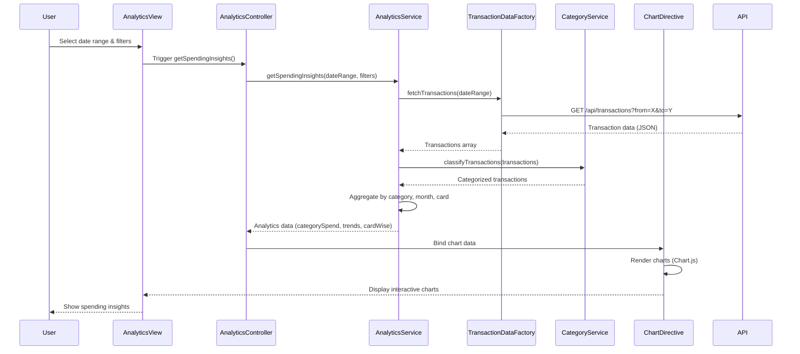

# Low-Level Design: Analytics and Spending Insights
**Epic ID:** QE-10140  
**Application Stack:** AngularJS 1.x, JavaScript ES6, HTML5, CSS3, Bootstrap, REST APIs, MVC Architecture

---

## a. Architecture Mapping

- **Analytics UI** → AngularJS Module (`app.analytics`) + Controller (`AnalyticsController`) + View Template (`analytics.html`)
- **Analytics Engine** → AngularJS Service (`AnalyticsService`) for data aggregation and trend computation
- **Transaction Data Service** → AngularJS Factory (`TransactionDataFactory`) for REST API calls to fetch transaction data
- **Category Classification Service** → AngularJS Service (`CategoryService`) for category mapping and filtering logic
- **Visualization Library** → Directive (`chartDirective`) wrapping Chart.js or D3.js for rendering interactive charts

**Recommended Folder Structure:**
```
/app
  /modules
    /analytics
      analytics.module.js
      analytics.controller.js
      analytics.service.js
      analytics.html
  /services
    transaction-data.factory.js
    category.service.js
  /directives
    chart.directive.js
  /models
    transaction.model.js
```

---

## b. Component Specifications

| Component Name | Artifact Type | Responsibility | Key Dependencies |
|---|---|---|---|
| `app.analytics` | Module | Encapsulates analytics feature; declares controllers, services, and directives | `ngRoute`, `app.services` |
| `AnalyticsController` | Controller | Manages analytics view state, user interactions, filter selections, and chart data binding | `AnalyticsService`, `$scope` |
| `AnalyticsService` | Service | Aggregates transaction data by category, computes monthly trends, and prepares chart datasets | `TransactionDataFactory`, `CategoryService` |
| `TransactionDataFactory` | Factory | Fetches transaction data from REST API (`GET /api/transactions`) for specified date range | `$http`, `$q` |
| `CategoryService` | Service | Maps transactions to 9 predefined categories and provides filtering utilities | None |
| `chartDirective` | Directive | Renders responsive, interactive charts (bar, pie, line) using Chart.js; supports drill-down | `AnalyticsService` |

---

## c. Data Model

**Transaction Model** (`transaction.model.js`):
```javascript
{
  transactionId: String,
  cardId: String,
  amount: Number,
  category: String, // One of: Food & Dining, Fuel, Shopping, Travel, Entertainment, Utilities, Healthcare, Education, Miscellaneous
  date: Date,
  description: String
}
```

**Analytics Data Model** (computed by `AnalyticsService`):
```javascript
{
  categorySpend: Object, // { "Food & Dining": 1200, "Fuel": 300, ... }
  monthlyTrend: Array, // [{ month: "Jan", spend: 5000 }, { month: "Feb", spend: 4800 }, ...]
  cardWiseSpend: Object // { "Card-1234": 3000, "Card-5678": 2500 }
}
```

---

## d. Data Flow

User selects date range and filter options in the Analytics View → `AnalyticsController` invokes `AnalyticsService.getSpendingInsights()` → `AnalyticsService` calls `TransactionDataFactory.fetchTransactions()` to retrieve raw transaction data via REST API → `CategoryService` classifies transactions into 9 categories → `AnalyticsService` aggregates data by category, month, and card → Aggregated data is passed to `chartDirective` which renders interactive charts → User interacts with charts (drill-down, filter) triggering controller methods to update view dynamically.

---

## e. Primary Sequence Diagram



---

## f. Implementation Notes

- Use AngularJS Dependency Injection to inject `AnalyticsService`, `TransactionDataFactory`, and `CategoryService` into `AnalyticsController`.
- Implement `TransactionDataFactory` as a factory returning promise-based API methods using `$http` and `$q` for async handling.
- `AnalyticsService` should use ES6 array methods (`.map()`, `.filter()`, `.reduce()`) for efficient data aggregation.
- Wrap Chart.js in a custom AngularJS directive (`chartDirective`) with isolated scope and two-way data binding for chart configuration.
- Use Bootstrap grid system and CSS3 media queries to ensure responsive chart rendering across mobile and desktop devices.

---

## g. Error Handling

HTTP interceptor captures API errors; controller displays user-friendly notifications using Bootstrap alerts and logs errors to console.

---

## h. Security Notes

Standard input validation and secure API calls assumed; token-based authentication via existing SSO for API requests.

---