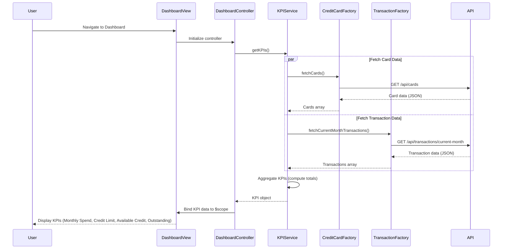

# Low-Level Design: Dashboard and KPI Management
**Epic ID:** QE-10141  
**Application Stack:** AngularJS 1.x, JavaScript ES6, HTML5, CSS3, Bootstrap, REST APIs, MVC Architecture

---

## a. Architecture Mapping

- **User Dashboard UI** → AngularJS Module (`app.dashboard`) + Controller (`DashboardController`) + View Template (`dashboard.html`)
- **KPI Aggregation Service** → AngularJS Service (`KPIService`) for computing and caching KPI metrics
- **Credit Card Data Service** → AngularJS Factory (`CreditCardFactory`) for REST API calls to fetch card data
- **Transaction Processing Service** → AngularJS Factory (`TransactionFactory`) for REST API calls to fetch spending and outstanding amounts
- **User Authentication Service** → AngularJS Service (`AuthService`) for session validation and token management

**Recommended Folder Structure:**
```
/app
  /modules
    /dashboard
      dashboard.module.js
      dashboard.controller.js
      dashboard.html
  /services
    kpi.service.js
    auth.service.js
  /factories
    credit-card.factory.js
    transaction.factory.js
  /models
    kpi.model.js
```

---

## b. Component Specifications

| Component Name | Artifact Type | Responsibility | Key Dependencies |
|---|---|---|---|
| `app.dashboard` | Module | Encapsulates dashboard feature; declares controllers, services, and factories | `ngRoute`, `app.services` |
| `DashboardController` | Controller | Manages dashboard view state, binds KPI data to UI, handles real-time refresh | `KPIService`, `$scope`, `$interval` |
| `KPIService` | Service | Aggregates data from multiple sources to compute Monthly Spend, Total Credit Limit, Available Credit, Outstanding Amount | `CreditCardFactory`, `TransactionFactory` |
| `CreditCardFactory` | Factory | Fetches credit card data from REST API (`GET /api/cards`) including limits and balances | `$http`, `$q` |
| `TransactionFactory` | Factory | Fetches current month transaction data from REST API (`GET /api/transactions/current-month`) | `$http`, `$q` |
| `AuthService` | Service | Validates user session, manages authentication tokens, and handles login/logout | `$http`, `$window` |

---

## c. Data Model

**KPI Model** (`kpi.model.js`):
```javascript
{
  monthlySpend: Number,
  totalCreditLimit: Number,
  availableCredit: Number,
  outstandingAmount: Number,
  lastUpdated: Date
}
```

**Credit Card Model**:
```javascript
{
  cardId: String,
  cardName: String,
  creditLimit: Number,
  availableCredit: Number,
  outstandingBalance: Number
}
```

---

## d. Data Flow

User navigates to Dashboard → `DashboardController` initializes and calls `KPIService.getKPIs()` → `KPIService` concurrently invokes `CreditCardFactory.fetchCards()` and `TransactionFactory.fetchCurrentMonthTransactions()` via REST APIs → API responses return card data (limits, balances) and transaction data (monthly spend) → `KPIService` aggregates data to compute Total Credit Limit (sum of all card limits), Available Credit (sum of available credit per card), Outstanding Amount (sum of outstanding balances), and Monthly Spend (sum of current month transactions) → Computed KPI object is returned to `DashboardController` → Controller binds KPI data to view using `$scope` → Dashboard UI displays KPIs in responsive Bootstrap cards → `$interval` triggers periodic refresh every 30 seconds to update KPIs.

---

## e. Primary Sequence Diagram



---

## f. Implementation Notes

- Use AngularJS Dependency Injection to inject `KPIService`, `CreditCardFactory`, `TransactionFactory`, and `$interval` into `DashboardController`.
- Implement `CreditCardFactory` and `TransactionFactory` as factories returning promise-based methods using `$http` and `$q.all()` for parallel API calls.
- `KPIService` should use ES6 `.reduce()` to efficiently sum card limits, available credit, outstanding amounts, and monthly spend.
- Use `$interval` in `DashboardController` to auto-refresh KPIs every 30 seconds; cancel interval on `$scope.$on('$destroy')` to prevent memory leaks.
- Apply Bootstrap responsive grid (col-md-3, col-sm-6, col-xs-12) to KPI cards for mobile and desktop compatibility.

---

## g. Error Handling

HTTP interceptor-based error handling with user notification via Bootstrap toasts; retry logic for failed API calls using exponential backoff.

---

## h. Security Notes

Requires token-based auth via existing SSO; AuthService injects JWT token in API request headers.

---