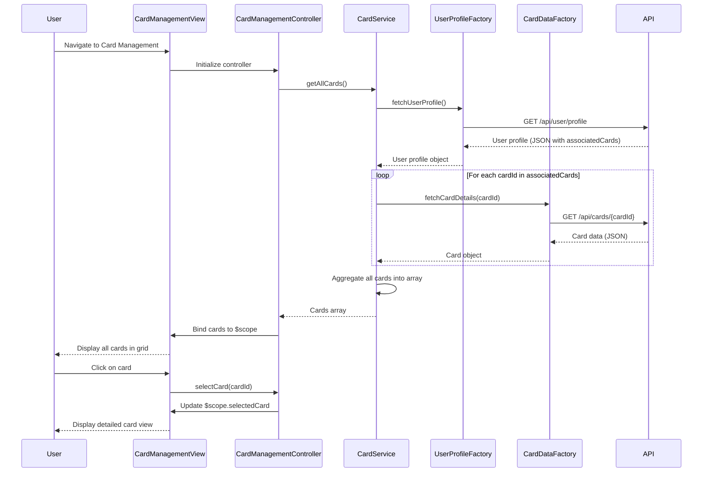

# Low-Level Design: Multiple Credit Card Management
**Epic ID:** QE-10142  
**Application Stack:** AngularJS 1.x, JavaScript ES6, HTML5, CSS3, Bootstrap, REST APIs, MVC Architecture

---

## a. Architecture Mapping

- **User Interface** → AngularJS Module (`app.cardManagement`) + Controller (`CardManagementController`) + View Template (`card-management.html`)
- **Card Management Service** → AngularJS Service (`CardService`) for managing card data, filtering, and card-wise spend analysis
- **User Profile Service** → AngularJS Factory (`UserProfileFactory`) for REST API calls to fetch user-card associations
- **Credit Card Data Repository** → AngularJS Factory (`CardDataFactory`) for REST API calls to fetch card metadata and balances
- **Authentication Service** → AngularJS Service (`AuthService`) for session validation and token management

**Recommended Folder Structure:**
```
/app
  /modules
    /card-management
      card-management.module.js
      card-management.controller.js
      card-management.html
  /services
    card.service.js
    auth.service.js
  /factories
    user-profile.factory.js
    card-data.factory.js
  /models
    card.model.js
```

---

## b. Component Specifications

| Component Name | Artifact Type | Responsibility | Key Dependencies |
|---|---|---|---|
| `app.cardManagement` | Module | Encapsulates card management feature; declares controllers, services, and factories | `ngRoute`, `app.services` |
| `CardManagementController` | Controller | Manages card list view, handles card selection, displays individual card details | `CardService`, `$scope` |
| `CardService` | Service | Retrieves all user cards, provides card filtering, computes card-wise spend analysis | `UserProfileFactory`, `CardDataFactory` |
| `UserProfileFactory` | Factory | Fetches user profile and card associations from REST API (`GET /api/user/profile`) | `$http`, `$q` |
| `CardDataFactory` | Factory | Fetches card metadata, limits, and balances from REST API (`GET /api/cards/{cardId}`) | `$http`, `$q` |
| `AuthService` | Service | Validates user session, manages authentication tokens, and handles login/logout | `$http`, `$window` |

---

## c. Data Model

**Card Model** (`card.model.js`):
```javascript
{
  cardId: String,
  cardName: String,
  cardType: String, // e.g., Visa, MasterCard, Amex
  lastFourDigits: String,
  creditLimit: Number,
  availableCredit: Number,
  outstandingBalance: Number,
  cardStatus: String, // Active, Inactive
  issueDate: Date
}
```

**User Profile Model**:
```javascript
{
  userId: String,
  userName: String,
  associatedCards: Array // Array of cardId strings
}
```

---

## d. Data Flow

User navigates to Card Management view → `CardManagementController` initializes and calls `CardService.getAllCards()` → `CardService` invokes `UserProfileFactory.fetchUserProfile()` to retrieve user-card associations via REST API → For each associated cardId, `CardService` calls `CardDataFactory.fetchCardDetails(cardId)` to retrieve card metadata and balances → API responses return card data (limits, balances, metadata) → `CardService` aggregates all card data into an array → Array is returned to `CardManagementController` → Controller binds card array to view using `$scope` → UI displays cards in responsive Bootstrap grid → User clicks on a card → Controller updates `$scope.selectedCard` → Detailed card view displays individual card information (limit, balance, spend).

---

## e. Primary Sequence Diagram



---

## f. Implementation Notes

- Use AngularJS Dependency Injection to inject `CardService`, `UserProfileFactory`, `CardDataFactory`, and `AuthService` into `CardManagementController`.
- Implement `UserProfileFactory` and `CardDataFactory` as factories returning promise-based methods using `$http` and `$q.all()` for parallel card data fetching.
- `CardService` should use ES6 `.map()` and `Promise.all()` to efficiently fetch and aggregate card details for multiple cards.
- Use Bootstrap card component (`.card`, `.card-body`) with responsive grid (col-lg-4, col-md-6, col-sm-12) to display cards.
- Implement card selection using `ng-click` directive bound to controller method `selectCard(cardId)` which updates `$scope.selectedCard`.

---

## g. Error Handling

HTTP interceptor captures API errors; controller displays user-friendly error messages using Bootstrap alerts and provides retry option.

---

## h. Security Notes

Secure storage of card metadata with data encryption; token-based authentication via existing SSO for all API requests.

---