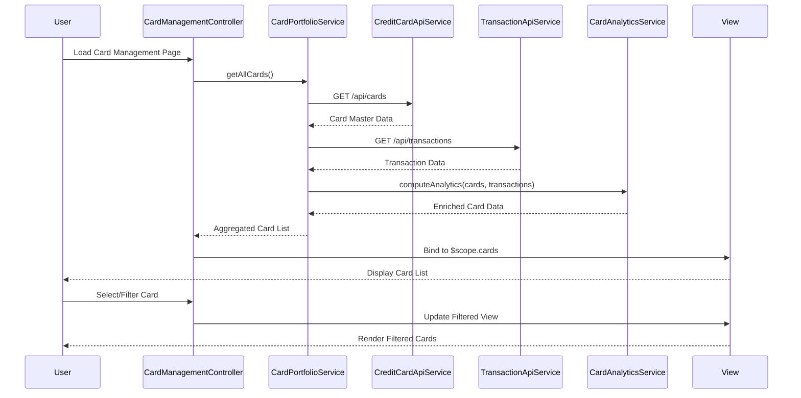

# Low-Level Design: Multiple Credit Card Management
**Epic ID:** QE-10152  
**Application Stack:** AngularJS 1.x, JavaScript ES6, HTML5, CSS3, Bootstrap, REST APIs, MVC Architecture

---

## a. Architecture Mapping

| HLD Component | AngularJS Artifact | Type |
|---------------|-------------------|------|
| User Interface - Card Management | CardManagementController | Controller |
| Card Portfolio Service | CardPortfolioService | Service |
| Credit Card Master Data Service | CreditCardApiService | Factory |
| Transaction Service | TransactionApiService | Factory |
| Card Analytics Module | CardAnalyticsService | Service |

**Recommended Folder Structure:**
```
/app
  /modules
    /card-management
      /controllers
      /services
      /views
      /directives
  /shared
    /factories
    /filters
```

---

## b. Component Specifications

| Component Name | Artifact Type | Responsibility | Key Dependencies |
|----------------|---------------|----------------|------------------|
| CardManagementController | Controller | Orchestrates card display, selection, filtering; binds card data to view | CardPortfolioService, $scope, $filter |
| CardPortfolioService | Service | Aggregates multi-card data, handles filtering and sorting logic | CreditCardApiService, TransactionApiService |
| CreditCardApiService | Factory | Fetches card master data from REST API (GET /api/cards) | $http, $q |
| TransactionApiService | Factory | Retrieves card-wise transaction data (GET /api/transactions?cardId=) | $http, $q |
| CardAnalyticsService | Service | Computes card-specific metrics (spend, balance, utilization) | - |
| cardListDirective | Directive | Renders card list with lazy loading for 10+ cards | CardPortfolioService |

---

## c. Data Model

**CreditCard Object:**
```javascript
{
  cardId: String,
  cardNumber: String,        // masked, e.g., "**** 1234"
  cardType: String,          // "Visa", "MasterCard", etc.
  creditLimit: Number,
  outstandingBalance: Number,
  availableCredit: Number,
  cardHolderName: String,
  expiryDate: String         // ISO date
}
```

**CardSpendAnalytics Object:**
```javascript
{
  cardId: String,
  monthlySpend: Number,
  utilizationPercent: Number,
  transactionCount: Number
}
```

---

## d. Data Flow

User accesses the Card Management view → CardManagementController initializes and calls CardPortfolioService.getAllCards() → CardPortfolioService invokes CreditCardApiService (GET /api/cards) and TransactionApiService (GET /api/transactions) in parallel → Raw data is aggregated and enriched with analytics via CardAnalyticsService → Enriched card list is bound to $scope → cardListDirective renders cards with lazy loading → User selects/filters cards → Controller updates view model → UI refreshes with filtered cards.

---

## e. Primary Sequence Diagram



---

## f. Implementation Notes

- Use AngularJS Dependency Injection for all services and factories; register module as `angular.module('cardManagement', [])`.
- Implement client-side filtering using AngularJS `$filter` service for card selection/filtering to maintain performance with 10+ cards.
- Use `$http` interceptors for adding auth tokens and handling API errors globally.
- Apply lazy loading via custom directive with `ng-repeat` and `limitTo` filter; paginate if cards exceed 20.
- Leverage ES6 Promises ($q) for parallel API calls to meet 500ms retrieval target.

---

## g. Error Handling

HTTP interceptor-based error handling with user-friendly notifications via Bootstrap alerts; retry logic for transient API failures.

---

## h. Security Notes

Requires token-based auth via existing SSO; card numbers are masked on client-side; secure HTTPS API calls enforced.

---