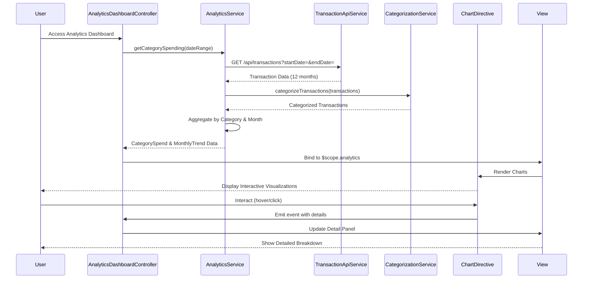

# Low-Level Design: Analytics and Spending Insights
**Epic ID:** QE-10153  
**Application Stack:** AngularJS 1.x, JavaScript ES6, HTML5, CSS3, Bootstrap, REST APIs, MVC Architecture

---

## a. Architecture Mapping

| HLD Component | AngularJS Artifact | Type |
|---------------|-------------------|------|
| User Interface - Analytics Dashboard | AnalyticsDashboardController | Controller |
| Analytics Engine | AnalyticsService | Service |
| Transaction Data Service | TransactionApiService | Factory |
| Categorization Engine | CategorizationService | Service |
| Visualization Service | ChartDirective | Directive |

**Recommended Folder Structure:**
```
/app
  /modules
    /analytics
      /controllers
      /services
      /directives
      /views
  /shared
    /factories
    /constants
```

---

## b. Component Specifications

| Component Name | Artifact Type | Responsibility | Key Dependencies |
|----------------|---------------|----------------|------------------|
| AnalyticsDashboardController | Controller | Manages analytics view, handles user interactions for category/trend selection | AnalyticsService, $scope |
| AnalyticsService | Service | Aggregates transaction data, computes category-wise and monthly trends | TransactionApiService, CategorizationService |
| TransactionApiService | Factory | Fetches categorized transactions (GET /api/transactions?startDate=&endDate=) | $http, $q |
| CategorizationService | Service | Maps transactions to 9 predefined categories; supports external categorization API if needed | - |
| ChartDirective | Directive | Renders interactive charts (pie, bar, line) using Chart.js or D3.js | AnalyticsService |
| SpendingCategoriesConstant | Constant | Defines 9 categories: Food & Dining, Fuel, Shopping, Travel, Entertainment, Utilities, Healthcare, Education, Miscellaneous | - |

---

## c. Data Model

**Transaction Object:**
```javascript
{
  transactionId: String,
  cardId: String,
  amount: Number,
  category: String,          // one of 9 predefined categories
  transactionDate: String,   // ISO date
  merchantName: String,
  description: String
}
```

**CategorySpend Object:**
```javascript
{
  category: String,
  totalSpend: Number,
  transactionCount: Number,
  percentage: Number         // of total spend
}
```

**MonthlyTrend Object:**
```javascript
{
  month: String,             // "YYYY-MM"
  totalSpend: Number,
  categoryBreakdown: Array   // Array of CategorySpend
}
```

---

## d. Data Flow

User navigates to Analytics Dashboard → AnalyticsDashboardController calls AnalyticsService.getCategorySpending(dateRange) → AnalyticsService invokes TransactionApiService (GET /api/transactions) → Transactions are categorized via CategorizationService → Aggregated category-wise and monthly trend data is computed → Data is bound to $scope → ChartDirective renders interactive charts (pie for categories, line for trends) → User interacts with charts (hover, click) → Controller updates view with detailed breakdowns.

---

## e. Primary Sequence Diagram



---

## f. Implementation Notes

- Use AngularJS module `angular.module('analytics', [])` with DI for all components.
- Integrate Chart.js via angular-chart.js directive for responsive, interactive visualizations; ensure 2-second render target via data pre-processing.
- Store 9 spending categories as AngularJS constant for reusability across services and views.
- Implement date range picker using Bootstrap Datepicker for user-selected trend analysis.
- Cache transaction data in AnalyticsService using `$cacheFactory` to optimize repeat queries within session.

---

## g. Error Handling

Centralized error handling via $http interceptor with try/catch in service methods; display user-friendly error messages using Bootstrap modals.

---

## h. Security Notes

Standard input validation and secure API calls assumed; token-based authentication enforced via SSO.

---