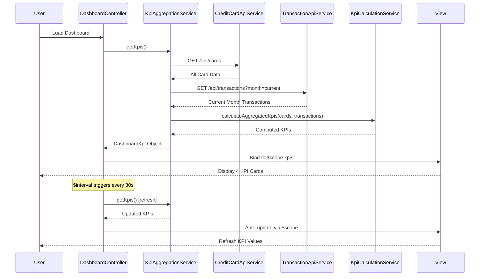

# Low-Level Design: Dashboard and KPI Management
**Epic ID:** QE-10154  
**Application Stack:** AngularJS 1.x, JavaScript ES6, HTML5, CSS3, Bootstrap, REST APIs, MVC Architecture

---

## a. Architecture Mapping

| HLD Component | AngularJS Artifact | Type |
|---------------|-------------------|------|
| User Interface - Dashboard | DashboardController | Controller |
| KPI Aggregation Service | KpiAggregationService | Service |
| Credit Card Data Source | CreditCardApiService | Factory |
| Transaction Data Service | TransactionApiService | Factory |
| Real-time Calculation Engine | KpiCalculationService | Service |

**Recommended Folder Structure:**
```
/app
  /modules
    /dashboard
      /controllers
      /services
      /views
      /directives
  /shared
    /factories
```

---

## b. Component Specifications

| Component Name | Artifact Type | Responsibility | Key Dependencies |
|----------------|---------------|----------------|------------------|
| DashboardController | Controller | Orchestrates dashboard view, binds KPI data to UI, handles real-time updates | KpiAggregationService, $scope, $interval |
| KpiAggregationService | Service | Aggregates KPIs across all cards (Monthly Spend, Total Credit Limit, Available Credit, Outstanding Amount) | CreditCardApiService, TransactionApiService, KpiCalculationService |
| CreditCardApiService | Factory | Fetches credit card data (GET /api/cards) | $http, $q |
| TransactionApiService | Factory | Retrieves transaction data for current month (GET /api/transactions?month=current) | $http, $q |
| KpiCalculationService | Service | Computes individual and aggregated KPI values in real-time | - |
| kpiCardDirective | Directive | Renders individual KPI card with value, label, and trend indicator | - |

---

## c. Data Model

**DashboardKpi Object:**
```javascript
{
  monthlySpend: Number,
  totalCreditLimit: Number,
  availableCredit: Number,
  outstandingAmount: Number,
  lastUpdated: String        // ISO timestamp
}
```

**CreditCardSummary Object:**
```javascript
{
  cardId: String,
  creditLimit: Number,
  availableCredit: Number,
  outstandingBalance: Number
}
```

---

## d. Data Flow

User loads Dashboard → DashboardController initializes and calls KpiAggregationService.getKpis() → KpiAggregationService fetches data from CreditCardApiService (all cards) and TransactionApiService (current month transactions) in parallel → KpiCalculationService computes aggregated KPIs (sum of limits, available credit, outstanding amounts, monthly spend) → Aggregated KPIs are returned to controller and bound to $scope → kpiCardDirective renders four KPI cards → $interval triggers periodic refresh every 30 seconds for real-time updates → UI updates automatically via two-way data binding.

---

## e. Primary Sequence Diagram



---

## f. Implementation Notes

- Register module as `angular.module('dashboard', [])` with DI for all services and controllers.
- Use `$interval` service for real-time KPI refresh every 30 seconds; cancel interval on scope destroy to prevent memory leaks.
- Implement responsive layout using Bootstrap grid system (col-xs-12, col-sm-6, col-md-3) for 4 KPI cards.
- Leverage ES6 arrow functions and template literals in services for cleaner code.
- Use AngularJS `$q.all()` to parallelize API calls to CreditCardApiService and TransactionApiService for performance.

---

## g. Error Handling

HTTP interceptor-based error handling with retry logic for transient failures; user notifications via Bootstrap toasts.

---

## h. Security Notes

Requires token-based auth via existing SSO; all API calls over HTTPS with CORS validation.

---