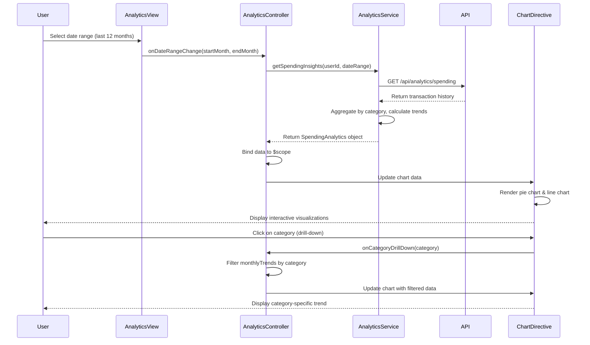

# Low-Level Design: QE-10161 - Analytics and Spending Insights

## a. Architecture Mapping

- **Analytics Module** (`app.analytics`) → Root AngularJS module for analytics feature
- **AnalyticsController** → Manages UI state, user interactions, filters, and drill-down logic
- **AnalyticsService** → Fetches spending data, aggregates by category, calculates trends via REST API
- **CategoryService** → Provides category definitions and categorization logic
- **SpendingChartDirective** → Renders interactive charts (pie/bar/line) using charting library (e.g., Chart.js/D3.js)
- **DateRangeFilterDirective** → Provides date range selection UI component

**Folder Structure:**
```
app/
├── modules/
│   └── analytics/
│       ├── analytics.module.js
│       ├── controllers/
│       │   └── analytics.controller.js
│       ├── services/
│       │   ├── analytics.service.js
│       │   └── category.service.js
│       ├── directives/
│       │   ├── spending-chart.directive.js
│       │   └── date-range-filter.directive.js
│       └── views/
│           └── analytics.html
```

## b. Component Specifications

| Name | Artifact Type | Responsibility | Key Dependencies |
|------|---------------|----------------|------------------|
| AnalyticsController | Controller | Orchestrates analytics view, handles filter changes, manages chart data binding | AnalyticsService, CategoryService, $scope |
| AnalyticsService | Service | Fetches transaction history, aggregates spending by category, calculates monthly trends | $http, $q, API_CONFIG |
| CategoryService | Service | Provides category list (Food, Fuel, Shopping, Travel, Entertainment, Utilities, Healthcare, Education, Misc) | None |
| SpendingChartDirective | Directive | Renders interactive pie/bar/line charts with drill-down capability | Chart.js/D3.js library |
| DateRangeFilterDirective | Directive | Provides month/year range selector (default: last 12 months) | None |

## c. Data Model

```javascript
// SpendingAnalytics
{
  userId: String,
  dateRange: { startMonth: String, endMonth: String }, // 'YYYY-MM' format
  categorySpending: [
    {
      category: String, // 'Food & Dining', 'Fuel', 'Shopping', etc.
      totalAmount: Number,
      percentage: Number,
      transactionCount: Number
    }
  ],
  monthlyTrends: [
    {
      month: String, // 'YYYY-MM'
      totalSpend: Number,
      categoryBreakdown: { categoryName: Number }
    }
  ]
}

// Transaction (from API)
{
  transactionId: String,
  cardId: String,
  amount: Number,
  category: String,
  transactionDate: String, // ISO 8601
  merchantName: String
}
```

## d. Data Flow

User selects date range (default: last 12 months) → AnalyticsController invokes AnalyticsService.getSpendingInsights(userId, dateRange) → Service calls REST API `/api/analytics/spending?userId={id}&startMonth={start}&endMonth={end}` → Backend returns categorized transaction history → AnalyticsService aggregates data by category, calculates monthly trends, computes percentages → Controller binds processed data to scope → SpendingChartDirective renders category pie chart and monthly trend line chart → User interacts (filters by category, drills down) → Controller updates chart data dynamically without re-fetching unless date range changes.

## e. Primary Sequence Diagram



## f. Implementation Notes

- Use AngularJS DI to inject AnalyticsService and CategoryService into AnalyticsController; configure API base URL via constant `API_CONFIG`
- Implement AnalyticsService using $http promises; cache category spending data in service scope to avoid redundant API calls on drill-down
- Use Chart.js or D3.js wrapped in custom directive with two-way data binding (`scope: { chartData: '=' }`) for reactive chart updates
- Apply ES6 arrow functions and template literals in service for cleaner API URL construction and data transformation
- Leverage Bootstrap grid for responsive layout; ensure charts resize dynamically using chart library's responsive options

## g. Error Handling

HTTP interceptor captures API errors (4xx/5xx), displays user-friendly notification via Bootstrap modal/toast, logs error details to console.

## h. Security Notes

Requires token-based auth via existing SSO; userId validated server-side; standard input validation for date range parameters.