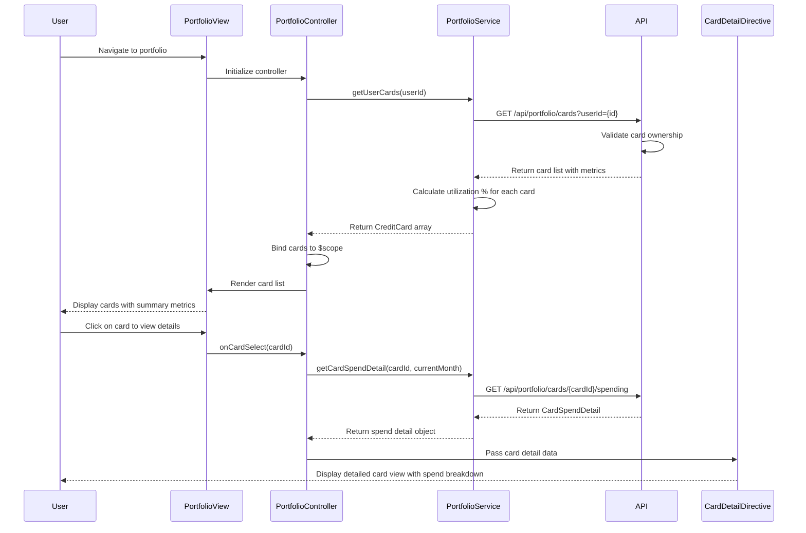

# Low-Level Design: QE-10162 - Credit Card Portfolio Management

## a. Architecture Mapping

- **Portfolio Module** (`app.portfolio`) → Root AngularJS module for portfolio management feature
- **PortfolioController** → Manages card list display, filtering, selection, and card detail view state
- **PortfolioService** → Fetches user's credit cards, retrieves card-specific spending data via REST API
- **CardListDirective** → Renders list of credit cards with summary metrics (limit, balance, utilization)
- **CardDetailDirective** → Displays detailed view of selected card including spend breakdown
- **CardFilterFactory** → Provides filtering logic (by card type, utilization range, etc.)

**Folder Structure:**
```
app/
├── modules/
│   └── portfolio/
│       ├── portfolio.module.js
│       ├── controllers/
│       │   └── portfolio.controller.js
│       ├── services/
│       │   └── portfolio.service.js
│       ├── factories/
│       │   └── card-filter.factory.js
│       ├── directives/
│       │   ├── card-list.directive.js
│       │   └── card-detail.directive.js
│       └── views/
│           ├── portfolio.html
│           └── card-detail.html
```

## b. Component Specifications

| Name | Artifact Type | Responsibility | Key Dependencies |
|------|---------------|----------------|------------------|
| PortfolioController | Controller | Manages portfolio view state, handles card selection, applies filters | PortfolioService, CardFilterFactory, $scope |
| PortfolioService | Service | Fetches all user credit cards, retrieves card-specific spending data, validates card ownership | $http, $q, API_CONFIG |
| CardFilterFactory | Factory | Provides filter functions (by card type, utilization, balance) and filter state management | None |
| CardListDirective | Directive | Renders card list with summary (card name, limit, balance, utilization %, monthly spend) | None |
| CardDetailDirective | Directive | Displays detailed card view with spend breakdown, transaction list, utilization chart | None |

## c. Data Model

```javascript
// CreditCard
{
  cardId: String,
  userId: String,
  cardNumber: String, // Masked: 'XXXX-XXXX-XXXX-1234'
  cardType: String, // 'Visa', 'Mastercard', 'Amex'
  cardName: String, // 'Chase Sapphire', 'Citi Rewards'
  creditLimit: Number,
  currentBalance: Number,
  availableCredit: Number,
  utilizationPercentage: Number, // Calculated: (currentBalance / creditLimit) * 100
  monthlySpend: Number,
  status: String // 'Active', 'Inactive'
}

// CardSpendDetail
{
  cardId: String,
  month: String, // 'YYYY-MM'
  totalSpend: Number,
  transactionCount: Number,
  categoryBreakdown: [
    { category: String, amount: Number }
  ],
  recentTransactions: [
    { transactionId: String, date: String, merchant: String, amount: Number, category: String }
  ]
}
```

## d. Data Flow

User navigates to portfolio view → PortfolioController calls PortfolioService.getUserCards(userId) → Service invokes REST API `/api/portfolio/cards?userId={id}` → Backend validates ownership via User Profile Service, returns card list with metrics → Service calculates utilization percentage for each card → Controller binds card array to scope → CardListDirective renders card grid with summary metrics → User selects a card → Controller calls PortfolioService.getCardSpendDetail(cardId, month) → API returns card-specific spending data → CardDetailDirective displays detailed view with spend breakdown and recent transactions → User applies filter (e.g., high utilization) → CardFilterFactory filters card list client-side → View updates to show filtered cards.

## e. Primary Sequence Diagram



## f. Implementation Notes

- Use AngularJS DI to inject PortfolioService into PortfolioController; configure API endpoints via `API_CONFIG` constant
- Implement PortfolioService with $http promises; cache card list in service to avoid redundant API calls on filter/sort operations
- CardListDirective uses `ng-repeat` with track by `cardId` for efficient rendering; apply Bootstrap card/grid layout for responsive design
- CardFilterFactory returns pure functions for filtering; controller applies filters using `$filter` service or Array.filter() with ES6 syntax
- Use ES6 template literals for masked card number display and arrow functions for data transformation in service layer

## g. Error Handling

HTTP interceptor handles API errors; display user-friendly error messages via Bootstrap alert/toast; log errors to console for debugging.

## h. Security Notes

Requires token-based auth via existing SSO; card ownership validated server-side; card numbers masked client-side; secure API calls over HTTPS.