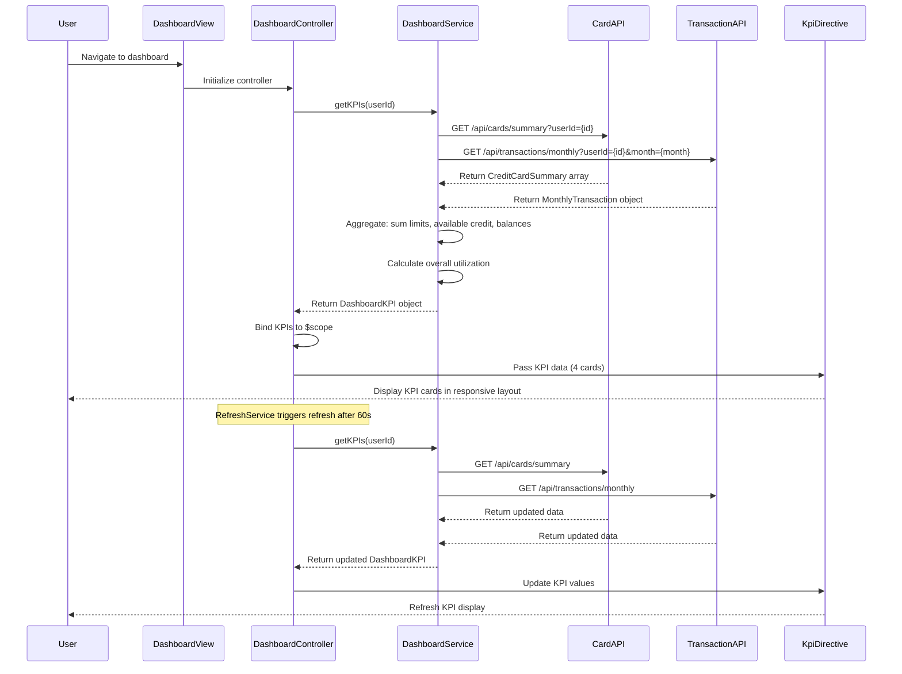

# Low-Level Design: QE-10163 - Dashboard and KPI Management

## a. Architecture Mapping

- **Dashboard Module** (`app.dashboard`) → Root AngularJS module for dashboard feature
- **DashboardController** → Manages dashboard state, orchestrates KPI data fetching, handles real-time refresh
- **DashboardService** → Aggregates data from Credit Card Data Service and Transaction Service via REST API
- **KpiCardDirective** → Reusable component to display individual KPI (monthly spend, credit limit, available credit, outstanding amount)
- **RefreshService** → Manages periodic data refresh using $interval for real-time updates

**Folder Structure:**
```
app/
├── modules/
│   └── dashboard/
│       ├── dashboard.module.js
│       ├── controllers/
│       │   └── dashboard.controller.js
│       ├── services/
│       │   ├── dashboard.service.js
│       │   └── refresh.service.js
│       ├── directives/
│       │   └── kpi-card.directive.js
│       └── views/
│           └── dashboard.html
```

## b. Component Specifications

| Name | Artifact Type | Responsibility | Key Dependencies |
|------|---------------|----------------|------------------|
| DashboardController | Controller | Initializes dashboard, fetches KPI data, manages refresh cycle, binds data to view | DashboardService, RefreshService, $scope |
| DashboardService | Service | Aggregates KPIs (monthly spend, total credit limit, available credit, outstanding amount) from backend APIs | $http, $q, API_CONFIG |
| RefreshService | Service | Provides periodic refresh mechanism using $interval; configurable refresh frequency | $interval |
| KpiCardDirective | Directive | Displays individual KPI with label, value, icon, and trend indicator (if applicable) | None |

## c. Data Model

```javascript
// DashboardKPI
{
  userId: String,
  month: String, // 'YYYY-MM' (current month)
  monthlySpend: Number,
  totalCreditLimit: Number, // Sum of all card limits
  availableCredit: Number, // Sum of available credit across all cards
  outstandingAmount: Number, // Sum of current balances
  overallUtilization: Number, // (outstandingAmount / totalCreditLimit) * 100
  cardCount: Number,
  lastUpdated: String // ISO 8601 timestamp
}

// CreditCardSummary (from API)
{
  cardId: String,
  creditLimit: Number,
  currentBalance: Number,
  availableCredit: Number
}

// MonthlyTransaction (from API)
{
  userId: String,
  month: String,
  totalSpend: Number
}
```

## d. Data Flow

User navigates to dashboard → DashboardController calls DashboardService.getKPIs(userId) → Service makes parallel REST API calls: (1) `/api/cards/summary?userId={id}` for card data, (2) `/api/transactions/monthly?userId={id}&month={currentMonth}` for monthly spend → Service aggregates responses: sums credit limits, available credit, outstanding amounts; retrieves monthly spend → Service calculates overall utilization percentage → DashboardService returns DashboardKPI object → Controller binds KPIs to scope → KpiCardDirective renders four KPI cards (monthly spend, total credit limit, available credit, outstanding amount) in responsive Bootstrap grid → RefreshService triggers periodic refresh (e.g., every 60 seconds) → Controller re-fetches KPIs → View updates dynamically.

## e. Primary Sequence Diagram



## f. Implementation Notes

- Use AngularJS DI to inject DashboardService and RefreshService into DashboardController; configure API base URL and refresh interval via constants
- Implement DashboardService using $q.all() to make parallel API calls for card summary and monthly transactions; aggregate results in single promise resolution
- KpiCardDirective is isolated scope directive with bindings: `scope: { label: '@', value: '=', icon: '@' }`; use Bootstrap card component for styling
- RefreshService wraps $interval; expose start/stop methods to allow controller to manage refresh lifecycle (start on init, stop on $destroy)
- Apply ES6 arrow functions in service for data aggregation logic; use template literals for API URL construction

## g. Error Handling

HTTP interceptor captures API failures; display error notification via Bootstrap toast; retry failed requests up to 2 times before showing error to user.

## h. Security Notes

Requires token-based auth via existing SSO; userId validated server-side; standard input validation and secure API calls assumed.