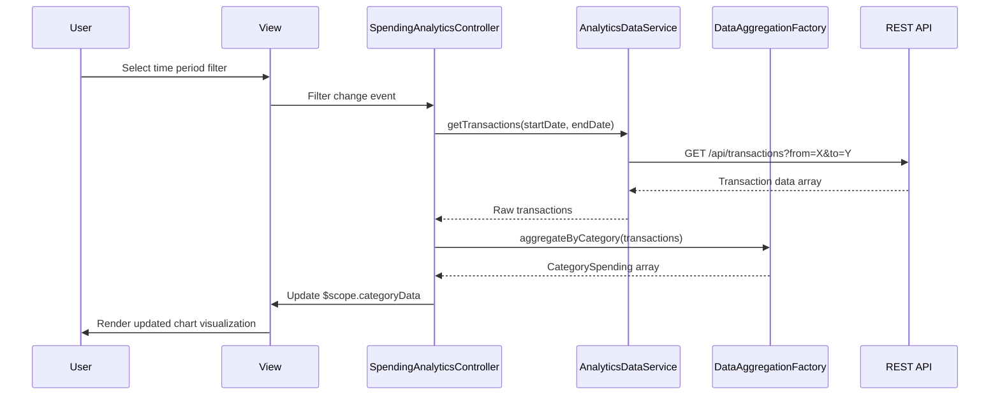

# Low-Level Design: QE-10166 - Spending Analytics and Insights

## a. Architecture Mapping

**AngularJS Artifacts:**
- **Module**: `app.analytics` - Main analytics module
- **Controller**: `SpendingAnalyticsController` - Manages analytics view state and user interactions
- **Service**: `AnalyticsDataService` - Fetches transaction and spending data from REST APIs
- **Service**: `CategoryClassificationService` - Handles category mapping and classification logic
- **Directive**: `spendingChart` - Renders interactive spending visualizations
- **Factory**: `DataAggregationFactory` - Aggregates and transforms raw transaction data for display

**Folder Structure:**
```
app/
├── modules/
│   └── analytics/
│       ├── controllers/
│       │   └── spending-analytics.controller.js
│       ├── services/
│       │   ├── analytics-data.service.js
│       │   └── category-classification.service.js
│       ├── directives/
│       │   └── spending-chart.directive.js
│       ├── factories/
│       │   └── data-aggregation.factory.js
│       └── views/
│           └── spending-analytics.html
```

## b. Component Specifications

| Component Name | Artifact Type | Responsibility | Key Dependencies |
|----------------|---------------|----------------|------------------|
| SpendingAnalyticsController | Controller | Orchestrates analytics view, handles user filter selections, manages chart state | AnalyticsDataService, DataAggregationFactory, $scope |
| AnalyticsDataService | Service | Fetches transaction data from REST API, retrieves 12-month historical data | $http, $q, API_CONFIG |
| CategoryClassificationService | Service | Maps transactions to 9 predefined categories, provides category metadata | None |
| spendingChart | Directive | Renders interactive charts using D3.js/Chart.js, handles responsive behavior | DataAggregationFactory |
| DataAggregationFactory | Factory | Aggregates transactions by category and time period, calculates trends | CategoryClassificationService |

## c. Data Model

**Transaction Model:**
```javascript
{
  id: String,
  cardId: String,
  amount: Number,
  category: String, // One of: Food & Dining, Fuel, Shopping, Travel, Entertainment, Utilities, Healthcare, Education, Miscellaneous
  date: Date,
  description: String,
  merchantName: String
}
```

**CategorySpending Model:**
```javascript
{
  category: String,
  totalAmount: Number,
  transactionCount: Number,
  percentage: Number
}
```

**MonthlyTrend Model:**
```javascript
{
  month: String, // YYYY-MM format
  totalSpend: Number,
  categoryBreakdown: Array<CategorySpending>
}
```

## d. Data Flow

User selects time period and category filters in the analytics view → SpendingAnalyticsController captures selections and invokes AnalyticsDataService → Service makes REST API call to fetch transaction data → DataAggregationFactory processes raw transactions using CategoryClassificationService to group by category and time → Aggregated data is bound to $scope → spendingChart directive watches scope changes and renders interactive visualizations → User interactions with charts trigger controller methods to update filters and refresh data.

## e. Primary Sequence Diagram



## f. Implementation Notes

- Use AngularJS dependency injection to inject services and factories into controller; follow ES6 class syntax for controllers with $inject annotation
- Implement Chart.js or D3.js within custom directive with isolated scope for reusability; use directive link function for DOM manipulation
- REST API integration via $http service with promise-based error handling; cache 12-month data using $cacheFactory for performance
- Apply Bootstrap grid system for responsive layout; use ng-repeat with track by for efficient list rendering of categories
- Implement client-side filtering using AngularJS filters for real-time category and date range selection without additional API calls

## g. Error Handling

HTTP interceptor captures API errors; display user-friendly notifications via toaster service; graceful degradation shows cached data when API unavailable.

## h. Security Notes

Requires token-based auth via existing SSO; validate user session before API calls; sanitize transaction descriptions to prevent XSS.