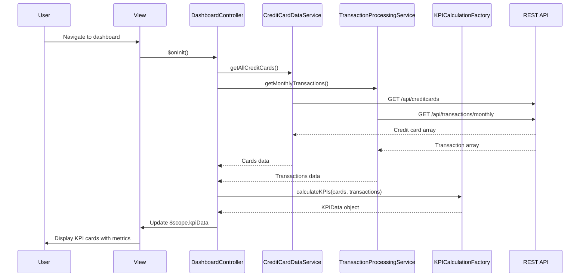

# Low-Level Design: QE-10167 - Credit Card Dashboard and KPI Overview

## a. Architecture Mapping

**AngularJS Artifacts:**
- **Module**: `app.dashboard` - Main dashboard module
- **Controller**: `DashboardController` - Manages dashboard state and KPI display logic
- **Service**: `CreditCardDataService` - Fetches credit card information from REST APIs
- **Service**: `TransactionProcessingService` - Retrieves and processes transaction data for KPI calculations
- **Factory**: `KPICalculationFactory` - Computes monthly spend, available credit, outstanding amounts
- **Directive**: `kpiCard` - Reusable component for displaying individual KPI metrics

**Folder Structure:**
```
app/
├── modules/
│   └── dashboard/
│       ├── controllers/
│       │   └── dashboard.controller.js
│       ├── services/
│       │   ├── credit-card-data.service.js
│       │   └── transaction-processing.service.js
│       ├── factories/
│       │   └── kpi-calculation.factory.js
│       ├── directives/
│       │   └── kpi-card.directive.js
│       └── views/
│           └── dashboard.html
```

## b. Component Specifications

| Component Name | Artifact Type | Responsibility | Key Dependencies |
|----------------|---------------|----------------|------------------|
| DashboardController | Controller | Orchestrates dashboard view, initializes KPI data, handles refresh actions | CreditCardDataService, TransactionProcessingService, KPICalculationFactory, $scope, $interval |
| CreditCardDataService | Service | Fetches all credit card details for authenticated user via REST API | $http, $q, AuthService |
| TransactionProcessingService | Service | Retrieves transaction data and outstanding balances from REST API | $http, $q, API_CONFIG |
| KPICalculationFactory | Factory | Calculates monthly spend, total credit limit, available credit, outstanding amount from raw data | None |
| kpiCard | Directive | Renders individual KPI metric with icon, label, and value; supports responsive design | None |

## c. Data Model

**CreditCard Model:**
```javascript
{
  cardId: String,
  cardNumber: String, // Masked format: **** **** **** 1234
  cardType: String, // Visa, Mastercard, Amex, etc.
  creditLimit: Number,
  availableCredit: Number,
  outstandingAmount: Number,
  expiryDate: String, // MM/YY format
  holderName: String
}
```

**KPIData Model:**
```javascript
{
  monthlySpend: Number,
  totalCreditLimit: Number,
  availableCredit: Number,
  outstandingAmount: Number,
  lastUpdated: Date
}
```

## d. Data Flow

User navigates to dashboard → DashboardController initializes and calls CreditCardDataService and TransactionProcessingService → Services make parallel REST API calls to fetch credit card details and transaction data → KPICalculationFactory aggregates data from all cards to compute monthly spend, total credit limit, available credit, and outstanding amounts → Calculated KPI data is bound to $scope → View renders KPI metrics using kpiCard directives → $interval service triggers periodic refresh every 30 seconds to update KPIs with latest data.

## e. Primary Sequence Diagram



## f. Implementation Notes

- Use AngularJS component architecture with lifecycle hooks ($onInit) for controller initialization; inject dependencies via $inject array
- Implement $http service with promise chaining for parallel API calls using $q.all(); apply response interceptors for authentication token injection
- Bootstrap responsive grid (col-xs, col-sm, col-md, col-lg) for KPI card layout; ensure mobile-first design with stacked cards on small screens
- Use $interval service for auto-refresh with cleanup in $scope.$on('$destroy') to prevent memory leaks
- Apply WCAG 2.1 standards: ARIA labels on KPI cards, sufficient color contrast, keyboard navigation support

## g. Error Handling

HTTP interceptor-based error handling with try/catch blocks in service methods; display error notifications to user via modal or toast; retry failed API calls once before showing error.

## h. Security Notes

Requires token-based auth via existing SSO; mask sensitive card numbers in UI; validate user session before rendering dashboard data.