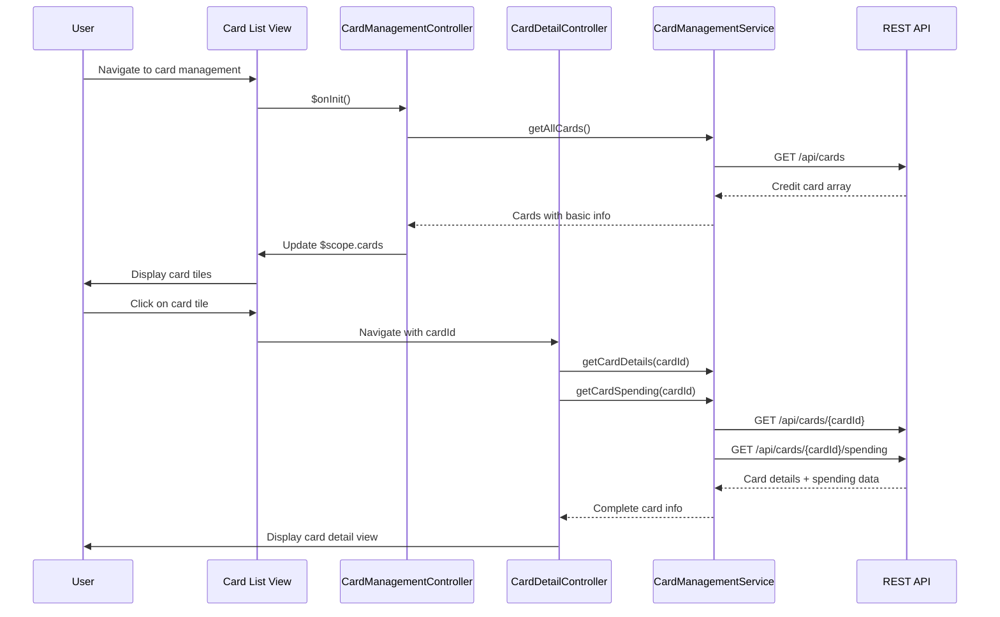

# Low-Level Design: QE-10168 - Credit Card Management and Display

## a. Architecture Mapping

**AngularJS Artifacts:**
- **Module**: `app.cardManagement` - Card management module
- **Controller**: `CardManagementController` - Manages card list view and user interactions
- **Controller**: `CardDetailController` - Handles individual card detail view
- **Service**: `CardManagementService` - Fetches card data and card-wise spending from REST APIs
- **Service**: `UserProfileService` - Validates card ownership for authenticated user
- **Directive**: `creditCardTile` - Displays individual card summary in list view
- **Factory**: `CardUtilizationFactory` - Calculates credit utilization percentage per card

**Folder Structure:**
```
app/
├── modules/
│   └── card-management/
│       ├── controllers/
│       │   ├── card-management.controller.js
│       │   └── card-detail.controller.js
│       ├── services/
│       │   ├── card-management.service.js
│       │   └── user-profile.service.js
│       ├── directives/
│       │   └── credit-card-tile.directive.js
│       ├── factories/
│       │   └── card-utilization.factory.js
│       └── views/
│           ├── card-management.html
│           └── card-detail.html
```

## b. Component Specifications

| Component Name | Artifact Type | Responsibility | Key Dependencies |
|----------------|---------------|----------------|------------------|
| CardManagementController | Controller | Manages card list display, filtering, and selection; handles navigation to card details | CardManagementService, UserProfileService, $scope, $state |
| CardDetailController | Controller | Displays individual card details, card-wise spending analysis, and utilization metrics | CardManagementService, CardUtilizationFactory, $stateParams, $scope |
| CardManagementService | Service | Fetches all user credit cards and card-specific spending data via REST API | $http, $q, API_CONFIG |
| UserProfileService | Service | Validates card ownership and retrieves user profile information | $http, AuthService |
| creditCardTile | Directive | Renders card summary tile with card type, last 4 digits, available credit, and utilization bar | CardUtilizationFactory |
| CardUtilizationFactory | Factory | Calculates credit utilization percentage (outstandingAmount / creditLimit * 100) | None |

## c. Data Model

**CreditCard Model:**
```javascript
{
  cardId: String,
  cardNumber: String, // Masked: **** **** **** 1234
  cardType: String, // Visa, Mastercard, Amex
  cardNetwork: String,
  creditLimit: Number,
  availableCredit: Number,
  outstandingAmount: Number,
  utilizationPercentage: Number,
  expiryDate: String, // MM/YY
  holderName: String,
  status: String // Active, Blocked, Expired
}
```

**CardSpending Model:**
```javascript
{
  cardId: String,
  currentMonthSpend: Number,
  lastMonthSpend: Number,
  yearToDateSpend: Number,
  topCategories: Array<{category: String, amount: Number}>
}
```

## d. Data Flow

User navigates to card management view → CardManagementController initializes and calls UserProfileService to validate session → CardManagementService fetches all credit cards for user via REST API → Cards are bound to $scope and rendered using creditCardTile directives with utilization calculated by CardUtilizationFactory → User clicks on a card tile → $state.go navigates to card detail view with cardId parameter → CardDetailController loads specific card data and spending analysis via CardManagementService → Detailed card information and spending breakdown are displayed to user.

## e. Primary Sequence Diagram



## f. Implementation Notes

- Use AngularJS ui-router for state management; define states for card list and card detail views with URL parameters for cardId
- Implement ES6 classes for controllers with constructor-based dependency injection using $inject annotation
- REST API calls via $http service with promise-based error handling; implement response caching using $cacheFactory for card list to reduce API calls
- Bootstrap grid and card components for responsive layout; use ng-repeat with track by cardId for efficient rendering of up to 10+ cards
- Implement search/filter functionality using AngularJS filters (e.g., filter by card type, status) for client-side filtering without additional API calls

## g. Error Handling

HTTP interceptor captures API failures; display user-friendly error messages via toaster; implement retry logic for transient failures; show cached data when API unavailable.

## h. Security Notes

Requires token-based auth via existing SSO; validate card ownership on server side; mask full card numbers in all views; sanitize user inputs to prevent XSS.