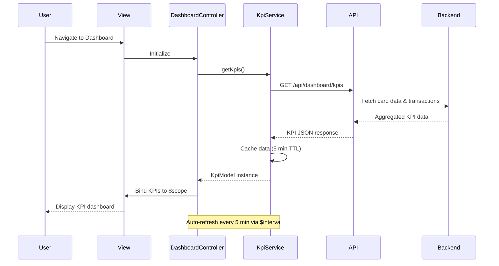

# Low-Level Design: Credit Card Dashboard and KPI Management
**Epic ID:** QE-10182

## a. Architecture Mapping

- **Dashboard Module** → AngularJS Module (`app.dashboard`)
- **Dashboard Controller** → AngularJS Controller (`DashboardController`)
- **KPI Service** → AngularJS Service (`KpiService`)
- **Authentication Interceptor** → AngularJS HTTP Interceptor (`AuthInterceptor`)
- **Dashboard View** → HTML5 template with Bootstrap responsive grid

**Folder Structure:**
```
/app
  /modules
    /dashboard
      dashboard.module.js
      dashboard.controller.js
      dashboard.html
  /services
    kpi.service.js
    auth.interceptor.js
  /models
    kpi.model.js
```

## b. Component Specifications

| Name | Artifact Type | Responsibility | Key Dependencies |
|------|---------------|----------------|------------------|
| DashboardModule | AngularJS Module | Register dashboard components and routes | ngRoute, ngResource |
| DashboardController | Controller | Manage dashboard state, fetch KPIs, handle refresh | KpiService, $scope, $interval |
| KpiService | Service | Fetch and cache KPI data from REST APIs | $http, $q, CacheFactory |
| AuthInterceptor | HTTP Interceptor | Inject auth tokens and handle 401 responses | $window, AuthService |
| KpiModel | ES6 Class | Represent KPI data structure with validation | None |
| DashboardView | HTML5 Template | Display KPIs in responsive Bootstrap grid | Bootstrap CSS |

## c. Data Model

**KpiModel (ES6 Class):**
```javascript
class KpiModel {
  constructor(data) {
    this.monthlySpend = Number;        // Total spend for current month
    this.totalCreditLimit = Number;    // Sum of all card limits
    this.availableCredit = Number;     // Total available credit
    this.outstandingAmount = Number;   // Total outstanding balance
    this.lastUpdated = Date;           // Timestamp of last refresh
    this.cardCount = Number;           // Number of active cards
  }
}
```

## d. Data Flow

User navigates to dashboard → DashboardController initializes and calls KpiService.getKpis() → KpiService checks cache; if expired, makes REST API call to /api/dashboard/kpis with auth token via AuthInterceptor → Backend aggregates data from Credit Card Data Service and Transaction Processing Service → Response returns KPI JSON → KpiService instantiates KpiModel and updates cache → Controller binds KpiModel to $scope → View renders KPIs using Bootstrap cards with responsive layout → $interval triggers auto-refresh every 5 minutes, repeating the flow.

## e. Primary Sequence Diagram



## f. Implementation Notes

- Use AngularJS Dependency Injection for all services and controllers; register via module.config()
- Implement HTTP caching in KpiService using $cacheFactory with 5-minute TTL to meet 2-second load requirement
- Use $interval service for auto-refresh; cancel interval on $scope.$destroy to prevent memory leaks
- Apply Bootstrap responsive grid (col-xs/sm/md/lg) for mobile-first KPI card layout
- Leverage ES6 classes for models with constructor validation; transpile using Babel if needed

## g. Error Handling

AuthInterceptor captures 401/403 errors and redirects to login; KpiService uses try/catch with $q.reject and displays user-friendly error toasts via notification service.

## h. Security Notes

Requires token-based auth via existing SSO; AuthInterceptor injects JWT in Authorization header for all API calls.