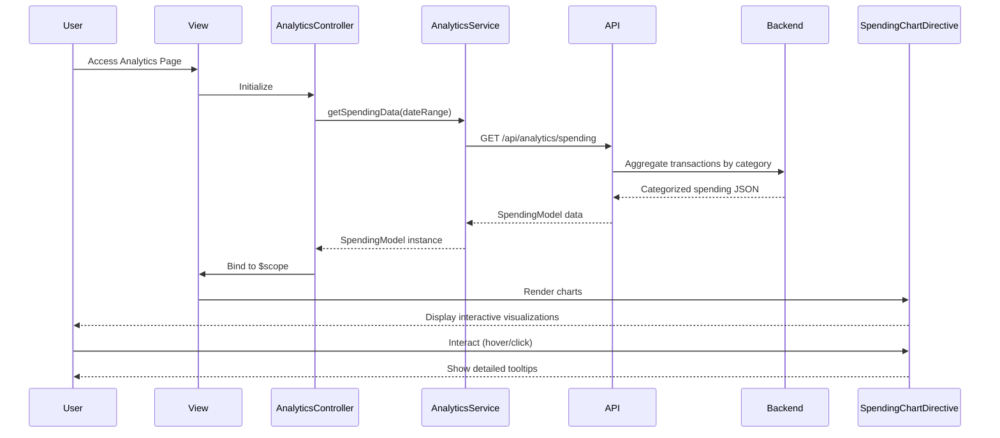

# Low-Level Design: Spending Analytics and Insights
**Epic ID:** QE-10183

## a. Architecture Mapping

- **Analytics Module** → AngularJS Module (`app.analytics`)
- **Analytics Controller** → AngularJS Controller (`AnalyticsController`)
- **Analytics Service** → AngularJS Service (`AnalyticsService`)
- **Chart Directive** → AngularJS Directive (`spendingChart`)
- **Analytics View** → HTML5 template with Chart.js integration

**Folder Structure:**
```
/app
  /modules
    /analytics
      analytics.module.js
      analytics.controller.js
      analytics.html
  /services
    analytics.service.js
  /directives
    spending-chart.directive.js
  /models
    spending.model.js
```

## b. Component Specifications

| Name | Artifact Type | Responsibility | Key Dependencies |
|------|---------------|----------------|------------------|
| AnalyticsModule | AngularJS Module | Register analytics components and routes | ngRoute, chart.js |
| AnalyticsController | Controller | Manage analytics state, fetch spending data, handle filters | AnalyticsService, $scope, $filter |
| AnalyticsService | Service | Fetch categorized spending data and trends from REST API | $http, $q |
| SpendingChartDirective | Directive | Render interactive Chart.js visualizations for category and trend data | chart.js, $timeout |
| SpendingModel | ES6 Class | Represent spending data by category and month | None |
| AnalyticsView | HTML5 Template | Display category breakdown and trend charts responsively | Bootstrap CSS, Chart.js |

## c. Data Model

**SpendingModel (ES6 Class):**
```javascript
class SpendingModel {
  constructor(data) {
    this.categories = Array;  // [{name: String, amount: Number, percentage: Number}]
    this.monthlyTrends = Array;  // [{month: String, amount: Number}]
    this.totalSpend = Number;
    this.period = String;  // e.g., "Last 12 months"
    this.lastUpdated = Date;
  }
}
```

**Category List:** Food & Dining, Fuel, Shopping, Travel, Entertainment, Utilities, Healthcare, Education, Miscellaneous

## d. Data Flow

User accesses analytics page → AnalyticsController calls AnalyticsService.getSpendingData() → Service makes REST API call to /api/analytics/spending with date range parameters → Backend's Data Aggregation Layer fetches transactions from Transaction Data Service and applies Categorization Engine mappings → Backend aggregates by category and month, returns JSON → AnalyticsService instantiates SpendingModel → Controller binds model to $scope → SpendingChartDirective watches scope data and renders Chart.js pie chart (categories) and line chart (trends) → User interacts with chart (hover, click) to view details; directive updates tooltips dynamically.

## e. Primary Sequence Diagram



## f. Implementation Notes

- Use Chart.js library integrated via AngularJS directive; directive isolates scope and watches data changes
- Implement responsive chart sizing using Chart.js responsive:true option and CSS container queries
- Fetch 12 months of data on load; use $filter for client-side date range filtering to reduce API calls
- Apply AngularJS $timeout in directive for DOM-ready chart rendering to avoid timing issues
- Use ES6 Array methods (map, reduce) for client-side data transformation and percentage calculations

## g. Error Handling

AnalyticsService uses try/catch with $q.reject; controller displays error message in view if API fails; directive gracefully handles empty data with "No data available" message.

## h. Security Notes

Standard input validation and secure API calls assumed; date range parameters sanitized on backend to prevent injection attacks.