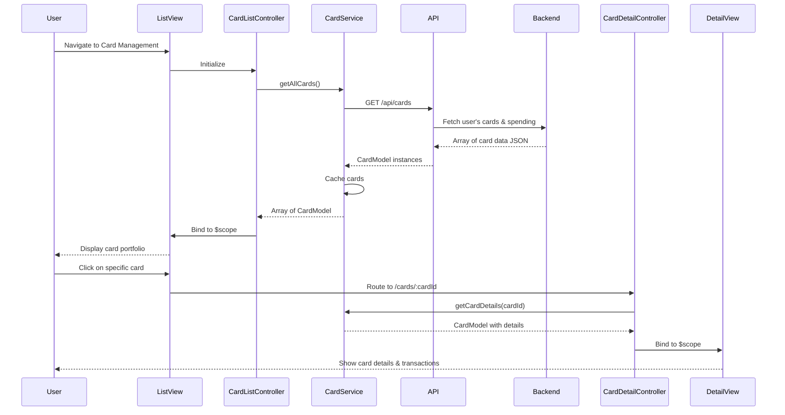

# Low-Level Design: Multiple Credit Card Management
**Epic ID:** QE-10184

## a. Architecture Mapping

- **Card Management Module** → AngularJS Module (`app.cardManagement`)
- **Card List Controller** → AngularJS Controller (`CardListController`)
- **Card Detail Controller** → AngularJS Controller (`CardDetailController`)
- **Card Service** → AngularJS Service (`CardService`)
- **Card Selector Directive** → AngularJS Directive (`cardSelector`)

**Folder Structure:**
```
/app
  /modules
    /card-management
      card-management.module.js
      card-list.controller.js
      card-detail.controller.js
      card-list.html
      card-detail.html
  /services
    card.service.js
  /directives
    card-selector.directive.js
  /models
    card.model.js
```

## b. Component Specifications

| Name | Artifact Type | Responsibility | Key Dependencies |
|------|---------------|----------------|------------------|
| CardManagementModule | AngularJS Module | Register card management components and routes | ngRoute, ngResource |
| CardListController | Controller | Manage card portfolio view, fetch all cards, handle navigation | CardService, $scope, $location |
| CardDetailController | Controller | Display single card details, fetch card-specific data | CardService, $routeParams, $scope |
| CardService | Service | Fetch card list, card details, and spending data from REST APIs | $http, $q, $cacheFactory |
| CardSelectorDirective | Directive | Render card selection UI with quick-switch functionality | CardService |
| CardModel | ES6 Class | Represent individual card with balance, limit, and metadata | None |

## c. Data Model

**CardModel (ES6 Class):**
```javascript
class CardModel {
  constructor(data) {
    this.cardId = String;
    this.cardNumber = String;  // Masked (e.g., "**** 1234")
    this.cardType = String;    // Visa, Mastercard, etc.
    this.creditLimit = Number;
    this.availableCredit = Number;
    this.outstandingBalance = Number;
    this.monthlySpend = Number;
    this.expiryDate = String;  // MM/YY
    this.isActive = Boolean;
  }
}
```

## d. Data Flow

User navigates to card management → CardListController calls CardService.getAllCards() → Service makes REST API call to /api/cards with user ID from User Profile Service → Backend fetches card associations and details from Credit Card Data Service and spending from Transaction Service → Response returns array of card JSON → CardService maps to CardModel instances and caches → Controller binds card list to $scope → View displays cards in Bootstrap grid with CardSelectorDirective → User clicks card → $location changes route to /cards/:cardId → CardDetailController initializes, calls CardService.getCardDetails(cardId) → Service fetches from cache or API → Detailed view renders with card-specific balance, limit, and transactions.

## e. Primary Sequence Diagram



## f. Implementation Notes

- Use AngularJS $routeProvider to configure routes for card list (/cards) and detail (/cards/:cardId) views
- Implement CardService with $cacheFactory to cache card list; cache invalidated on explicit refresh or 10-minute TTL
- CardSelectorDirective uses isolate scope with two-way binding for selected card; emits event on card switch
- Apply Bootstrap card components with responsive grid (col-md-4) for card list; detail view uses col-md-8 centered layout
- Use $location.path() for navigation to maintain SPA experience without full page reload

## g. Error Handling

CardService uses try/catch with $q.reject; controllers display error notifications via toast service; directive handles missing card data gracefully with placeholder UI.

## h. Security Notes

Requires token-based auth via existing SSO; card numbers are masked on backend; sensitive card details transmitted over HTTPS only.