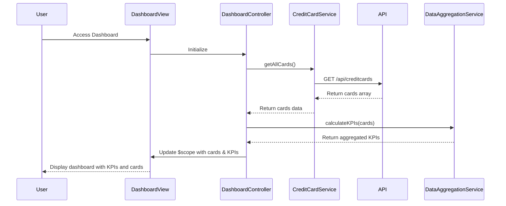

# Low-Level Design: Dashboard KPIs and Credit Card Overview
**Epic ID:** QE-10191  
**Technology Stack:** AngularJS 1.x, JavaScript ES6, HTML5, CSS3, Bootstrap, REST APIs, MVC Architecture

---

## a. Architecture Mapping

- **dashboardModule** (AngularJS Module) - Main module container for dashboard feature
- **DashboardController** (Controller) - Manages dashboard view state and user interactions
- **CreditCardService** (Service) - Fetches credit card data from REST API
- **DataAggregationService** (Service) - Aggregates KPIs across multiple cards
- **cardSummaryDirective** (Directive) - Reusable component for individual card display

**Folder Structure:**
```
app/
├── modules/dashboard/
│   ├── controllers/DashboardController.js
│   ├── services/CreditCardService.js
│   ├── services/DataAggregationService.js
│   ├── directives/cardSummaryDirective.js
│   └── views/dashboard.html
└── assets/css/dashboard.css
```

---

## b. Component Specifications

| Component Name | Artifact Type | Responsibility | Key Dependencies |
|----------------|---------------|----------------|------------------|
| dashboardModule | Module | Register all dashboard components and configure routing | ngRoute, ngResource |
| DashboardController | Controller | Initialize dashboard, load cards, refresh data | CreditCardService, DataAggregationService, $scope |
| CreditCardService | Service | Fetch card details, balances, limits via REST API | $http, $q, API_ENDPOINTS |
| DataAggregationService | Service | Calculate total credit limit, available credit, outstanding, monthly spend | - |
| cardSummaryDirective | Directive | Render individual card summary with KPIs | - |
| AuthInterceptor | Factory | Inject authentication token in API requests | $localStorage, $q |

---

## c. Data Model

**CreditCard Object:**
```javascript
{
  cardId: String,
  cardNumber: String,
  cardType: String,
  creditLimit: Number,
  availableCredit: Number,
  outstandingAmount: Number,
  monthlySpend: Number,
  lastUpdated: Date
}
```

**DashboardKPIs Object:**
```javascript
{
  totalCreditLimit: Number,
  totalAvailableCredit: Number,
  totalOutstanding: Number,
  totalMonthlySpend: Number,
  cardCount: Number
}
```

---

## d. Data Flow

User accesses dashboard view → DashboardController initializes and calls CreditCardService.getAllCards() → Service makes GET request to /api/creditcards endpoint → Response (array of card objects) is received → DataAggregationService computes KPIs (sum of limits, available credit, outstanding, monthly spend) → Controller updates $scope with cards array and aggregated KPIs → View renders Bootstrap grid with KPI cards and individual card summaries using cardSummaryDirective → User can trigger manual refresh which repeats the flow.

---

## e. Primary Sequence Diagram



---

## f. Implementation Notes

- Use AngularJS Dependency Injection for all services and controllers to ensure testability and modularity.
- Implement ES6 classes for services with arrow functions for cleaner syntax and proper `this` binding.
- Use $http service with promise chaining for API calls; wrap in service layer for reusability.
- Apply Bootstrap grid system (col-md-3, col-sm-6) for responsive KPI card layout across devices.
- Implement $interval for auto-refresh every 5 minutes with manual refresh button using ng-click.

---

## g. Error Handling

Use HTTP interceptor to catch API errors globally; display user-friendly error messages via Bootstrap alerts and log errors to console.

---

## h. Security Notes

Requires token-based auth via existing SSO; AuthInterceptor injects bearer token in all API request headers.

---