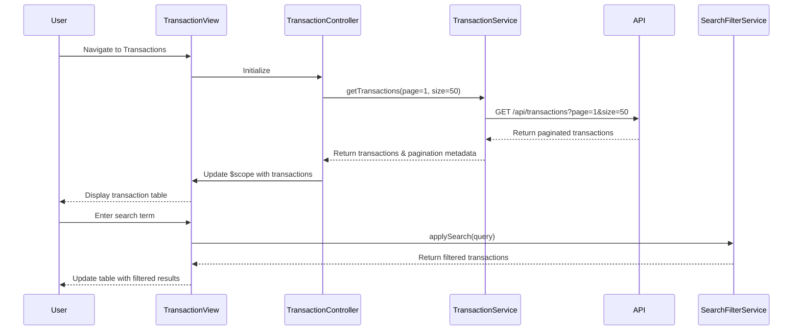

# Low-Level Design: Transaction Management and Monitoring
**Epic ID:** QE-10192  
**Technology Stack:** AngularJS 1.x, JavaScript ES6, HTML5, CSS3, Bootstrap, REST APIs, MVC Architecture

---

## a. Architecture Mapping

- **transactionModule** (AngularJS Module) - Main module for transaction management feature
- **TransactionController** (Controller) - Manages transaction list view and user interactions
- **TransactionService** (Service) - Fetches transaction data from REST API with pagination
- **SearchFilterService** (Service) - Handles client-side search and filter logic
- **transactionListDirective** (Directive) - Renders paginated transaction table

**Folder Structure:**
```
app/
├── modules/transactions/
│   ├── controllers/TransactionController.js
│   ├── services/TransactionService.js
│   ├── services/SearchFilterService.js
│   ├── directives/transactionListDirective.js
│   └── views/transactions.html
└── assets/css/transactions.css
```

---

## b. Component Specifications

| Component Name | Artifact Type | Responsibility | Key Dependencies |
|----------------|---------------|----------------|------------------|
| transactionModule | Module | Register transaction components and routing | ngRoute, ngResource |
| TransactionController | Controller | Load transactions, handle pagination, search, filter | TransactionService, SearchFilterService, $scope |
| TransactionService | Service | Fetch transactions via REST API with pagination support | $http, $q, API_ENDPOINTS |
| SearchFilterService | Service | Apply search query and filter criteria to transaction list | - |
| transactionListDirective | Directive | Render transaction table with pagination controls | - |
| PaginationFactory | Factory | Manage pagination state (current page, page size, total) | - |

---

## c. Data Model

**Transaction Object:**
```javascript
{
  transactionId: String,
  cardId: String,
  amount: Number,
  merchant: String,
  category: String,
  transactionDate: Date,
  description: String,
  status: String
}
```

**PaginationState Object:**
```javascript
{
  currentPage: Number,
  pageSize: Number,
  totalRecords: Number,
  totalPages: Number
}
```

---

## d. Data Flow

User navigates to transactions view → TransactionController initializes and calls TransactionService.getTransactions(page, pageSize) → Service makes GET request to /api/transactions?page=1&size=50 → API returns paginated transaction array with metadata → Controller updates $scope with transactions and pagination state → View renders Bootstrap table with transaction rows → User enters search term or applies filter → SearchFilterService filters displayed transactions client-side → User clicks pagination button → Controller fetches next page from API and updates view.

---

## e. Primary Sequence Diagram



---

## f. Implementation Notes

- Use AngularJS $http service with query parameters for server-side pagination to handle large datasets efficiently.
- Implement custom filter in SearchFilterService using ES6 Array.filter() for client-side search on merchant and description fields.
- Use ng-repeat with track by transactionId for optimal rendering performance in transaction list.
- Apply Bootstrap table-responsive class for mobile-friendly transaction display with horizontal scroll.
- Implement debounce on search input (300ms) using $timeout to reduce unnecessary filter operations.

---

## g. Error Handling

HTTP interceptor catches API failures; display error notification using Bootstrap alert-danger and retry button for failed requests.

---

## h. Security Notes

Standard input validation and secure API calls assumed; authentication token required for all transaction API endpoints.

---