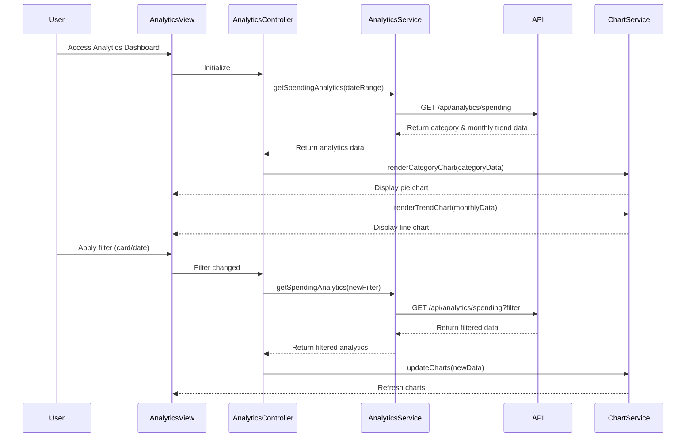

# Low-Level Design: Spending Analytics and Insights
**Epic ID:** QE-10193  
**Technology Stack:** AngularJS 1.x, JavaScript ES6, HTML5, CSS3, Bootstrap, REST APIs, MVC Architecture

---

## a. Architecture Mapping

- **analyticsModule** (AngularJS Module) - Main module for analytics feature
- **AnalyticsController** (Controller) - Manages analytics view and chart interactions
- **AnalyticsService** (Service) - Fetches aggregated spending data from REST API
- **ChartService** (Service) - Wraps Chart.js library for rendering visualizations
- **categoryChartDirective** (Directive) - Renders category-wise spending pie chart
- **trendChartDirective** (Directive) - Renders monthly spend trend line chart

**Folder Structure:**
```
app/
├── modules/analytics/
│   ├── controllers/AnalyticsController.js
│   ├── services/AnalyticsService.js
│   ├── services/ChartService.js
│   ├── directives/categoryChartDirective.js
│   ├── directives/trendChartDirective.js
│   └── views/analytics.html
└── assets/css/analytics.css
```

---

## b. Component Specifications

| Component Name | Artifact Type | Responsibility | Key Dependencies |
|----------------|---------------|----------------|------------------|
| analyticsModule | Module | Register analytics components and configure routing | ngRoute, Chart.js |
| AnalyticsController | Controller | Load analytics data, manage filters, update charts | AnalyticsService, ChartService, $scope |
| AnalyticsService | Service | Fetch category-wise and monthly spending data via REST API | $http, $q, API_ENDPOINTS |
| ChartService | Service | Initialize and update Chart.js instances with data | Chart.js library |
| categoryChartDirective | Directive | Render pie/donut chart for category-wise spending | ChartService |
| trendChartDirective | Directive | Render line chart for monthly spend trends | ChartService |

---

## c. Data Model

**CategorySpending Object:**
```javascript
{
  category: String,
  amount: Number,
  percentage: Number,
  transactionCount: Number
}
```

**MonthlyTrend Object:**
```javascript
{
  month: String,
  year: Number,
  totalSpend: Number,
  cardWiseSpend: Array<{cardId: String, amount: Number}>
}
```

**AnalyticsData Object:**
```javascript
{
  categorySpending: Array<CategorySpending>,
  monthlyTrends: Array<MonthlyTrend>,
  dateRange: {startDate: Date, endDate: Date}
}
```

---

## d. Data Flow

User accesses analytics view → AnalyticsController initializes and calls AnalyticsService.getSpendingAnalytics(dateRange) → Service makes GET request to /api/analytics/spending?startDate=X&endDate=Y → API returns category-wise spending array and monthly trends array → Controller passes data to ChartService → ChartService formats data for Chart.js and renders pie chart (categories) and line chart (monthly trends) → Charts are displayed in responsive Bootstrap grid → User applies filter (e.g., specific card or date range) → Controller re-fetches data via AnalyticsService and updates charts without page reload using AJAX.

---

## e. Primary Sequence Diagram



---

## f. Implementation Notes

- Use Chart.js library integrated via AngularJS directives for declarative chart rendering with data binding.
- Implement AnalyticsService with caching mechanism using $cacheFactory to avoid redundant API calls for same date range.
- Use ES6 Array.reduce() for client-side aggregation if needed for card-wise filtering on already-fetched data.
- Apply Bootstrap responsive grid (col-md-6) to display multiple charts side-by-side on desktop, stacked on mobile.
- Implement chart update logic using Chart.js .update() method instead of re-rendering for smooth transitions on filter changes.

---

## g. Error Handling

HTTP interceptor handles API errors; display user-friendly message via Bootstrap alert if analytics data fails to load, with retry option.

---

## h. Security Notes

Standard input validation and secure API calls assumed; date range inputs sanitized to prevent injection attacks.

---