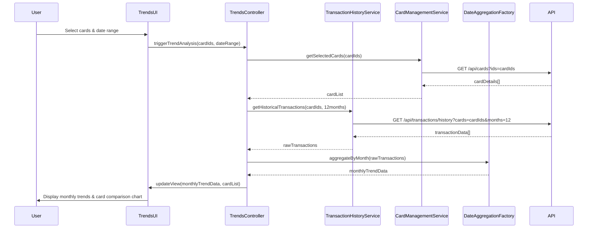

# Low-Level Design: QE-10200 - Monthly Spend Trends and Card-wise Analysis

## a. Architecture Mapping

**Component to Artifact Mapping:**
- Trends Analysis UI → AngularJS Module (`creditCard.trends`) + Controller (`TrendsController`)
- Transaction History Service Integration → AngularJS Service (`TransactionHistoryService`)
- Card Management Service Integration → AngularJS Service (`CardManagementService`)
- Date/Time Aggregation Logic → AngularJS Factory (`DateAggregationFactory`)
- Chart Rendering → AngularJS Directive (`trendChart`)

**Recommended Folder Structure:**
```
app/
├── modules/
│   └── trends/
│       ├── trends.module.js
│       ├── trends.controller.js
│       ├── trends.service.js
│       └── trends.html
├── services/
│   ├── transaction-history.service.js
│   └── card-management.service.js
├── factories/
│   └── date-aggregation.factory.js
└── directives/
    └── trend-chart.directive.js
```

## b. Component Specifications

| Component Name | Artifact Type | Responsibility | Key Dependencies |
|---|---|---|---|
| TrendsController | Controller | Manages trends view state, fetches monthly data, handles card selection | TransactionHistoryService, CardManagementService, DateAggregationFactory |
| TransactionHistoryService | Service | Retrieves 12 months historical transaction data via REST API | $http, API_CONFIG |
| CardManagementService | Service | Fetches card list, filters transactions by card, supports multi-card comparison (up to 10) | $http, API_CONFIG |
| DateAggregationFactory | Factory | Aggregates transactions by month, calculates month-over-month trends | Lodash/Underscore (optional) |
| trendChart | Directive | Renders interactive monthly spend trend chart using Chart.js or D3.js | Chart.js/D3.js library |
| TrendsModule | Module | Encapsulates all trends analysis functionality | ngRoute, ui.bootstrap |

## c. Data Model

**MonthlySpendTrend (JS Object):**
```javascript
{
  cardId: String,
  cardName: String,
  monthlyData: [
    {
      month: String,        // Format: 'YYYY-MM'
      year: Number,
      monthName: String,    // e.g., 'January'
      totalSpend: Number,
      transactionCount: Number
    }
  ],
  totalSpend12Months: Number
}
```

**CardComparison (JS Object):**
```javascript
{
  cards: [
    {
      cardId: String,
      cardName: String,
      currentMonthSpend: Number,
      previousMonthSpend: Number,
      percentageChange: Number
    }
  ],
  selectedMonth: String
}
```

## d. Data Flow

User selects date range and cards from the Trends Analysis UI → TrendsController receives input and calls TransactionHistoryService to fetch 12 months of transaction data → CardManagementService filters transactions by selected cards (up to 10) → DateAggregationFactory processes raw transactions into monthly aggregates with trend calculations → Controller updates $scope with processed data → trendChart directive renders interactive visualization → User interacts with chart to view detailed monthly breakdowns and card-wise comparisons, triggering real-time UI updates via two-way data binding.

## e. Primary Sequence Diagram



## f. Implementation Notes

- Use AngularJS dependency injection to inject services and factories into TrendsController for testability and modularity.
- Implement ES6 arrow functions and template literals for cleaner service methods and data transformation logic.
- Leverage $http interceptors for centralized API error handling and authentication token injection.
- Use Chart.js with Angular directive wrapper for responsive, interactive trend visualizations with hover tooltips.
- Cache card list in CardManagementService using $cacheFactory to minimize redundant API calls during multi-card selection.

## g. Error Handling

HTTP interceptor-based error handling with user-friendly notifications via Bootstrap alerts for API failures; client-side validation for date range and card selection limits.

## h. Security Notes

Requires token-based authentication via existing SSO; all API calls include Authorization header with JWT token.