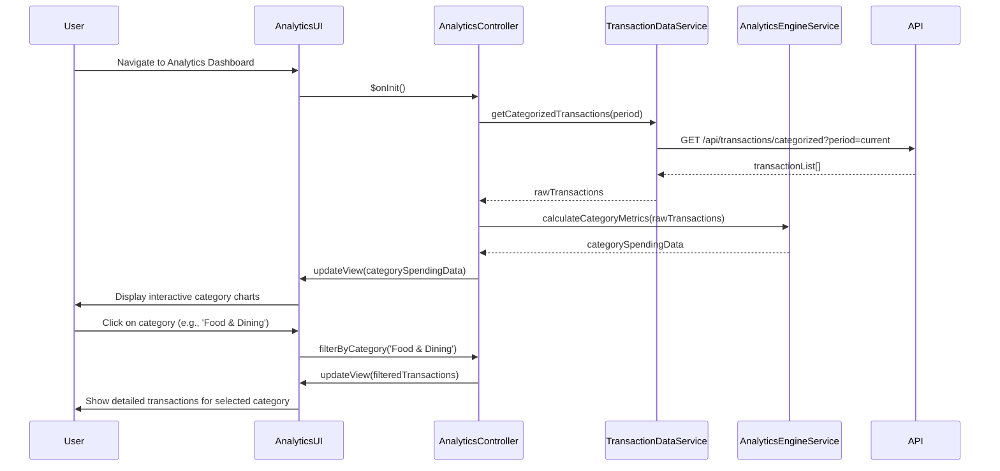

# Low-Level Design: QE-10201 - Spending Analytics and Category Insights

## a. Architecture Mapping

**Component to Artifact Mapping:**
- Analytics Dashboard Component → AngularJS Module (`creditCard.analytics`) + Controller (`AnalyticsController`)
- Transaction Data Service Integration → AngularJS Service (`TransactionDataService`)
- Analytics Engine Integration → AngularJS Service (`AnalyticsEngineService`)
- Chart Rendering → AngularJS Directive (`categoryChart`)
- Category Filter → AngularJS Filter (`categoryFilter`)

**Recommended Folder Structure:**
```
app/
├── modules/
│   └── analytics/
│       ├── analytics.module.js
│       ├── analytics.controller.js
│       ├── analytics.service.js
│       └── analytics.html
├── services/
│   ├── transaction-data.service.js
│   └── analytics-engine.service.js
├── directives/
│   └── category-chart.directive.js
└── filters/
    └── category.filter.js
```

## b. Component Specifications

| Component Name | Artifact Type | Responsibility | Key Dependencies |
|---|---|---|---|
| AnalyticsController | Controller | Manages analytics view state, fetches categorized spending data, handles category selection | TransactionDataService, AnalyticsEngineService |
| TransactionDataService | Service | Retrieves categorized transaction data from REST API for all 9 categories | $http, API_CONFIG |
| AnalyticsEngineService | Service | Aggregates and calculates category-wise spending metrics, percentage distributions | $q for promise handling |
| categoryChart | Directive | Renders interactive pie/bar charts for category-wise spending using Chart.js | Chart.js library, $timeout |
| categoryFilter | Filter | Filters transactions by selected category for detailed drill-down views | None |
| AnalyticsModule | Module | Encapsulates all spending analytics functionality | ngRoute, ui.bootstrap |

## c. Data Model

**CategorySpending (JS Object):**
```javascript
{
  categories: [
    {
      categoryId: String,
      categoryName: String,  // 'Food & Dining', 'Fuel', 'Shopping', 'Travel', 'Entertainment', 'Utilities', 'Healthcare', 'Education', 'Miscellaneous'
      totalAmount: Number,
      transactionCount: Number,
      percentage: Number,
      color: String          // Hex color for chart visualization
    }
  ],
  totalSpending: Number,
  period: String            // e.g., 'Current Month', 'Last 30 Days'
}
```

**Transaction (JS Object):**
```javascript
{
  transactionId: String,
  amount: Number,
  category: String,
  date: String,             // ISO 8601 format
  description: String,
  cardId: String
}
```

## d. Data Flow

User navigates to Analytics Dashboard → AnalyticsController initializes and calls TransactionDataService to fetch categorized transaction data → Service makes REST API call to retrieve transactions for current period → AnalyticsEngineService processes raw data to calculate category-wise totals and percentages → Controller updates $scope with processed analytics data → categoryChart directive renders interactive visualization (pie chart for distribution, bar chart for amounts) within 2 seconds → User clicks on category segment to filter and view detailed transactions using categoryFilter → UI updates instantly via Angular's two-way binding.

## e. Primary Sequence Diagram



## f. Implementation Notes

- Use AngularJS $http service with promise chaining for asynchronous API calls; handle large datasets with pagination or lazy loading.
- Implement ES6 classes for service organization and arrow functions for concise callback handling in data processing.
- Leverage Chart.js with custom Angular directive for responsive, interactive charts; ensure render time < 2 seconds via data pre-processing.
- Use AngularJS $scope.$watch for reactive updates when category selection changes; debounce frequent updates with $timeout.
- Apply Bootstrap grid system for responsive layout across desktop, tablet, and mobile devices.

## g. Error Handling

HTTP interceptor captures API errors and displays user-friendly messages via Bootstrap toast notifications; client-side try/catch blocks handle chart rendering failures gracefully.

## h. Security Notes

Standard input validation and secure API calls assumed; requires token-based auth via existing SSO for transaction data access.