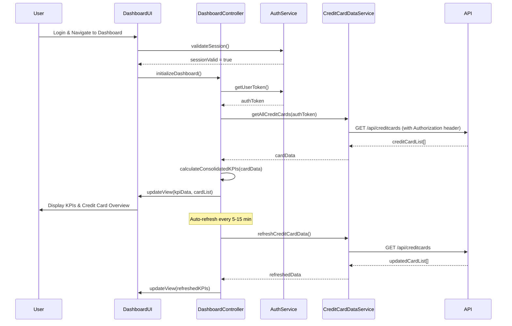

# Low-Level Design: QE-10202 - Dashboard KPIs and Credit Card Overview

## a. Architecture Mapping

**Component to Artifact Mapping:**
- Dashboard UI Component → AngularJS Module (`creditCard.dashboard`) + Controller (`DashboardController`)
- Credit Card Data Service Integration → AngularJS Service (`CreditCardDataService`)
- User Authentication Integration → AngularJS Service (`AuthService`)
- KPI Display → AngularJS Directive (`kpiCard`)
- Multi-Card View → AngularJS Component (`creditCardList`)

**Recommended Folder Structure:**
```
app/
├── modules/
│   └── dashboard/
│       ├── dashboard.module.js
│       ├── dashboard.controller.js
│       ├── dashboard.service.js
│       └── dashboard.html
├── services/
│   ├── credit-card-data.service.js
│   └── auth.service.js
├── directives/
│   └── kpi-card.directive.js
└── components/
    └── credit-card-list/
        ├── credit-card-list.component.js
        └── credit-card-list.html
```

## b. Component Specifications

| Component Name | Artifact Type | Responsibility | Key Dependencies |
|---|---|---|---|
| DashboardController | Controller | Manages dashboard state, fetches KPI data, orchestrates data refresh | CreditCardDataService, AuthService, $interval |
| CreditCardDataService | Service | Retrieves credit card details, balances, limits, and outstanding amounts via REST API | $http, API_CONFIG |
| AuthService | Service | Handles user authentication, token management, session validation | $http, $window, JWT_CONFIG |
| kpiCard | Directive | Renders individual KPI widgets (Monthly Spend, Credit Limit, Available Credit, Outstanding) | None |
| creditCardList | Component | Displays list of multiple credit cards with summary information | CreditCardDataService |
| DashboardModule | Module | Encapsulates all dashboard functionality | ngRoute, ui.bootstrap |

## c. Data Model

**DashboardKPI (JS Object):**
```javascript
{
  monthlySpend: Number,
  totalCreditLimit: Number,
  availableCredit: Number,
  outstandingAmount: Number,
  lastUpdated: String        // ISO 8601 timestamp
}
```

**CreditCard (JS Object):**
```javascript
{
  cardId: String,
  cardNumber: String,        // Masked: 'XXXX-XXXX-XXXX-1234'
  cardType: String,          // 'Visa', 'Mastercard', 'Amex'
  cardName: String,
  creditLimit: Number,
  availableCredit: Number,
  outstandingBalance: Number,
  currentMonthSpend: Number,
  status: String             // 'Active', 'Blocked', 'Expired'
}
```

## d. Data Flow

User logs in and navigates to Dashboard → AuthService validates session and retrieves user token → DashboardController initializes and calls CreditCardDataService to fetch all credit card data → Service makes REST API call with authentication token → API returns array of credit cards with balances and limits → Controller calculates consolidated KPIs (sum of limits, available credit, outstanding amounts, current month spend across all cards) → kpiCard directives render four KPI widgets → creditCardList component displays individual card details → $interval triggers periodic refresh (every 5-15 minutes) to update KPIs with latest data → UI updates seamlessly via Angular's digest cycle.

## e. Primary Sequence Diagram



## f. Implementation Notes

- Use AngularJS dependency injection to inject CreditCardDataService and AuthService into DashboardController for modularity and testability.
- Implement ES6 arrow functions and destructuring for cleaner data transformation when calculating consolidated KPIs from multiple cards.
- Leverage $http interceptors to automatically inject JWT authentication tokens into all API requests and handle 401 unauthorized responses.
- Use $interval service for periodic data refresh (configurable interval); cancel interval on $scope.$destroy to prevent memory leaks.
- Apply Bootstrap responsive grid (col-xs, col-sm, col-md, col-lg) for KPI cards to ensure optimal layout across desktop, tablet, and mobile devices.

## g. Error Handling

HTTP interceptor-based error handling with Bootstrap alert notifications for API failures; automatic retry with exponential backoff for transient network errors.

## h. Security Notes

Requires token-based authentication via existing SSO; JWT tokens stored securely in sessionStorage with automatic expiration handling and refresh token flow.