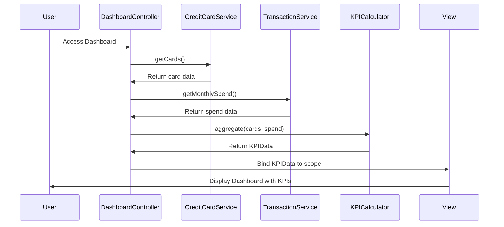

# Low-Level Design: Dashboard and KPI Management
**Epic ID:** QE-10203  
**Tech Stack:** AngularJS 1.x, JavaScript ES6, HTML5, CSS3, Bootstrap, REST APIs, MVC

---

## a. Architecture Mapping

- **Dashboard Module** → AngularJS Module (`app.dashboard`)
- **Dashboard Controller** → AngularJS Controller (`DashboardController`)
- **Credit Card Data Service** → AngularJS Service (`CreditCardService`)
- **Transaction Processing Service** → AngularJS Service (`TransactionService`)
- **KPI Calculation Engine** → AngularJS Factory (`KPICalculator`)
- **Dashboard UI Components** → AngularJS Directives (`kpiCard`, `dashboardSummary`)

**Folder Structure:**
```
/app
  /modules
    /dashboard
      dashboard.module.js
      dashboard.controller.js
      dashboard.html
  /services
    creditcard.service.js
    transaction.service.js
  /factories
    kpi-calculator.factory.js
  /directives
    kpi-card.directive.js
  /styles
    dashboard.css
```

---

## b. Component Specifications

| Component Name | Artifact Type | Responsibility | Key Dependencies |
|----------------|---------------|----------------|------------------|
| DashboardController | Controller | Orchestrates dashboard data loading, KPI calculation, and view updates | CreditCardService, TransactionService, KPICalculator |
| CreditCardService | Service | Fetches card balances, limits, and outstanding amounts via REST API | $http, $q |
| TransactionService | Service | Retrieves monthly spend and recent transactions via REST API | $http, $q |
| KPICalculator | Factory | Aggregates metrics across cards (total limit, available credit, utilization) | None |
| kpiCard | Directive | Renders individual KPI metric with icon, label, and value | None |
| dashboardSummary | Directive | Displays consolidated portfolio health summary | None |

---

## c. Data Model

**CreditCard Model:**
```javascript
{
  cardId: String,
  cardNumber: String,      // masked
  cardType: String,        // Visa, MasterCard, etc.
  creditLimit: Number,
  outstandingAmount: Number,
  availableCredit: Number
}
```

**KPIData Model:**
```javascript
{
  monthlySpend: Number,
  totalCreditLimit: Number,
  totalAvailableCredit: Number,
  totalOutstanding: Number,
  creditUtilization: Number  // percentage
}
```

---

## d. Data Flow

User lands on dashboard → DashboardController initializes and calls CreditCardService.getCards() and TransactionService.getMonthlySpend() → Services make parallel REST API calls → On response, KPICalculator.aggregate() computes total credit limit, available credit, outstanding, and utilization percentage → Controller binds KPIData to $scope → View renders KPI cards using kpiCard directives with Bootstrap grid → Auto-refresh triggered via $interval every 30 seconds to update data in real-time.

---

## e. Primary Sequence Diagram



---

## f. Implementation Notes

- Use AngularJS dependency injection to inject services into DashboardController for testability.
- Leverage $q.all() for parallel API calls to CreditCardService and TransactionService to meet 2-second load time.
- Implement $interval for auto-refresh every 30 seconds; clear interval on $scope.$on('$destroy').
- Use Bootstrap responsive grid (col-xs, col-md) for mobile and desktop layout adaptability.
- Apply AngularJS filters for currency formatting (| currency) in view templates.

---

## g. Error Handling

HTTP interceptor captures API errors; user notified via toast notification using angular-toastr; fallback to cached data if available.

---

## h. Security Notes

Standard input validation and secure API calls assumed; requires token-based auth via existing SSO.