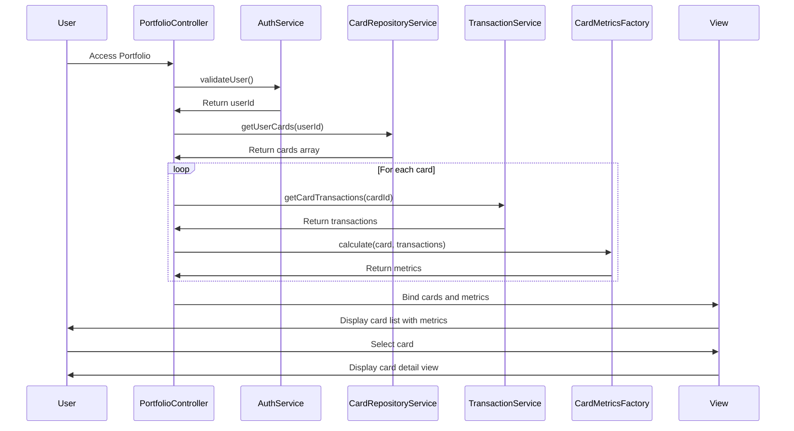

# Low-Level Design: Multi-Card Portfolio Management
**Epic ID:** QE-10204  
**Tech Stack:** AngularJS 1.x, JavaScript ES6, HTML5, CSS3, Bootstrap, REST APIs, MVC

---

## a. Architecture Mapping

- **Portfolio Module** → AngularJS Module (`app.portfolio`)
- **Portfolio Management Controller** → AngularJS Controller (`PortfolioController`)
- **User Authentication Service** → AngularJS Service (`AuthService`)
- **Credit Card Data Repository** → AngularJS Service (`CardRepositoryService`)
- **Transaction Service** → AngularJS Service (`TransactionService`)
- **Card Metrics Calculator** → AngularJS Factory (`CardMetricsFactory`)
- **Card List Component** → AngularJS Directive (`cardList`)
- **Card Detail Component** → AngularJS Directive (`cardDetail`)

**Folder Structure:**
```
/app
  /modules
    /portfolio
      portfolio.module.js
      portfolio.controller.js
      portfolio.html
  /services
    auth.service.js
    card-repository.service.js
    transaction.service.js
  /factories
    card-metrics.factory.js
  /directives
    card-list.directive.js
    card-detail.directive.js
  /styles
    portfolio.css
```

---

## b. Component Specifications

| Component Name | Artifact Type | Responsibility | Key Dependencies |
|----------------|---------------|----------------|------------------|
| PortfolioController | Controller | Manages multi-card view, card selection, and add card workflow | AuthService, CardRepositoryService, TransactionService, CardMetricsFactory |
| AuthService | Service | Validates user authentication and retrieves user identity | $http, $window (for token storage) |
| CardRepositoryService | Service | CRUD operations for credit card data via REST API | $http, $q |
| TransactionService | Service | Fetches card-wise transaction history via REST API | $http, $q |
| CardMetricsFactory | Factory | Computes card-specific metrics (spend, utilization, outstanding) | None |
| cardList | Directive | Displays all user cards in grid/list view with masked numbers | None |
| cardDetail | Directive | Shows detailed view of selected card with metrics and transactions | None |

---

## c. Data Model

**CreditCard Model:**
```javascript
{
  cardId: String,
  userId: String,
  cardNumber: String,         // encrypted in DB, masked in UI (last 4 digits)
  cardHolderName: String,
  cardType: String,           // Visa, MasterCard, Amex
  issuer: String,
  creditLimit: Number,
  outstandingBalance: Number,
  availableCredit: Number,
  expiryDate: String          // MM/YY
}
```

**CardMetrics Model:**
```javascript
{
  cardId: String,
  monthlySpend: Number,
  utilizationRate: Number,    // percentage
  transactionCount: Number,
  lastTransactionDate: Date
}
```

---

## d. Data Flow

User authenticates via AuthService → PortfolioController calls CardRepositoryService.getUserCards(userId) → Service returns array of up to 10 cards with masked card numbers → For each card, TransactionService.getCardTransactions(cardId) fetches transaction history → CardMetricsFactory.calculate() computes spend, utilization, and transaction count per card → Controller binds cards and metrics to $scope → View renders cardList directive showing all cards in Bootstrap grid → User clicks card → cardDetail directive displays selected card's full details, metrics, and transaction list → User can add new card via modal form calling CardRepositoryService.addCard().

---

## e. Primary Sequence Diagram



---

## f. Implementation Notes

- Use AuthService to retrieve JWT token from $window.localStorage and attach to all API requests via $http interceptor.
- Implement card number masking filter in AngularJS: `filter('maskCard', () => (num) => '****' + num.slice(-4))`.
- Use $q.all() to fetch transactions for multiple cards in parallel to meet 3-second retrieval NFR.
- Bootstrap modal component for add card form with client-side validation using AngularJS form validation ($valid, $invalid).
- Store encrypted card data; never expose full card number in API response or UI.

---

## g. Error Handling

HTTP interceptor handles 401/403 errors by redirecting to login; other API errors shown via toast notification with retry option.

---

## h. Security Notes

Requires token-based auth via existing SSO; card numbers encrypted at rest and masked in UI; input validation on card addition form.