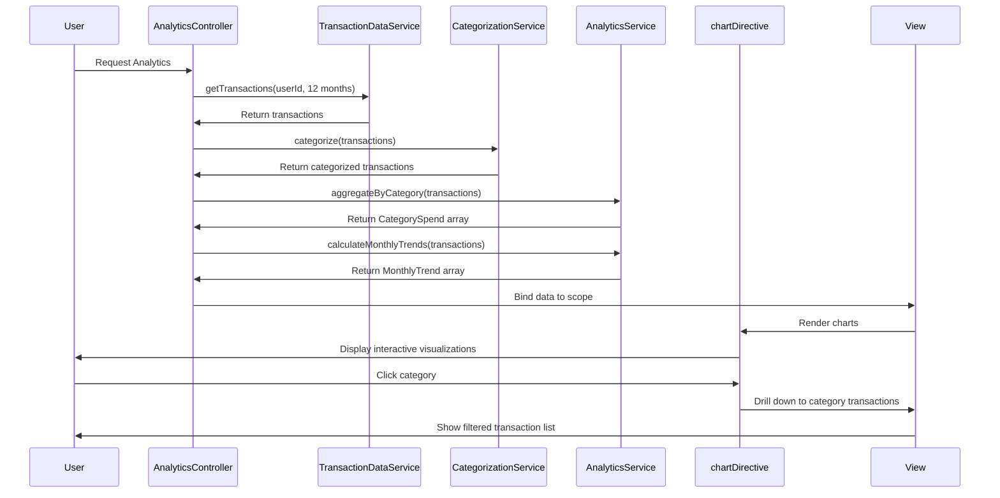

# Low-Level Design: Analytics and Spending Insights
**Epic ID:** QE-10205  
**Tech Stack:** AngularJS 1.x, JavaScript ES6, HTML5, CSS3, Bootstrap, REST APIs, MVC

---

## a. Architecture Mapping

- **Analytics Module** → AngularJS Module (`app.analytics`)
- **Analytics Controller** → AngularJS Controller (`AnalyticsController`)
- **Transaction Categorization Service** → AngularJS Service (`CategorizationService`)
- **Data Analytics Engine** → AngularJS Service (`AnalyticsService`)
- **Visualization Library** → Third-party library (Chart.js) wrapped in AngularJS Directive (`chartDirective`)
- **Transaction Data Store** → AngularJS Service (`TransactionDataService`)

**Folder Structure:**
```
/app
  /modules
    /analytics
      analytics.module.js
      analytics.controller.js
      analytics.html
  /services
    categorization.service.js
    analytics.service.js
    transaction-data.service.js
  /directives
    chart.directive.js
  /styles
    analytics.css
```

---

## b. Component Specifications

| Component Name | Artifact Type | Responsibility | Key Dependencies |
|----------------|---------------|----------------|------------------|
| AnalyticsController | Controller | Orchestrates analytics data retrieval, aggregation, and chart rendering | CategorizationService, AnalyticsService, TransactionDataService |
| CategorizationService | Service | Assigns categories to transactions via REST API or rule-based logic | $http, $q |
| AnalyticsService | Service | Aggregates spending by category, calculates monthly trends via REST API | $http, $q |
| TransactionDataService | Service | Fetches historical transaction data (up to 12 months) via REST API | $http, $q |
| chartDirective | Directive | Wraps Chart.js to render interactive pie/bar/line charts with drill-down | Chart.js library |

---

## c. Data Model

**Transaction Model:**
```javascript
{
  transactionId: String,
  cardId: String,
  amount: Number,
  category: String,          // Food & Dining, Fuel, Shopping, Travel, Entertainment, Utilities, Healthcare, Education, Miscellaneous
  merchantName: String,
  transactionDate: Date,
  description: String
}
```

**CategorySpend Model:**
```javascript
{
  category: String,
  totalSpend: Number,
  transactionCount: Number,
  percentage: Number         // of total spend
}
```

**MonthlyTrend Model:**
```javascript
{
  month: String,             // YYYY-MM
  totalSpend: Number,
  categoryBreakdown: Array   // Array of CategorySpend
}
```

---

## d. Data Flow

User navigates to analytics view → AnalyticsController calls TransactionDataService.getTransactions(userId, last12Months) → Service returns transaction array → CategorizationService.categorize() assigns categories to uncategorized transactions → AnalyticsService.aggregateByCategory() computes total spend per category and AnalyticsService.calculateMonthlyTrends() generates monthly trend data → Controller binds CategorySpend and MonthlyTrend arrays to $scope → chartDirective renders interactive pie chart (category breakdown) and line chart (monthly trends) using Chart.js → User clicks category in pie chart → View drills down to show transaction list for that category.

---

## e. Primary Sequence Diagram



---

## f. Implementation Notes

- Use Chart.js wrapped in AngularJS directive for interactive visualizations; directive watches $scope data changes to re-render charts.
- Implement caching in AnalyticsService using $cacheFactory to store aggregated results and meet 5-second processing NFR.
- Use ES6 Array methods (map, reduce, filter) in AnalyticsService for efficient category aggregation and trend calculation.
- Drill-down implemented via chart onClick event handler passing category to controller method that filters transactions.
- Bootstrap responsive layout ensures charts adapt to mobile and desktop viewports.

---

## g. Error Handling

HTTP interceptor captures API failures; user notified via toast; analytics view shows "No data available" message if service returns empty dataset.

---

## h. Security Notes

Standard input validation and secure API calls assumed; transaction data access restricted to authenticated user's own transactions.