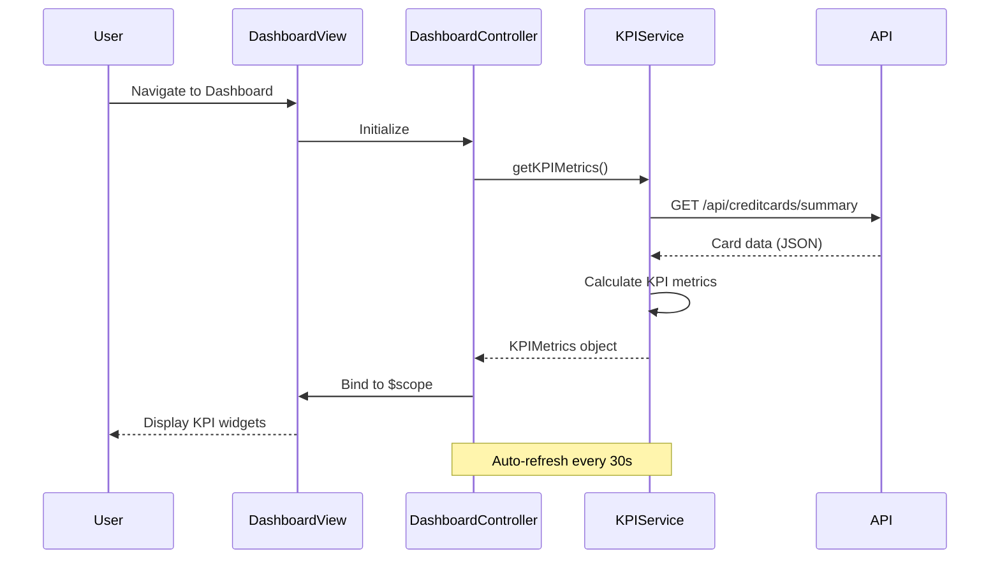

# Low-Level Design: QE-10230 - Dashboard and KPI Management

## a. Architecture Mapping

- **Dashboard Module** → AngularJS Module (`app.dashboard`)
- **Dashboard Controller** → AngularJS Controller (`DashboardController`)
- **KPI Aggregation Service** → AngularJS Service (`KPIService`)
- **Authentication Service** → AngularJS Factory (`AuthFactory`)
- **Dashboard UI Renderer** → AngularJS Directive (`kpiWidget`)

**Recommended Folder Structure:**
```
app/
├── modules/
│   └── dashboard/
│       ├── controllers/
│       │   └── dashboard.controller.js
│       ├── services/
│       │   └── kpi.service.js
│       ├── directives/
│       │   └── kpi-widget.directive.js
│       ├── views/
│       │   └── dashboard.html
│       └── dashboard.module.js
├── shared/
│   └── services/
│       └── auth.factory.js
└── app.js
```

## b. Component Specifications

| Name | Artifact Type | Responsibility | Key Dependencies |
|------|---------------|----------------|------------------|
| DashboardModule | Module | Registers dashboard feature module and its dependencies | angular, ui.router, app.shared |
| DashboardController | Controller | Orchestrates dashboard view, fetches KPI data, handles user interactions | KPIService, AuthFactory, $scope |
| KPIService | Service | Fetches credit card data from REST API, calculates and aggregates KPI metrics | $http, $q, API_CONFIG |
| AuthFactory | Factory | Manages user authentication state and token handling | $http, $window.localStorage |
| kpiWidgetDirective | Directive | Renders individual KPI widgets with responsive layout | None |
| DashboardView | HTML Template | Displays KPI widgets in responsive grid layout using Bootstrap | Bootstrap CSS, kpiWidget directive |

## c. Data Model

**CreditCard Model:**
```javascript
{
  cardId: String,
  cardNumber: String,
  cardType: String,
  creditLimit: Number,
  availableCredit: Number,
  outstandingAmount: Number,
  lastUpdated: Date
}
```

**KPIMetrics Model:**
```javascript
{
  monthlySpend: Number,
  totalCreditLimit: Number,
  totalAvailableCredit: Number,
  totalOutstanding: Number,
  utilizationPercentage: Number,
  lastRefreshed: Date
}
```

## d. Data Flow

User authenticates via AuthFactory → DashboardController initializes and calls KPIService.getKPIMetrics() → KPIService makes REST API call to /api/creditcards/summary with auth token → Backend returns aggregated card data → KPIService calculates monthly spend, total limits, available credit, and outstanding amounts → Computed KPIMetrics object returned to DashboardController → Controller binds data to $scope → kpiWidget directives render individual KPI cards in responsive Bootstrap grid → UI updates display real-time metrics with auto-refresh every 30 seconds.

## e. Primary Sequence Diagram



## f. Implementation Notes

- Use AngularJS dependency injection to inject KPIService and AuthFactory into DashboardController
- Implement ES6 classes for services and controllers with proper constructor injection pattern
- Use $http interceptor to attach authentication token to all API requests automatically
- Leverage Bootstrap responsive grid (col-xs, col-sm, col-md, col-lg) for multi-device layout support
- Implement $interval service for 30-second auto-refresh of KPI data with proper cleanup on $destroy

## g. Error Handling

HTTP interceptor-based error handling with user-friendly toast notifications for API failures and session timeout redirects.

## h. Security Notes

Requires token-based authentication via existing SSO with JWT tokens stored in localStorage and attached to API headers.