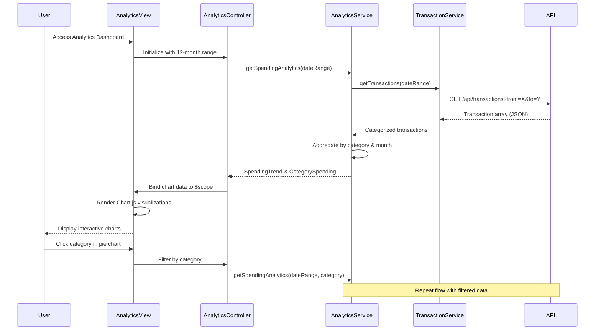

# Low-Level Design: QE-10231 - Spending Analytics and Insights

## a. Architecture Mapping

- **Analytics Module** → AngularJS Module (`app.analytics`)
- **Analytics Controller** → AngularJS Controller (`AnalyticsController`)
- **Data Analytics Engine** → AngularJS Service (`AnalyticsService`)
- **Transaction Data Service** → AngularJS Service (`TransactionService`)
- **Chart Rendering** → AngularJS Directive (`spendingChart`)

**Recommended Folder Structure:**
```
app/
├── modules/
│   └── analytics/
│       ├── controllers/
│       │   └── analytics.controller.js
│       ├── services/
│       │   ├── analytics.service.js
│       │   └── transaction.service.js
│       ├── directives/
│       │   └── spending-chart.directive.js
│       ├── views/
│       │   └── analytics.html
│       └── analytics.module.js
└── app.js
```

## b. Component Specifications

| Name | Artifact Type | Responsibility | Key Dependencies |
|------|---------------|----------------|------------------|
| AnalyticsModule | Module | Registers analytics feature module with chart library integration | angular, ui.router, chart.js |
| AnalyticsController | Controller | Manages analytics view state, fetches transaction data, prepares chart configurations | AnalyticsService, TransactionService, $scope |
| AnalyticsService | Service | Aggregates transaction data by category and time period, calculates spending trends | TransactionService, $q |
| TransactionService | Service | Fetches categorized transaction history from REST API with date range filters | $http, API_CONFIG |
| spendingChartDirective | Directive | Renders interactive charts (pie, bar, line) using Chart.js with touch support | Chart.js library |
| AnalyticsView | HTML Template | Displays category filters, date range selector, and chart containers | Bootstrap CSS, spendingChart directive |

## c. Data Model

**Transaction Model:**
```javascript
{
  transactionId: String,
  cardId: String,
  amount: Number,
  category: String,
  merchantName: String,
  transactionDate: Date,
  description: String
}
```

**CategorySpending Model:**
```javascript
{
  category: String,
  totalAmount: Number,
  transactionCount: Number,
  percentage: Number
}
```

**SpendingTrend Model:**
```javascript
{
  month: String,
  totalSpend: Number,
  categoryBreakdown: Array<CategorySpending>
}
```

## d. Data Flow

User navigates to analytics dashboard → AnalyticsController initializes with default 12-month date range → Controller calls AnalyticsService.getSpendingAnalytics(dateRange) → AnalyticsService requests TransactionService.getTransactions(dateRange) → TransactionService makes REST API call to /api/transactions with filters → Backend returns categorized transaction array → AnalyticsService aggregates data by 9 categories and monthly periods → Computed CategorySpending and SpendingTrend objects returned to Controller → Controller prepares Chart.js configuration objects → spendingChart directives render interactive pie chart (category breakdown) and line chart (monthly trends) → User interacts with charts to drill down into specific categories or time periods triggering filtered data refresh.

## e. Primary Sequence Diagram



## f. Implementation Notes

- Use Chart.js library integrated via angular-chart.js wrapper for two-way data binding support
- Implement ES6 array methods (filter, reduce, map) in AnalyticsService for efficient data aggregation
- Use AngularJS $q promises for chaining asynchronous service calls between TransactionService and AnalyticsService
- Configure Chart.js responsive: true and maintainAspectRatio: false for mobile-friendly charts with touch event handlers
- Cache transaction data in service layer using $cacheFactory to optimize performance and reduce API calls

## g. Error Handling

Try/catch blocks in service aggregation logic with HTTP interceptor for API errors, displaying user-friendly error messages via toast notifications.

## h. Security Notes

Standard input validation for date range parameters and secure API calls with authentication tokens to prevent unauthorized transaction data access.