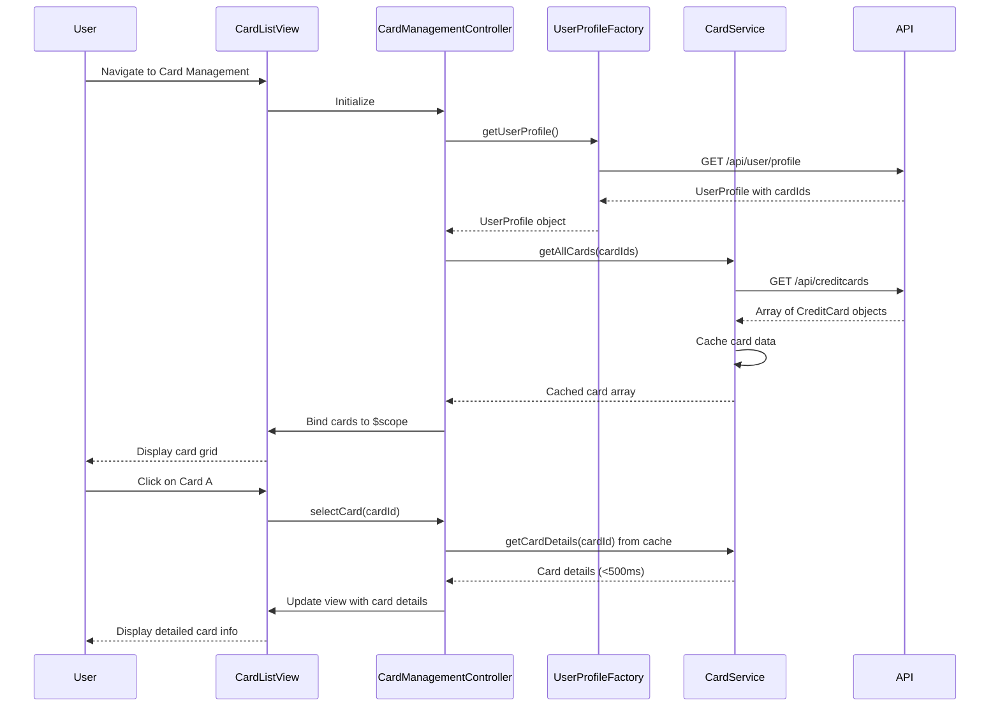

# Low-Level Design: QE-10232 - Multi-Card Management and Monitoring

## a. Architecture Mapping

- **Card Management Module** → AngularJS Module (`app.cardManagement`)
- **Card Management Controller** → AngularJS Controller (`CardManagementController`)
- **Card Data Service** → AngularJS Service (`CardService`)
- **User Profile Service** → AngularJS Factory (`UserProfileFactory`)
- **Card Detail Renderer** → AngularJS Directive (`cardDetail`)

**Recommended Folder Structure:**
```
app/
├── modules/
│   └── card-management/
│       ├── controllers/
│       │   └── card-management.controller.js
│       ├── services/
│       │   └── card.service.js
│       ├── directives/
│       │   └── card-detail.directive.js
│       ├── views/
│       │   ├── card-list.html
│       │   └── card-detail.html
│       └── card-management.module.js
├── shared/
│   └── services/
│       └── user-profile.factory.js
└── app.js
```

## b. Component Specifications

| Name | Artifact Type | Responsibility | Key Dependencies |
|------|---------------|----------------|------------------|
| CardManagementModule | Module | Registers card management feature with routing configuration | angular, ui.router, app.shared |
| CardManagementController | Controller | Manages card list/detail views, handles card selection, fetches card-specific metrics | CardService, UserProfileFactory, $scope, $state |
| CardService | Service | Fetches all user cards and individual card details from REST API with client-side caching | $http, $cacheFactory, API_CONFIG |
| UserProfileFactory | Factory | Retrieves user profile and associated card IDs | $http, $q |
| cardDetailDirective | Directive | Renders individual card information with masked card number and card-specific metrics | CardService |
| CardListView | HTML Template | Displays grid of cards with summary information using Bootstrap cards | Bootstrap CSS, ng-repeat |
| CardDetailView | HTML Template | Shows detailed card information including spend, limit, transactions | cardDetail directive |

## c. Data Model

**CreditCard Model:**
```javascript
{
  cardId: String,
  cardNumber: String,
  maskedCardNumber: String,
  cardType: String,
  issuer: String,
  expiryDate: String,
  creditLimit: Number,
  availableCredit: Number,
  outstandingAmount: Number,
  currentMonthSpend: Number
}
```

**UserProfile Model:**
```javascript
{
  userId: String,
  name: String,
  email: String,
  cardIds: Array<String>
}
```

**CardMetrics Model:**
```javascript
{
  cardId: String,
  monthlySpend: Number,
  utilizationRate: Number,
  recentTransactions: Array<Transaction>
}
```

## d. Data Flow

User logs in and navigates to card management → CardManagementController initializes → Controller calls UserProfileFactory.getUserProfile() to get user and associated cardIds → Controller calls CardService.getAllCards(cardIds) → CardService makes REST API call to /api/creditcards with caching enabled → Backend returns array of CreditCard objects with masked numbers → Cards displayed in grid layout via CardListView → User clicks on a card → Controller updates $state and calls CardService.getCardDetails(cardId) from cache (< 500ms) → cardDetail directive renders detailed card information including spend, limit, and recent transactions → User can switch between cards with instant response from client-side cache.

## e. Primary Sequence Diagram



## f. Implementation Notes

- Use AngularJS $cacheFactory in CardService to cache all card data for <500ms card switching performance
- Implement ES6 template literals for masked card number display (e.g., `**** **** **** ${last4Digits}`)
- Use ui-router state management for card list and detail views with cardId as state parameter
- Leverage Bootstrap card components with responsive grid (col-md-4, col-sm-6, col-xs-12) for card display
- Implement ng-repeat with track by cardId for efficient DOM rendering when switching between 10+ cards

## g. Error Handling

HTTP interceptor handles API errors with fallback to cached data when available, displaying toast notifications for failures.

## h. Security Notes

Card numbers masked on server-side before transmission; secure storage with encryption; token-based authentication via existing SSO for all API calls.