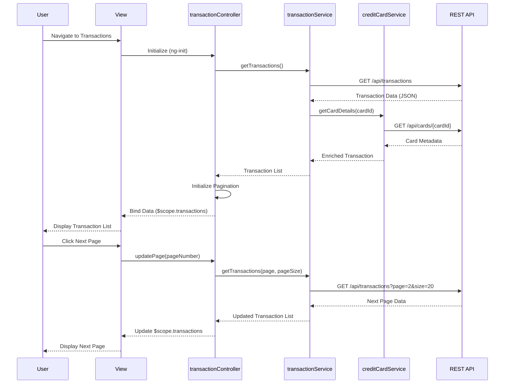

# Low-Level Design: Transaction Management and Viewing
**Epic ID:** QE-10233

---

## a. Architecture Mapping

- **Transaction Viewing UI** → AngularJS View (HTML template with ng-repeat, ng-show/ng-hide directives)
- **Transaction Controller** → AngularJS Controller (`transactionController.js`) managing view state and user interactions
- **Transaction Service** → AngularJS Service/Factory (`transactionService.js`) handling API calls and business logic
- **Credit Card Service** → AngularJS Service (`creditCardService.js`) providing card metadata and linking
- **Pagination Handler** → AngularJS Directive or built-in ng-repeat with limitTo filter + custom pagination component
- **Transaction Repository** → REST API endpoints consumed by services

**Recommended Folder Structure:**
```
app/
├── modules/
│   └── transactions/
│       ├── controllers/
│       │   └── transactionController.js
│       ├── services/
│       │   ├── transactionService.js
│       │   └── creditCardService.js
│       ├── directives/
│       │   └── paginationDirective.js
│       ├── views/
│       │   └── transaction-list.html
│       └── transactionModule.js
├── shared/
│   └── services/
└── assets/
    └── css/
```

---

## b. Component Specifications

| Component Name | Artifact Type | Responsibility | Key Dependencies |
|---|---|---|---|
| transactionModule | AngularJS Module | Register all transaction-related components and configure routing | angular, ui.router |
| transactionController | Controller | Manage transaction list state, pagination, filtering, and user interactions | transactionService, creditCardService, $scope |
| transactionService | Factory | Fetch transaction data from REST API, handle filtering and sorting logic | $http, $q |
| creditCardService | Service | Retrieve credit card metadata and link transactions to cards | $http |
| paginationDirective | Directive | Render pagination controls and manage page state | transactionController |
| transaction-list.html | View Template | Display transaction list with card details, date, merchant, amount | transactionController, Bootstrap CSS |

---

## c. Data Model

**Transaction Object:**
```javascript
{
  transactionId: String,
  cardId: String,
  cardName: String,
  date: Date,
  merchant: String,
  category: String,
  amount: Number,
  currency: String
}
```

**CreditCard Object:**
```javascript
{
  cardId: String,
  cardName: String,
  cardType: String,
  lastFourDigits: String
}
```

**Pagination State:**
```javascript
{
  currentPage: Number,
  pageSize: Number,
  totalRecords: Number,
  totalPages: Number
}
```

---

## d. Data Flow

User navigates to the transaction view, triggering the transactionController to invoke transactionService.getTransactions(). The service makes a GET request to the REST API endpoint (/api/transactions), retrieves the transaction dataset, and links each transaction to its corresponding credit card using creditCardService. The controller receives the data, initializes pagination state (currentPage, pageSize), and binds the first page of transactions to $scope. The view renders the transaction list using ng-repeat with Bootstrap table styling. As the user scrolls or clicks pagination controls, the paginationDirective updates currentPage, and the controller fetches the next batch of transactions (lazy loading) or slices the existing dataset (client-side pagination), updating the UI reactively via two-way data binding.

---

## e. Primary Sequence Diagram



---

## f. Implementation Notes

- Use AngularJS Dependency Injection to inject transactionService and creditCardService into transactionController for testability and modularity.
- Implement transactionService as a Factory using $http for REST API calls; return promises ($q) for asynchronous handling.
- Apply ES6 arrow functions and const/let for service and controller logic where AngularJS 1.x supports ES6 transpilation (Babel).
- Use ng-repeat with track by transactionId for optimized rendering and Bootstrap responsive table classes for mobile compatibility.
- Implement lazy loading by appending new transaction batches to $scope.transactions array on pagination events to reduce initial load time.

---

## g. Error Handling

HTTP interceptor captures API errors (4xx/5xx), logs to console, and displays user-friendly error messages via a shared notification service (toast/alert).

---

## h. Security Notes

Requires token-based authentication via existing SSO; API calls include Authorization header with JWT token for secure transaction data access.