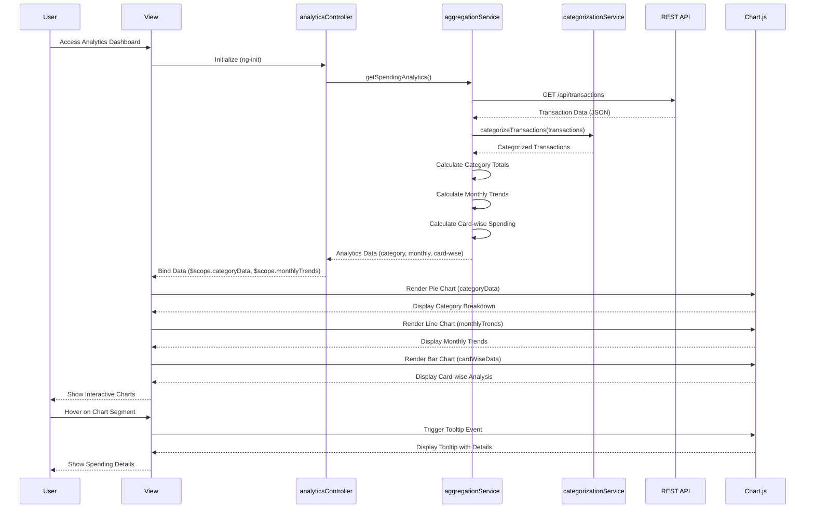

# Low-Level Design: Spending Analytics and Category Insights
**Epic ID:** QE-10234

---

## a. Architecture Mapping

- **Analytics Dashboard UI** → AngularJS View (HTML template with chart directives and ng-repeat for category lists)
- **Analytics Controller** → AngularJS Controller (`analyticsController.js`) managing chart data, filters, and user interactions
- **Transaction Categorization Engine** → AngularJS Service (`categorizationService.js`) applying categorization rules to transactions
- **Data Aggregation Service** → AngularJS Service (`aggregationService.js`) calculating category, monthly, and card-wise totals
- **Charting Library** → AngularJS Directive wrapping Chart.js or D3.js (`chartDirective.js`) for rendering interactive visualizations
- **Transaction Data Repository** → REST API endpoints consumed by services

**Recommended Folder Structure:**
```
app/
├── modules/
│   └── analytics/
│       ├── controllers/
│       │   └── analyticsController.js
│       ├── services/
│       │   ├── categorizationService.js
│       │   └── aggregationService.js
│       ├── directives/
│       │   └── chartDirective.js
│       ├── views/
│       │   └── analytics-dashboard.html
│       └── analyticsModule.js
├── shared/
│   └── services/
└── assets/
    ├── css/
    └── js/
        └── chart.min.js
```

---

## b. Component Specifications

| Component Name | Artifact Type | Responsibility | Key Dependencies |
|---|---|---|---|
| analyticsModule | AngularJS Module | Register analytics components and configure routing | angular, ui.router, chart.js |
| analyticsController | Controller | Manage analytics state, filter selections, and chart data binding | aggregationService, categorizationService, $scope |
| categorizationService | Service | Classify transactions into 9 predefined categories using merchant/keyword rules | $http |
| aggregationService | Factory | Aggregate spending data by category, month, and card; return summary objects | categorizationService, $q |
| chartDirective | Directive | Render interactive charts (pie, bar, line) using Chart.js with responsive config | Chart.js library |
| analytics-dashboard.html | View Template | Display category breakdown, monthly trends, and card-wise analysis with charts | analyticsController, Bootstrap grid |

---

## c. Data Model

**CategorySpending Object:**
```javascript
{
  category: String, // e.g., "Food & Dining"
  totalAmount: Number,
  transactionCount: Number,
  percentage: Number
}
```

**MonthlyTrend Object:**
```javascript
{
  month: String, // e.g., "2026-11"
  totalSpend: Number,
  categoryBreakdown: Array<CategorySpending>
}
```

**CardWiseSpending Object:**
```javascript
{
  cardId: String,
  cardName: String,
  totalSpend: Number,
  categoryBreakdown: Array<CategorySpending>
}
```

**Categories Enum:**
```javascript
const CATEGORIES = [
  "Food & Dining", "Fuel", "Shopping", "Travel", 
  "Entertainment", "Utilities", "Healthcare", "Education", "Miscellaneous"
];
```

---

## d. Data Flow

User accesses the analytics dashboard, triggering analyticsController to call aggregationService.getSpendingAnalytics(). The aggregation service fetches transaction data via REST API (/api/transactions), then invokes categorizationService to classify each transaction into one of 9 predefined categories based on merchant name or transaction metadata. The aggregation service calculates category-wise totals, monthly trends, and card-wise spending summaries, returning structured data objects to the controller. The controller binds this data to $scope (e.g., $scope.categoryData, $scope.monthlyTrends, $scope.cardWiseData). The view renders three chart directives (pie chart for category breakdown, line chart for monthly trends, bar chart for card-wise analysis) using Chart.js. User interactions (hover, click) trigger Chart.js event handlers to display tooltips and drill-down details, with updates propagated via Angular's digest cycle.

---

## e. Primary Sequence Diagram



---

## f. Implementation Notes

- Use AngularJS Factory pattern for aggregationService to encapsulate complex aggregation logic and return promises for async data processing.
- Implement categorizationService with a rule-based mapping (merchant keywords → category) stored in a config object or fetched from API.
- Wrap Chart.js in a custom AngularJS directive (chartDirective) with isolated scope, accepting chart type, data, and options as attributes for reusability.
- Apply ES6 Array methods (map, reduce, filter) in aggregationService for efficient data transformation and category calculations.
- Use $scope.$watch in analyticsController to reactively update charts when user applies filters (date range, card selection) without full page reload.

---

## g. Error Handling

HTTP interceptor-based error handling with fallback to default empty datasets; user notified via toast message if categorization or aggregation fails.

---

## h. Security Notes

Requires token-based auth via existing SSO; API requests include Authorization header with JWT for secure access to transaction and analytics data.