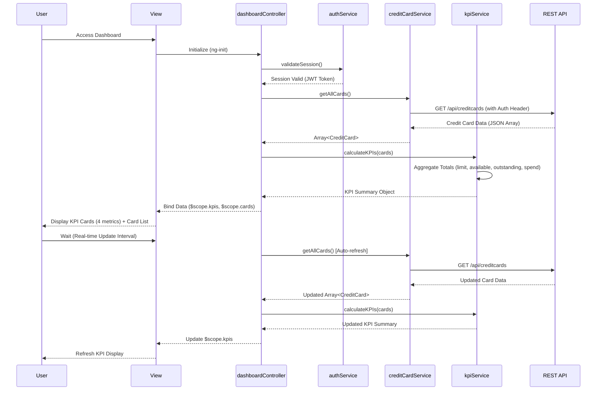

# Low-Level Design: Credit Card Portfolio Management and Dashboard KPIs
**Epic ID:** QE-10235

---

## a. Architecture Mapping

- **User Interface Dashboard** → AngularJS View (HTML template with Bootstrap cards/panels displaying KPIs)
- **Authentication Service** → AngularJS Service (`authService.js`) managing login, token storage, and session validation
- **Dashboard Controller** → AngularJS Controller (`dashboardController.js`) orchestrating data fetching and KPI display logic
- **Credit Card Data Service** → AngularJS Service (`creditCardService.js`) fetching card details and financial metrics via REST API
- **KPI Calculation Engine** → AngularJS Service (`kpiService.js`) aggregating monthly spend, total credit limit, available credit, outstanding amounts
- **Data Repository** → REST API endpoints consumed by services

**Recommended Folder Structure:**
```
app/
├── modules/
│   └── dashboard/
│       ├── controllers/
│       │   └── dashboardController.js
│       ├── services/
│       │   ├── authService.js
│       │   ├── creditCardService.js
│       │   └── kpiService.js
│       ├── views/
│       │   └── dashboard.html
│       └── dashboardModule.js
├── shared/
│   └── services/
└── assets/
    └── css/
```

---

## b. Component Specifications

| Component Name | Artifact Type | Responsibility | Key Dependencies |
|---|---|---|---|
| dashboardModule | AngularJS Module | Register dashboard components and configure routing | angular, ui.router |
| dashboardController | Controller | Fetch credit card data, invoke KPI calculations, bind results to view | creditCardService, kpiService, authService, $scope |
| authService | Service | Authenticate user, store JWT token, validate session before API calls | $http, $window (localStorage) |
| creditCardService | Factory | Retrieve credit card details (card list, limits, balances) from REST API | $http, $q, authService |
| kpiService | Service | Aggregate KPIs (monthly spend, total limit, available credit, outstanding) from card data | None (pure calculation logic) |
| dashboard.html | View Template | Display KPI cards (monthly spend, credit limit, available credit, outstanding) with responsive layout | dashboardController, Bootstrap grid |

---

## c. Data Model

**CreditCard Object:**
```javascript
{
  cardId: String,
  cardName: String,
  cardType: String,
  creditLimit: Number,
  availableCredit: Number,
  outstandingAmount: Number,
  monthlySpend: Number,
  lastUpdated: Date
}
```

**KPI Summary Object:**
```javascript
{
  totalCreditLimit: Number,
  totalAvailableCredit: Number,
  totalOutstanding: Number,
  totalMonthlySpend: Number,
  cardCount: Number
}
```

---

## d. Data Flow

User authenticates via authService, which stores the JWT token in localStorage and redirects to the dashboard. The dashboardController initializes by calling creditCardService.getAllCards(), which makes a GET request to /api/creditcards with the Authorization header. The API returns an array of CreditCard objects. The controller passes this array to kpiService.calculateKPIs(), which aggregates totalCreditLimit (sum of all creditLimit), totalAvailableCredit (sum of availableCredit), totalOutstanding (sum of outstandingAmount), and totalMonthlySpend (sum of monthlySpend). The kpiService returns a KPI Summary Object, which the controller binds to $scope.kpis. The view renders four Bootstrap card components displaying each KPI with responsive styling. Real-time updates are simulated via $interval or WebSocket (if available), triggering periodic re-fetch of card data and KPI recalculation, with Angular's two-way binding automatically updating the UI.

---

## e. Primary Sequence Diagram



---

## f. Implementation Notes

- Use AngularJS Dependency Injection to inject authService into creditCardService to automatically attach JWT token to all API requests via HTTP interceptor.
- Implement kpiService as a stateless service with pure functions (ES6 arrow functions, reduce/map) for KPI aggregation to ensure testability.
- Apply $interval in dashboardController to poll creditCardService.getAllCards() every 30 seconds for near real-time updates, meeting the 2-second load NFR.
- Use Bootstrap 3/4 grid system (col-md-3 for 4 KPI cards) and CSS3 media queries for responsive design across desktop, tablet, and mobile.
- Cache card data in creditCardService using a simple in-memory object to reduce redundant API calls during the session, invalidating cache on user-triggered refresh.

---

## g. Error Handling

HTTP interceptor captures 401/403 errors, redirects to login; other API errors logged and displayed via shared notification service (toast/modal).

---

## h. Security Notes

Requires token-based authentication via existing SSO; all API calls include Authorization header with JWT token; sensitive card data encrypted in transit (HTTPS).