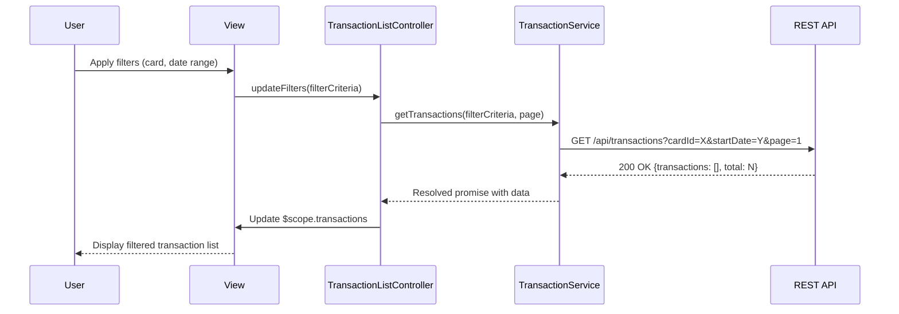

# Low-Level Design: Transaction Management and Viewing
**Epic ID:** QE-10242

## a. Architecture Mapping

- **Transaction List Module** → AngularJS Module (`app.transactions`)
- **Transaction Controller** → AngularJS Controller (`TransactionListController`)
- **Transaction Service** → AngularJS Service (`TransactionService`)
- **Filter Directive** → AngularJS Directive (`transactionFilter`)
- **Pagination Factory** → AngularJS Factory (`PaginationFactory`)

**Folder Structure:**
```
/app
  /modules
    /transactions
      /controllers
      /services
      /directives
      /views
  /shared
    /factories
```

## b. Component Specifications

| Component | Artifact Type | Responsibility | Key Dependencies |
|-----------|---------------|----------------|------------------|
| TransactionListController | Controller | Manages transaction list state, filters, and pagination | TransactionService, PaginationFactory, $scope |
| TransactionService | Service | Fetches transaction data from REST API with filters | $http, $q, API_CONFIG |
| transactionFilter | Directive | Renders filter UI for card, date range, and type | TransactionService, $filter |
| PaginationFactory | Factory | Handles pagination logic and page state | None |
| TransactionDetailController | Controller | Displays individual transaction details | TransactionService, $routeParams |

## c. Data Model

**Transaction Object:**
```javascript
{
  id: String,
  cardId: String,
  cardName: String,
  amount: Number,
  currency: String,
  merchantName: String,
  category: String,
  transactionDate: Date,
  transactionType: String,
  description: String,
  status: String
}
```

**Filter Criteria Object:**
```javascript
{
  cardId: String,
  startDate: Date,
  endDate: Date,
  transactionType: String,
  page: Number,
  pageSize: Number
}
```

## d. Data Flow

User selects filters (card, date range) in the transaction view → transactionFilter directive captures input and updates filter model → TransactionListController invokes TransactionService.getTransactions() with filter criteria → Service makes GET request to `/api/transactions` with query params → API returns paginated transaction list (500ms SLA) → Controller updates $scope.transactions → View renders transaction list with pagination controls → User clicks pagination or updates filters triggering new API call without page reload.

## e. Primary Sequence Diagram



## f. Implementation Notes

- Use AngularJS dependency injection for all services and controllers with explicit annotation to avoid minification issues
- Implement REST API calls using $http service with promise-based error handling
- Apply Bootstrap grid system for responsive transaction table layout (col-xs, col-sm, col-md)
- Use ng-repeat with track by id for efficient DOM rendering of large transaction lists
- Implement debounce on filter inputs to reduce API calls during user typing

## g. Error Handling

HTTP interceptor captures API errors and displays user-friendly notifications via a shared NotificationService; try/catch blocks in service methods for client-side validation errors.

## h. Security Notes

Requires token-based auth via existing SSO; all API calls include Authorization header with JWT token.