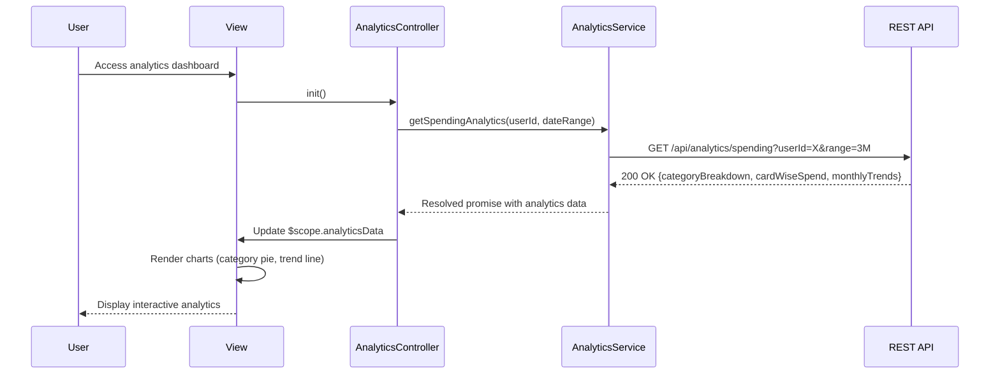

# Low-Level Design: Spending Analytics and Insights
**Epic ID:** QE-10243

## a. Architecture Mapping

- **Analytics Module** → AngularJS Module (`app.analytics`)
- **Analytics Controller** → AngularJS Controller (`AnalyticsController`)
- **Analytics Service** → AngularJS Service (`AnalyticsService`)
- **Chart Directive** → AngularJS Directive (`spendingChart`)
- **Category Filter Factory** → AngularJS Factory (`CategoryFilterFactory`)

**Folder Structure:**
```
/app
  /modules
    /analytics
      /controllers
      /services
      /directives
      /views
  /shared
    /factories
    /charts
```

## b. Component Specifications

| Component | Artifact Type | Responsibility | Key Dependencies |
|-----------|---------------|----------------|------------------|
| AnalyticsController | Controller | Manages analytics state, filters, and chart data | AnalyticsService, CategoryFilterFactory, $scope |
| AnalyticsService | Service | Fetches spending analytics data from REST API | $http, $q, API_CONFIG |
| spendingChart | Directive | Renders interactive charts using Chart.js or D3.js | AnalyticsService, $timeout |
| CategoryFilterFactory | Factory | Provides category list and filtering logic | None |
| TrendAnalysisController | Controller | Handles monthly trend visualization | AnalyticsService, $filter |

## c. Data Model

**Spending Analytics Object:**
```javascript
{
  userId: String,
  period: String,
  categoryBreakdown: [
    { category: String, amount: Number, percentage: Number }
  ],
  cardWiseSpend: [
    { cardId: String, cardName: String, totalSpend: Number }
  ],
  monthlyTrends: [
    { month: String, totalSpend: Number, categoryData: Array }
  ]
}
```

**Category Enum:**
```javascript
['Food & Dining', 'Fuel', 'Shopping', 'Travel', 'Entertainment', 'Utilities', 'Healthcare', 'Education', 'Miscellaneous']
```

## d. Data Flow

User navigates to analytics view → AnalyticsController requests spending data from AnalyticsService → Service calls GET `/api/analytics/spending` with userId and date range → API processes transactions, categorizes spending, and aggregates data → Service receives analytics payload → Controller updates $scope with category breakdown, card-wise spend, and monthly trends → spendingChart directive renders interactive charts (pie for categories, line for trends) → User interacts with filters (card, date range) triggering chart updates without page reload via $scope.$watch.

## e. Primary Sequence Diagram



## f. Implementation Notes

- Use Chart.js or D3.js wrapped in AngularJS directive for responsive, interactive charts with data binding
- Implement $scope.$watch on filter criteria to trigger chart re-rendering without API calls if data is cached
- Apply Bootstrap responsive utilities for chart containers (col-md-6 for side-by-side charts on desktop)
- Use AngularJS $filter service for client-side date range filtering when data is already loaded
- Leverage AngularJS promises ($q) for chaining multiple API calls if card and transaction data are separate endpoints

## g. Error Handling

HTTP interceptor-based error handling with fallback to cached data if available; user notification via toast messages for API failures.

## h. Security Notes

Standard input validation and secure API calls assumed; token-based authentication required for all analytics endpoints.