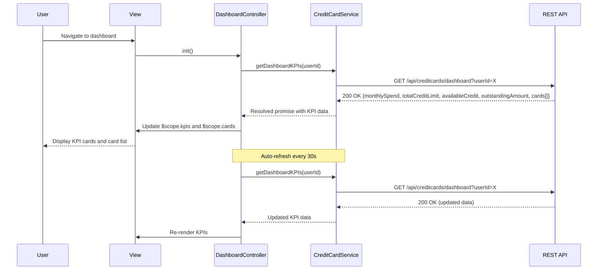

# Low-Level Design: Dashboard KPIs and Credit Card Overview
**Epic ID:** QE-10244

## a. Architecture Mapping

- **Dashboard Module** → AngularJS Module (`app.dashboard`)
- **Dashboard Controller** → AngularJS Controller (`DashboardController`)
- **Credit Card Service** → AngularJS Service (`CreditCardService`)
- **KPI Card Directive** → AngularJS Directive (`kpiCard`)
- **Refresh Factory** → AngularJS Factory (`DataRefreshFactory`)

**Folder Structure:**
```
/app
  /modules
    /dashboard
      /controllers
      /services
      /directives
      /views
  /shared
    /factories
```

## b. Component Specifications

| Component | Artifact Type | Responsibility | Key Dependencies |
|-----------|---------------|----------------|------------------|
| DashboardController | Controller | Manages dashboard state and KPI data | CreditCardService, DataRefreshFactory, $scope, $interval |
| CreditCardService | Service | Fetches credit card portfolio data from REST API | $http, $q, API_CONFIG |
| kpiCard | Directive | Renders individual KPI card with value and label | None |
| DataRefreshFactory | Factory | Handles periodic data refresh logic | $interval |
| CardListController | Controller | Displays list of all credit cards with details | CreditCardService, $filter |

## c. Data Model

**Dashboard KPI Object:**
```javascript
{
  userId: String,
  monthlySpend: Number,
  totalCreditLimit: Number,
  availableCredit: Number,
  outstandingAmount: Number,
  cards: [
    {
      cardId: String,
      cardName: String,
      cardNumber: String,
      creditLimit: Number,
      availableCredit: Number,
      outstandingBalance: Number,
      monthlySpend: Number
    }
  ]
}
```

## d. Data Flow

User logs in and navigates to dashboard → DashboardController invokes CreditCardService.getDashboardKPIs() → Service makes GET request to `/api/creditcards/dashboard` → API retrieves card data, calculates aggregated KPIs (sum of limits, available credit, outstanding amounts, monthly spend) → Service returns KPI object → Controller updates $scope.kpis and $scope.cards → View renders KPI cards using kpiCard directive and card list → DataRefreshFactory triggers periodic refresh every 30 seconds via $interval → Updated data re-renders KPIs without user action.

## e. Primary Sequence Diagram



## f. Implementation Notes

- Use AngularJS $interval service for periodic data refresh with cleanup on $scope.$on('$destroy')
- Implement responsive KPI cards using Bootstrap grid (col-xs-12 col-sm-6 col-md-3 for 4 KPIs in a row on desktop)
- Apply AngularJS filters (currency, number) for formatting KPI values in the view
- Use ng-cloak directive to prevent flash of unstyled content during initial load
- Leverage AngularJS $http caching for repeated API calls within short time windows to reduce server load

## g. Error Handling

Interceptor-based error handling with retry logic for failed API calls; user notification via alert banner for persistent failures.

## h. Security Notes

Requires token-based auth via existing SSO; all dashboard API calls include Authorization header with JWT token.