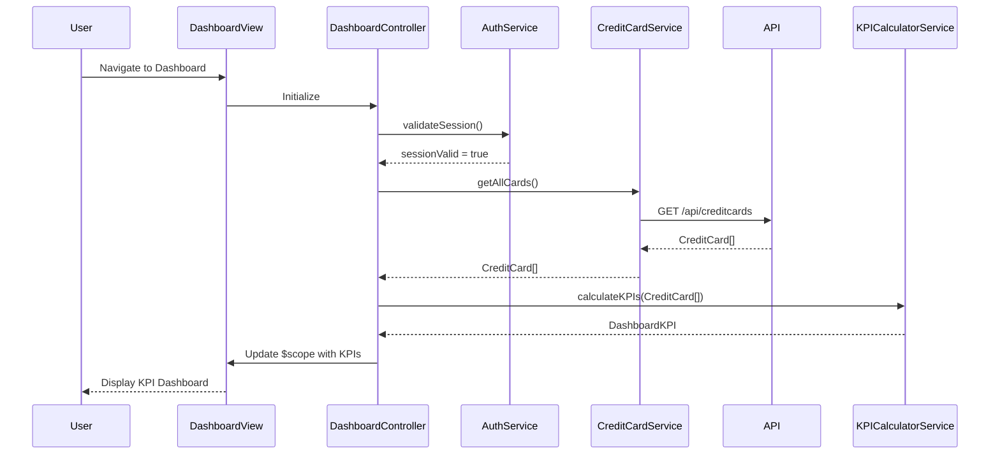

# Low-Level Design: QE-10257 - Dashboard KPIs and Credit Card Overview

## a. Architecture Mapping

- **Dashboard Module** (`app.dashboard`) → AngularJS Module hosting all dashboard components
- **DashboardController** → Controller managing dashboard state and KPI display logic
- **CreditCardService** → Service for fetching aggregated credit card data via REST API
- **KPICalculatorService** → Factory for computing KPIs (monthly spend, credit limit, available credit, outstanding)
- **AuthService** → Service handling user authentication and session management
- **dashboardKpiDirective** → Directive rendering individual KPI cards with responsive layout

**Recommended Folder Structure:**
```
app/
├── modules/
│   └── dashboard/
│       ├── dashboard.module.js
│       ├── dashboard.controller.js
│       ├── dashboard.html
│       └── directives/
│           └── dashboard-kpi.directive.js
├── services/
│   ├── credit-card.service.js
│   ├── kpi-calculator.service.js
│   └── auth.service.js
└── assets/
    └── styles/
        └── dashboard.css
```

## b. Component Specifications

| Component Name | Artifact Type | Responsibility | Key Dependencies |
|---|---|---|---|
| app.dashboard | Module | Root module for dashboard feature | angular, ngRoute |
| DashboardController | Controller | Orchestrates dashboard view, loads KPI data, handles user interactions | CreditCardService, KPICalculatorService, $scope |
| CreditCardService | Service | Fetches credit card account data from REST API endpoint `/api/creditcards` | $http, AuthService |
| KPICalculatorService | Factory | Computes monthly spend, total credit limit, available credit, outstanding amounts from raw data | None |
| AuthService | Service | Manages user authentication state and token injection | $http, $window |
| dashboardKpiDirective | Directive | Renders individual KPI card with label, value, and icon in responsive Bootstrap layout | None |

## c. Data Model

**CreditCard Object:**
```javascript
{
  cardId: String,
  cardNumber: String,
  cardHolderName: String,
  creditLimit: Number,
  availableCredit: Number,
  outstandingAmount: Number,
  monthlySpend: Number,
  lastUpdated: Date
}
```

**DashboardKPI Object:**
```javascript
{
  totalCreditLimit: Number,
  totalAvailableCredit: Number,
  totalOutstanding: Number,
  totalMonthlySpend: Number,
  cardCount: Number
}
```

## d. Data Flow

User navigates to dashboard → DashboardController initializes and calls AuthService to validate session → On successful auth, controller invokes CreditCardService.getAllCards() → Service makes GET request to `/api/creditcards` with auth token → API returns array of CreditCard objects → KPICalculatorService aggregates data to compute DashboardKPI metrics → Controller updates $scope with computed KPIs → View renders KPI cards via dashboardKpiDirective with Bootstrap responsive grid → UI displays within 2-second performance target using cached data and optimized rendering.

## e. Primary Sequence Diagram



## f. Implementation Notes

- Use AngularJS Dependency Injection to inject services into DashboardController and ensure testability
- Implement ES6 classes for services (CreditCardService, KPICalculatorService) with arrow functions for cleaner syntax
- Use $http interceptor to automatically inject auth tokens into all API requests
- Leverage Bootstrap grid system (col-md-3, col-sm-6, col-xs-12) for responsive KPI card layout
- Cache API responses using $cacheFactory with 15-minute TTL to meet 2-second load requirement

## g. Error Handling

$http interceptor captures API errors and displays user-friendly notifications via toastr; controller wraps service calls in try/catch blocks.

## h. Security Notes

Requires token-based auth via existing SSO; AuthService manages token lifecycle and injection into API headers.