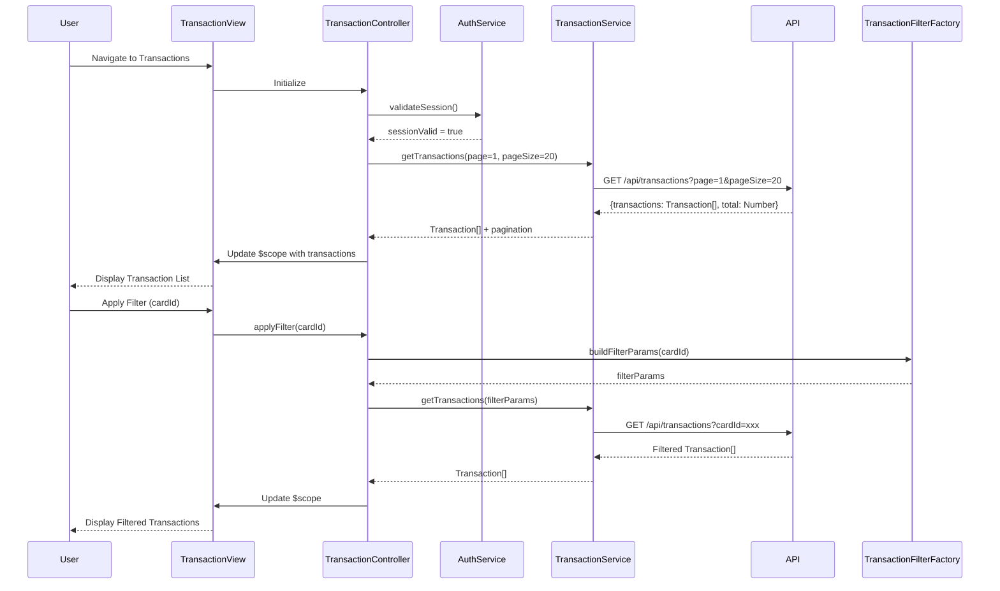

# Low-Level Design: QE-10258 - Transaction Management and Monitoring

## a. Architecture Mapping

- **Transaction Module** (`app.transactions`) → AngularJS Module hosting transaction management components
- **TransactionController** → Controller managing transaction list state, filtering, and detail view
- **TransactionService** → Service for fetching transaction data via REST API with pagination support
- **TransactionFilterFactory** → Factory providing filter logic for card, date range, and amount filtering
- **AuthService** → Service handling user authentication and session management
- **transactionListDirective** → Directive rendering paginated transaction list with responsive table layout
- **transactionDetailDirective** → Directive displaying detailed transaction information in modal/panel

**Recommended Folder Structure:**
```
app/
├── modules/
│   └── transactions/
│       ├── transactions.module.js
│       ├── transactions.controller.js
│       ├── transactions.html
│       └── directives/
│           ├── transaction-list.directive.js
│           └── transaction-detail.directive.js
├── services/
│   ├── transaction.service.js
│   ├── transaction-filter.factory.js
│   └── auth.service.js
└── assets/
    └── styles/
        └── transactions.css
```

## b. Component Specifications

| Component Name | Artifact Type | Responsibility | Key Dependencies |
|---|---|---|---|
| app.transactions | Module | Root module for transaction management feature | angular, ngRoute |
| TransactionController | Controller | Manages transaction list state, applies filters, handles pagination and detail view navigation | TransactionService, TransactionFilterFactory, $scope |
| TransactionService | Service | Fetches transaction data from REST API `/api/transactions` with pagination and card filter parameters | $http, AuthService |
| TransactionFilterFactory | Factory | Provides filter functions for card, date range, and amount; supports client-side filtering for performance | None |
| AuthService | Service | Manages user authentication state and token injection | $http, $window |
| transactionListDirective | Directive | Renders paginated transaction table with Bootstrap responsive design and sorting capabilities | None |
| transactionDetailDirective | Directive | Displays detailed transaction info (merchant, category, timestamp, amount, card) in expandable panel | None |

## c. Data Model

**Transaction Object:**
```javascript
{
  transactionId: String,
  cardId: String,
  cardNumber: String,
  timestamp: Date,
  amount: Number,
  merchantName: String,
  merchantCategory: String,
  transactionType: String,
  status: String
}
```

**TransactionFilter Object:**
```javascript
{
  cardId: String,
  startDate: Date,
  endDate: Date,
  minAmount: Number,
  maxAmount: Number
}
```

**PaginationConfig Object:**
```javascript
{
  currentPage: Number,
  pageSize: Number,
  totalRecords: Number
}
```

## d. Data Flow

User navigates to transaction view → TransactionController initializes and calls AuthService to validate session → On successful auth, controller invokes TransactionService.getTransactions() with initial pagination params (page=1, pageSize=20) → Service makes GET request to `/api/transactions?page=1&pageSize=20` with auth token → API returns paginated Transaction[] with total count → Controller updates $scope with transactions and pagination metadata → transactionListDirective renders table with accurate timestamps and amounts → User applies filter (e.g., select specific card) → TransactionFilterFactory processes filter criteria → Controller calls TransactionService with updated filter params → Updated transaction list rendered → User clicks transaction row → transactionDetailDirective displays detailed view with merchant details, category, and card info.

## e. Primary Sequence Diagram



## f. Implementation Notes

- Use AngularJS Dependency Injection to inject services into TransactionController for testability
- Implement ES6 classes for TransactionService with promise-based $http calls and arrow functions
- Use $http interceptor to automatically inject auth tokens and handle 401 unauthorized responses
- Implement infinite scroll or pagination using Bootstrap pagination component for high-volume transaction handling
- Use Angular filters for client-side date formatting and currency display to ensure accurate timestamp/amount rendering

## g. Error Handling

$http interceptor captures API errors (network failures, 500 errors) and displays user-friendly error messages via toastr notification service.

## h. Security Notes

Requires token-based auth via existing SSO; all transaction API calls include authorization header with JWT token validated server-side.