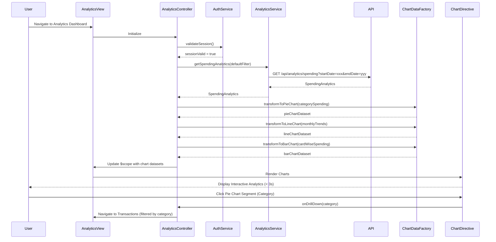

# Low-Level Design: QE-10259 - Spending Analytics and Insights

## a. Architecture Mapping

- **Analytics Module** (`app.analytics`) → AngularJS Module hosting spending analytics components
- **AnalyticsController** → Controller managing analytics dashboard state, filter interactions, and chart data
- **AnalyticsService** → Service for fetching categorized spending data via REST API
- **CategoryService** → Service providing category definitions and mapping logic for nine spending categories
- **ChartDataFactory** → Factory transforming raw analytics data into chart-ready formats (pie, line, bar)
- **AuthService** → Service handling user authentication and session management
- **spendingChartDirective** → Directive rendering interactive charts using Chart.js or D3.js with responsive design
- **categoryFilterDirective** → Directive providing interactive filter controls for date range, card, and category selection

**Recommended Folder Structure:**
```
app/
├── modules/
│   └── analytics/
│       ├── analytics.module.js
│       ├── analytics.controller.js
│       ├── analytics.html
│       └── directives/
│           ├── spending-chart.directive.js
│           └── category-filter.directive.js
├── services/
│   ├── analytics.service.js
│   ├── category.service.js
│   ├── chart-data.factory.js
│   └── auth.service.js
└── assets/
    └── styles/
        └── analytics.css
```

## b. Component Specifications

| Component Name | Artifact Type | Responsibility | Key Dependencies |
|---|---|---|---|
| app.analytics | Module | Root module for spending analytics feature | angular, ngRoute, chart.js |
| AnalyticsController | Controller | Manages analytics dashboard state, handles filter changes, coordinates chart updates | AnalyticsService, ChartDataFactory, $scope |
| AnalyticsService | Service | Fetches categorized spending data from REST API `/api/analytics/spending` with date/card filters | $http, AuthService |
| CategoryService | Service | Provides nine category definitions (Food & Dining, Fuel, Shopping, Travel, Entertainment, Utilities, Healthcare, Education, Miscellaneous) and mapping rules | None |
| ChartDataFactory | Factory | Transforms raw spending data into chart-ready datasets for pie (category distribution), line (monthly trends), bar (card-wise comparison) | CategoryService |
| AuthService | Service | Manages user authentication state and token injection | $http, $window |
| spendingChartDirective | Directive | Renders interactive Chart.js visualizations with drill-down capability and responsive canvas sizing | chart.js |
| categoryFilterDirective | Directive | Provides Bootstrap-based filter UI for date range picker, card selector, and category multi-select | None |

## c. Data Model

**SpendingAnalytics Object:**
```javascript
{
  categorySpending: Array<{category: String, amount: Number, transactionCount: Number}>,
  monthlyTrends: Array<{month: String, amount: Number}>,
  cardWiseSpending: Array<{cardId: String, cardNumber: String, amount: Number}>,
  dateRange: {startDate: Date, endDate: Date}
}
```

**Category Object:**
```javascript
{
  categoryId: String,
  categoryName: String,
  icon: String,
  color: String
}
```

**AnalyticsFilter Object:**
```javascript
{
  cardId: String,
  startDate: Date,
  endDate: Date,
  categories: Array<String>
}
```

**ChartDataset Object:**
```javascript
{
  labels: Array<String>,
  datasets: Array<{label: String, data: Array<Number>, backgroundColor: Array<String>}>,
  options: Object
}
```

## d. Data Flow

User navigates to analytics dashboard → AnalyticsController initializes and calls AuthService to validate session → On successful auth, controller invokes AnalyticsService.getSpendingAnalytics() with default filter (last 12 months, all cards, all categories) → Service makes GET request to `/api/analytics/spending?startDate=xxx&endDate=yyy` with auth token → API returns SpendingAnalytics object with categorized data → ChartDataFactory transforms data into three chart datasets (pie for category distribution, line for monthly trends, bar for card-wise comparison) → Controller updates $scope with chart data → spendingChartDirective renders three interactive Chart.js visualizations within 3-second target → User applies filter via categoryFilterDirective (e.g., select specific date range or card) → Controller calls AnalyticsService with updated filter → New data fetched and charts re-rendered → User clicks on pie chart segment to drill down → Controller navigates to transaction view filtered by selected category.

## e. Primary Sequence Diagram



## f. Implementation Notes

- Use AngularJS Dependency Injection to inject services and factories into AnalyticsController
- Implement ES6 classes for services with promise-based $http calls and async/await pattern where supported
- Use Chart.js library via spendingChartDirective for responsive, interactive visualizations with click event handlers for drill-down
- Leverage Bootstrap date range picker component in categoryFilterDirective for intuitive date selection
- Cache analytics data using $cacheFactory with 5-minute TTL to optimize 3-second rendering target and reduce API calls

## g. Error Handling

$http interceptor captures API errors and displays user-friendly notifications; controller handles empty data scenarios with "No data available" message in chart area.

## h. Security Notes

Requires token-based auth via existing SSO; all analytics API endpoints validate JWT token and enforce user-level data access control.