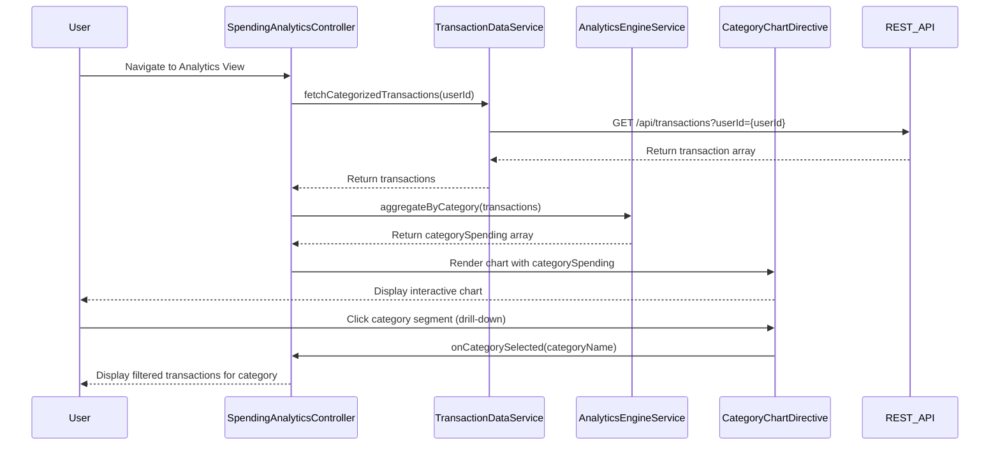

# Low-Level Design: QE-10272 - Spending Analytics and Visualization

## a. Architecture Mapping

- **Module**: `spendingAnalyticsModule` - Main AngularJS module for analytics feature
- **Controller**: `SpendingAnalyticsController` - Manages UI state, user interactions, and visualization rendering
- **Service**: `TransactionDataService` - Fetches categorized transaction data via REST API
- **Service**: `AnalyticsEngineService` - Aggregates and processes spending data by category
- **Directive**: `categoryChartDirective` - Renders interactive charts with drill-down capability
- **Factory**: `CategoryFactory` - Manages category definitions and mappings

**Folder Structure:**
```
/app
  /modules
    /spending-analytics
      /controllers
        spending-analytics.controller.js
      /services
        transaction-data.service.js
        analytics-engine.service.js
      /directives
        category-chart.directive.js
      /factories
        category.factory.js
      /views
        spending-analytics.html
      /styles
        spending-analytics.css
```

## b. Component Specifications

| Name | Artifact Type | Responsibility | Key Dependencies |
|------|---------------|----------------|------------------|
| spendingAnalyticsModule | Module | Defines the analytics feature module and its dependencies | ngRoute, chart.js |
| SpendingAnalyticsController | Controller | Manages view state, handles user interactions, coordinates data fetching and chart rendering | TransactionDataService, AnalyticsEngineService, CategoryFactory |
| TransactionDataService | Service | Fetches categorized transaction history from REST API | $http, $q |
| AnalyticsEngineService | Service | Aggregates transactions by category, calculates totals and percentages | CategoryFactory |
| categoryChartDirective | Directive | Renders interactive pie/bar charts with drill-down support using Chart.js | Chart.js library |
| CategoryFactory | Factory | Provides category definitions (Food & Dining, Fuel, Shopping, Travel, Entertainment, Utilities, Healthcare, Education, Miscellaneous) | None |

## c. Data Model

**Transaction Object:**
```javascript
{
  id: String,
  userId: String,
  cardId: String,
  amount: Number,
  category: String, // One of 9 predefined categories
  description: String,
  transactionDate: Date,
  merchantName: String
}
```

**CategorySpending Object:**
```javascript
{
  categoryName: String,
  totalAmount: Number,
  transactionCount: Number,
  percentage: Number,
  transactions: Array<Transaction>
}
```

**AnalyticsViewModel:**
```javascript
{
  categories: Array<CategorySpending>,
  totalSpending: Number,
  chartData: Object, // Chart.js compatible format
  selectedCategory: String
}
```

## d. Data Flow

User navigates to spending analytics view → SpendingAnalyticsController initializes and calls TransactionDataService to fetch categorized transactions via REST API → TransactionDataService returns transaction array → AnalyticsEngineService aggregates transactions by category (Food & Dining, Fuel, Shopping, etc.) and calculates totals and percentages → Controller updates AnalyticsViewModel with processed data → categoryChartDirective renders interactive chart → User clicks on category segment to drill down → Controller filters transactions for selected category and updates view with detailed transaction list.

## e. Primary Sequence Diagram



## f. Implementation Notes

- Use AngularJS 1.x dependency injection to inject services into controller and directive
- Leverage ES6 classes for service and controller definitions with proper constructor-based DI
- Integrate Chart.js library via categoryChartDirective for rendering pie/bar charts with click event handlers for drill-down
- Use $http service with promise-based API calls; cache transaction data in controller scope to avoid redundant API calls
- Apply Bootstrap grid system for responsive layout; use ng-repeat for transaction list rendering

## g. Error Handling

HTTP interceptor captures API errors; user-friendly error messages displayed via Bootstrap alerts; try/catch blocks in AnalyticsEngineService for data processing errors.

## h. Security Notes

Requires token-based authentication via existing SSO; userId validated server-side; standard input validation and secure API calls assumed.