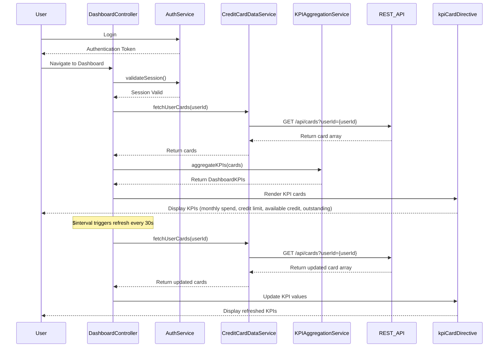

# Low-Level Design: QE-10273 - Dashboard KPIs and Credit Card Overview

## a. Architecture Mapping

- **Module**: `dashboardModule` - Main AngularJS module for dashboard feature
- **Controller**: `DashboardController` - Manages KPI display, data refresh, and multi-card overview
- **Service**: `CreditCardDataService` - Fetches card details, balances, limits, and outstanding amounts via REST API
- **Service**: `KPIAggregationService` - Calculates aggregated KPIs across all user cards
- **Service**: `AuthService` - Handles user authentication and session management
- **Directive**: `kpiCardDirective` - Renders individual KPI cards (monthly spend, credit limit, available credit, outstanding)
- **Factory**: `CardFactory` - Manages credit card data models

**Folder Structure:**
```
/app
  /modules
    /dashboard
      /controllers
        dashboard.controller.js
      /services
        credit-card-data.service.js
        kpi-aggregation.service.js
        auth.service.js
      /directives
        kpi-card.directive.js
      /factories
        card.factory.js
      /views
        dashboard.html
      /styles
        dashboard.css
```

## b. Component Specifications

| Name | Artifact Type | Responsibility | Key Dependencies |
|------|---------------|----------------|------------------|
| dashboardModule | Module | Defines the dashboard feature module and routing | ngRoute, ngAnimate |
| DashboardController | Controller | Manages dashboard state, coordinates KPI data fetching, handles real-time refresh | CreditCardDataService, KPIAggregationService, AuthService, $interval |
| CreditCardDataService | Service | Fetches credit card details, balances, limits, and outstanding amounts from REST API | $http, $q, AuthService |
| KPIAggregationService | Service | Aggregates KPIs (monthly spend, total credit limit, available credit, outstanding) across multiple cards | CardFactory |
| AuthService | Service | Validates user authentication, manages session tokens | $http, $window |
| kpiCardDirective | Directive | Renders individual KPI card with icon, label, value, and trend indicator | None |
| CardFactory | Factory | Provides credit card data model and utility methods | None |

## c. Data Model

**CreditCard Object:**
```javascript
{
  cardId: String,
  userId: String,
  cardNumber: String, // Masked
  cardType: String, // Visa, MasterCard, etc.
  creditLimit: Number,
  availableCredit: Number,
  outstandingAmount: Number,
  monthlySpend: Number,
  lastUpdated: Date
}
```

**DashboardKPIs Object:**
```javascript
{
  totalMonthlySpend: Number,
  totalCreditLimit: Number,
  totalAvailableCredit: Number,
  totalOutstanding: Number,
  cardCount: Number,
  cards: Array<CreditCard>
}
```

## d. Data Flow

User logs in via AuthService → DashboardController initializes and calls CreditCardDataService to fetch all user credit cards via REST API → CreditCardDataService returns array of CreditCard objects → KPIAggregationService aggregates KPIs (sum of monthly spend, total credit limit, available credit, outstanding amounts) → Controller updates DashboardKPIs model → kpiCardDirective instances render individual KPI cards with values → $interval triggers periodic refresh (every 30 seconds) to fetch updated card data → UI updates with refreshed KPIs without full page reload.

## e. Primary Sequence Diagram



## f. Implementation Notes

- Use AngularJS $interval service for real-time KPI refresh every 30 seconds; cancel interval on scope destroy to prevent memory leaks
- Implement ES6 arrow functions and template literals for cleaner service code
- Use Bootstrap responsive grid (col-xs, col-sm, col-md, col-lg) for KPI card layout across devices
- Apply AngularJS $http interceptor for attaching authentication tokens to all API requests
- Use ng-cloak directive to prevent flash of unstyled content during initial load

## g. Error Handling

HTTP interceptor-based error handling with user notification via Bootstrap modals; session timeout redirects to login page.

## h. Security Notes

Requires token-based auth via existing SSO; card numbers masked on client-side; standard input validation and secure API calls assumed.