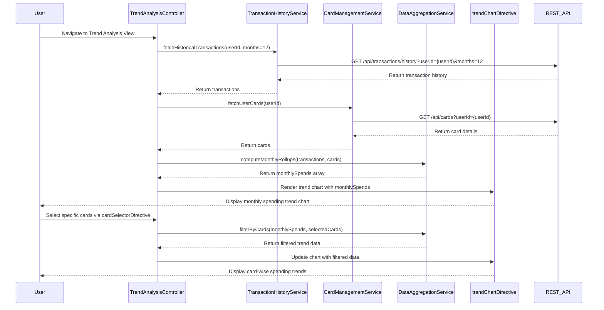

# Low-Level Design: QE-10274 - Monthly Spend Trends and Card-wise Analysis

## a. Architecture Mapping

- **Module**: `trendAnalysisModule` - Main AngularJS module for trend analysis feature
- **Controller**: `TrendAnalysisController` - Manages trend visualization, card selection, and historical data display
- **Service**: `TransactionHistoryService` - Fetches time-series transaction data via REST API
- **Service**: `CardManagementService` - Fetches individual card details and metadata
- **Service**: `DataAggregationService` - Computes monthly rollups and spending distributions
- **Directive**: `trendChartDirective` - Renders line/bar charts for monthly spending trends
- **Directive**: `cardSelectorDirective` - Provides multi-select dropdown for card-wise filtering
- **Factory**: `TrendDataFactory` - Manages trend data models and calculations

**Folder Structure:**
```
/app
  /modules
    /trend-analysis
      /controllers
        trend-analysis.controller.js
      /services
        transaction-history.service.js
        card-management.service.js
        data-aggregation.service.js
      /directives
        trend-chart.directive.js
        card-selector.directive.js
      /factories
        trend-data.factory.js
      /views
        trend-analysis.html
      /styles
        trend-analysis.css
```

## b. Component Specifications

| Name | Artifact Type | Responsibility | Key Dependencies |
|------|---------------|----------------|------------------|
| trendAnalysisModule | Module | Defines the trend analysis feature module and dependencies | ngRoute, chart.js, angular-ui-bootstrap |
| TrendAnalysisController | Controller | Manages trend view state, handles card selection, coordinates data fetching and chart rendering | TransactionHistoryService, CardManagementService, DataAggregationService, TrendDataFactory |
| TransactionHistoryService | Service | Fetches historical transaction data (12+ months) via REST API | $http, $q |
| CardManagementService | Service | Fetches user's credit card details and metadata | $http, $q |
| DataAggregationService | Service | Computes monthly rollups, card-wise spending distributions, and MoM comparisons | TrendDataFactory |
| trendChartDirective | Directive | Renders line/bar charts for monthly spending trends using Chart.js | Chart.js library |
| cardSelectorDirective | Directive | Renders multi-select dropdown for filtering by specific cards | angular-ui-bootstrap |
| TrendDataFactory | Factory | Provides trend data models and utility methods for MoM calculations | None |

## c. Data Model

**MonthlySpend Object:**
```javascript
{
  month: String, // YYYY-MM format
  totalSpend: Number,
  cardWiseSpend: Object, // { cardId: spendAmount }
  transactionCount: Number
}
```

**TrendData Object:**
```javascript
{
  months: Array<String>, // Last 12 months in YYYY-MM format
  monthlySpends: Array<MonthlySpend>,
  selectedCards: Array<String>, // Array of cardIds
  cardDetails: Array<CreditCard>,
  chartData: Object // Chart.js compatible format
}
```

**MoMComparison Object:**
```javascript
{
  currentMonth: String,
  currentSpend: Number,
  previousMonth: String,
  previousSpend: Number,
  percentageChange: Number,
  trend: String // 'up', 'down', 'stable'
}
```

## d. Data Flow

User navigates to trend analysis view → TrendAnalysisController initializes and calls TransactionHistoryService to fetch 12 months of transaction data via REST API → CardManagementService fetches user's card details → DataAggregationService processes transactions to compute monthly rollups and card-wise spending distributions → TrendDataFactory calculates MoM comparisons and percentage changes → Controller updates TrendData model → trendChartDirective renders line chart showing monthly spending trends → User selects specific cards via cardSelectorDirective → Controller filters trend data for selected cards and updates chart → User views card-specific spending patterns and MoM trends.

## e. Primary Sequence Diagram



## f. Implementation Notes

- Use AngularJS $q service for promise chaining when fetching transactions and card details in parallel
- Implement ES6 Map and Set for efficient card-wise aggregation in DataAggregationService
- Integrate Chart.js with custom options for line chart (responsive, tooltips, legend) via trendChartDirective
- Use angular-ui-bootstrap multiselect dropdown for cardSelectorDirective with search and select-all functionality
- Cache historical transaction data in controller scope to avoid redundant API calls; implement $watch on selectedCards for reactive filtering

## g. Error Handling

HTTP interceptor captures API errors; fallback to cached data if available; user-friendly error messages via Bootstrap alerts; try/catch in DataAggregationService for calculation errors.

## h. Security Notes

Requires token-based auth via existing SSO; userId validated server-side; transaction data filtered by user ownership; standard input validation and secure API calls assumed.