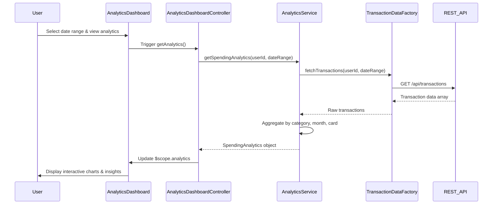

# Low-Level Design: Spending Analytics and Insights
**Epic ID:** QE-10389

## a. Architecture Mapping

- **Analytics Dashboard UI** → AngularJS Module (`app.analytics`) + Controller (`AnalyticsDashboardController`)
- **Spending Visualization** → AngularJS Directive (`spendingChart`)
- **Analytics Data Service** → AngularJS Service (`AnalyticsService`)
- **Category Filter** → AngularJS Filter (`categoryFilter`)
- **Transaction Data Provider** → AngularJS Factory (`TransactionDataFactory`)

**Folder Structure:**
```
/app
  /modules
    /analytics
      analytics.module.js
      analytics.controller.js
      analytics.service.js
      analytics.directive.js
  /shared
    /filters
      category.filter.js
    /factories
      transaction-data.factory.js
  /assets
    /views
      analytics-dashboard.html
```

## b. Component Specifications

| Component Name | Artifact Type | Responsibility | Key Dependencies |
|----------------|---------------|----------------|------------------|
| AnalyticsDashboardController | Controller | Orchestrates analytics view, fetches spending data, manages date range selection | AnalyticsService, $scope, $filter |
| AnalyticsService | Service | Aggregates transaction data by category and time period, calculates trends | TransactionDataFactory, $http, $q |
| spendingChart | Directive | Renders interactive category-wise spending visualizations using Chart.js | Chart.js library, $timeout |
| TransactionDataFactory | Factory | Fetches raw transaction data from REST API, caches results | $http, $cacheFactory |
| categoryFilter | Filter | Filters transactions by predefined categories (Food, Fuel, Shopping, etc.) | None |

## c. Data Model

```javascript
// SpendingAnalytics
{
  userId: String,
  dateRange: { startDate: Date, endDate: Date },
  categoryBreakdown: [
    {
      category: String, // 'Food & Dining', 'Fuel', 'Shopping', 'Travel', 'Entertainment', 'Utilities', 'Healthcare', 'Education', 'Miscellaneous'
      amount: Number,
      transactionCount: Number,
      percentage: Number
    }
  ],
  monthlyTrends: [
    {
      month: String, // 'YYYY-MM'
      totalSpend: Number,
      categoryWiseSpend: Object // { category: amount }
    }
  ],
  cardWiseAnalytics: [
    {
      cardId: String,
      cardLastFour: String,
      totalSpend: Number,
      categoryBreakdown: Array
    }
  ]
}

// Transaction
{
  transactionId: String,
  cardId: String,
  amount: Number,
  category: String,
  merchant: String,
  transactionDate: Date,
  description: String
}
```

## d. Data Flow

User selects date range and filters in the Analytics Dashboard view. AnalyticsDashboardController calls AnalyticsService.getSpendingAnalytics() with selected parameters. AnalyticsService uses TransactionDataFactory to fetch transaction data via REST API (/api/transactions?userId=X&startDate=Y&endDate=Z). Retrieved transactions are categorized and aggregated by category, month, and card. Aggregated data is returned to the controller, which binds it to $scope. The spendingChart directive watches scope data and renders interactive Chart.js visualizations showing category-wise breakdowns, monthly trends, and card-wise analysis with touch gesture support.

## e. Primary Sequence Diagram



## f. Implementation Notes

- Use AngularJS DI to inject AnalyticsService and TransactionDataFactory into controllers; leverage $q for promise-based async operations
- Integrate Chart.js via custom directive with isolated scope; bind data using two-way binding and $watch for real-time updates
- Implement REST API calls using $http with interceptors for authentication token injection and error handling
- Use $cacheFactory in TransactionDataFactory to cache transaction data for 5 minutes to reduce API calls and improve performance
- Apply categoryFilter to ensure consistent categorization across all views; maintain category enum in shared constants module

## g. Error Handling

HTTP interceptor captures API errors and displays user-friendly notifications via toastr; controller-level try/catch for data processing errors.

## h. Security Notes

Requires token-based authentication via existing SSO; all API calls include Authorization header with JWT token.