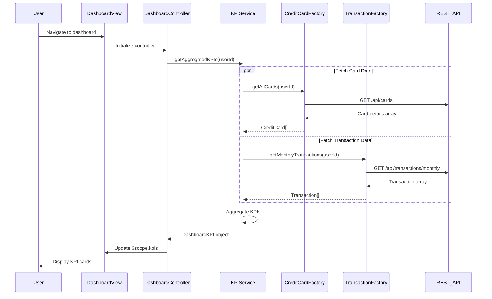

# Low-Level Design: Credit Card Dashboard and KPI Management
**Epic ID:** QE-10390

## a. Architecture Mapping

- **Dashboard UI** → AngularJS Module (`app.dashboard`) + Controller (`DashboardController`)
- **KPI Display Component** → AngularJS Directive (`kpiCard`)
- **KPI Aggregation Logic** → AngularJS Service (`KPIService`)
- **Credit Card Data Provider** → AngularJS Factory (`CreditCardFactory`)
- **Transaction Data Provider** → AngularJS Factory (`TransactionFactory`)

**Folder Structure:**
```
/app
  /modules
    /dashboard
      dashboard.module.js
      dashboard.controller.js
      kpi.service.js
      kpi-card.directive.js
  /shared
    /factories
      credit-card.factory.js
      transaction.factory.js
  /assets
    /views
      dashboard.html
    /styles
      dashboard.css
```

## b. Component Specifications

| Component Name | Artifact Type | Responsibility | Key Dependencies |
|----------------|---------------|----------------|------------------|
| DashboardController | Controller | Manages dashboard state, fetches aggregated KPIs, handles refresh actions | KPIService, $scope, $interval |
| KPIService | Service | Aggregates KPI data (monthly spend, total limit, available credit, outstanding) from multiple sources | CreditCardFactory, TransactionFactory, $q |
| kpiCard | Directive | Renders individual KPI metric cards with responsive design and accessibility features | None |
| CreditCardFactory | Factory | Fetches credit card details (limits, balances) from REST API | $http, $cacheFactory |
| TransactionFactory | Factory | Fetches transaction data for monthly spend and outstanding calculations | $http |

## c. Data Model

```javascript
// DashboardKPI
{
  userId: String,
  lastUpdated: Date,
  monthlySpend: Number,
  totalCreditLimit: Number,
  availableCredit: Number,
  outstandingAmount: Number,
  cardCount: Number,
  topSpendingCategory: String
}

// CreditCard
{
  cardId: String,
  cardNumber: String, // masked
  cardType: String, // 'Visa', 'MasterCard', 'Amex'
  creditLimit: Number,
  availableCredit: Number,
  outstandingBalance: Number,
  dueDate: Date
}
```

## d. Data Flow

User navigates to dashboard; DashboardController initializes and calls KPIService.getAggregatedKPIs(userId). KPIService concurrently fetches credit card data via CreditCardFactory.getAllCards() and transaction data via TransactionFactory.getMonthlyTransactions(). REST APIs return card details and transaction records. KPIService aggregates: sums credit limits across all cards, calculates total available credit, computes monthly spend from current month transactions, and determines outstanding amounts. Aggregated DashboardKPI object is returned to controller and bound to $scope. kpiCard directives render each KPI metric with responsive Bootstrap grid layout and WCAG-compliant markup. Auto-refresh using $interval polls KPIService every 30 seconds for real-time updates.

## e. Primary Sequence Diagram



## f. Implementation Notes

- Use AngularJS $q.all() to parallelize credit card and transaction API calls for faster dashboard load (<2 seconds)
- Implement kpiCard directive with templateUrl and isolated scope; use Bootstrap grid classes for responsive design across devices
- Apply WCAG 2.1 compliance: aria-labels on KPI cards, semantic HTML5 elements, sufficient color contrast ratios in CSS
- Use $interval service for 30-second auto-refresh; cancel interval on $scope.$destroy to prevent memory leaks
- Inject authentication token via $http interceptor configured in app.config; handle 401 responses by redirecting to login

## g. Error Handling

HTTP interceptor-based error handling with user notifications via Angular-toastr; graceful degradation if partial data fails.

## h. Security Notes

Requires token-based auth via existing SSO; sensitive card data masked on display.