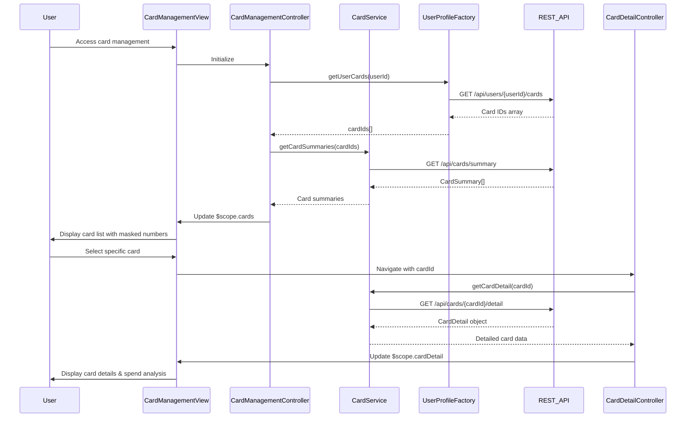

# Low-Level Design: Multiple Credit Card Management
**Epic ID:** QE-10391

## a. Architecture Mapping

- **Card Management UI** → AngularJS Module (`app.cardManagement`) + Controller (`CardManagementController`)
- **Card List Display** → AngularJS Directive (`cardList`)
- **Card Detail View** → AngularJS Controller (`CardDetailController`) + Directive (`cardDetail`)
- **Card Data Service** → AngularJS Service (`CardService`)
- **User Profile Provider** → AngularJS Factory (`UserProfileFactory`)

**Folder Structure:**
```
/app
  /modules
    /card-management
      card-management.module.js
      card-management.controller.js
      card-detail.controller.js
      card.service.js
      card-list.directive.js
      card-detail.directive.js
  /shared
    /factories
      user-profile.factory.js
  /assets
    /views
      card-management.html
      card-detail.html
```

## b. Component Specifications

| Component Name | Artifact Type | Responsibility | Key Dependencies |
|----------------|---------------|----------------|------------------|
| CardManagementController | Controller | Manages list of user's credit cards, handles card selection and navigation | CardService, UserProfileFactory, $scope |
| CardDetailController | Controller | Manages individual card detail view, fetches card-specific data | CardService, $routeParams, $scope |
| CardService | Service | Retrieves card details, balances, and transaction history; maintains card state | $http, $q, $cacheFactory |
| cardList | Directive | Renders scrollable list of credit cards with masked numbers and summary info | None |
| cardDetail | Directive | Displays comprehensive card details including limits, balances, and spend analysis | None |
| UserProfileFactory | Factory | Links credit cards to user account, fetches user's registered cards | $http |

## c. Data Model

```javascript
// CardSummary
{
  cardId: String,
  cardNumber: String, // masked format: 'XXXX-XXXX-XXXX-1234'
  cardType: String,
  cardLabel: String, // user-defined label
  creditLimit: Number,
  availableCredit: Number,
  outstandingBalance: Number,
  lastTransactionDate: Date
}

// CardDetail extends CardSummary
{
  ...CardSummary,
  dueDate: Date,
  minimumPayment: Number,
  statementBalance: Number,
  recentTransactions: [
    {
      transactionId: String,
      amount: Number,
      merchant: String,
      category: String,
      date: Date
    }
  ],
  monthlySpendByCategory: Object // { category: amount }
}
```

## d. Data Flow

User accesses Card Management view; CardManagementController calls UserProfileFactory.getUserCards(userId) to retrieve list of registered card IDs. CardService.getCardSummaries(cardIds) fetches summary data for all cards via REST API (/api/cards/summary). Card summaries are bound to $scope and rendered by cardList directive with masked card numbers. User selects a specific card; navigation triggers CardDetailController with cardId route parameter. CardDetailController calls CardService.getCardDetail(cardId), which fetches comprehensive card data including limits, balances, and recent transactions via REST API (/api/cards/{cardId}/detail). CardDetail object is bound to $scope and displayed by cardDetail directive showing card-wise financial summary and spend analysis.

## e. Primary Sequence Diagram



## f. Implementation Notes

- Use AngularJS $routeProvider for navigation between card list and detail views; pass cardId as route parameter
- Implement lazy loading in CardService: cache card summaries for 2 minutes, fetch detail only when user selects card
- Mask card numbers using custom filter: display only last 4 digits in format 'XXXX-XXXX-XXXX-1234'
- Use $q promises for sequential API calls; implement 1-second timeout requirement via $http config
- Maintain data synchronization using $rootScope.$broadcast for card updates; listeners in both list and detail controllers

## g. Error Handling

Interceptor-based error handling with retry logic for transient failures; user-friendly error messages via notification service.

## h. Security Notes

Standard input validation and secure API calls assumed; card numbers masked client-side before rendering.