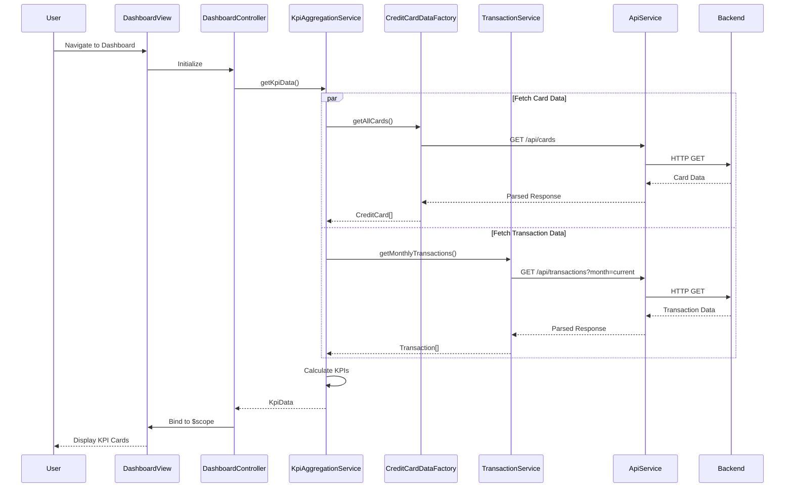

# Low-Level Design: QE-10470 - Dashboard and KPI Management

## a. Architecture Mapping

- **Dashboard View** → AngularJS Module (`app.dashboard`)
- **Dashboard Controller** → AngularJS Controller (`DashboardController`)
- **KPI Aggregation Engine** → AngularJS Service (`KpiAggregationService`)
- **Credit Card Data Service** → AngularJS Factory (`CreditCardDataFactory`)
- **Transaction Service** → AngularJS Service (`TransactionService`)
- **API Integration Layer** → AngularJS Service (`ApiService` with HTTP interceptor)

**Recommended Folder Structure:**
```
app/
├── modules/
│   └── dashboard/
│       ├── dashboard.module.js
│       ├── dashboard.controller.js
│       ├── dashboard.html
│       └── dashboard.css
├── services/
│   ├── kpi-aggregation.service.js
│   ├── transaction.service.js
│   └── api.service.js
├── factories/
│   └── credit-card-data.factory.js
└── shared/
    ├── interceptors/
    └── constants/
```

## b. Component Specifications

| Component Name | Artifact Type | Responsibility | Key Dependencies |
|---|---|---|---|
| DashboardController | Controller | Orchestrates KPI display, handles user interactions, binds data to view | KpiAggregationService, $scope, $q |
| KpiAggregationService | Service | Aggregates monthly spend, total credit limit, available credit, outstanding amounts | CreditCardDataFactory, TransactionService, $q |
| CreditCardDataFactory | Factory | Fetches card balances and credit limits from REST API | ApiService, $http |
| TransactionService | Service | Retrieves monthly transactions and calculates outstanding amounts | ApiService, $http |
| ApiService | Service | Handles all HTTP requests with base URL configuration and error handling | $http, $q |
| DashboardDirective | Directive | Renders responsive KPI cards with real-time updates | None |

## c. Data Model

**KpiData (JS Object):**
```javascript
{
  monthlySpend: Number,        // Total spend for current month
  totalCreditLimit: Number,    // Sum of all card limits
  availableCredit: Number,     // Total limit - total outstanding
  outstandingAmount: Number,   // Sum of unpaid transactions
  lastUpdated: Date            // Timestamp of last data refresh
}
```

**CreditCard (JS Object):**
```javascript
{
  cardId: String,
  cardNumber: String,
  creditLimit: Number,
  currentBalance: Number,
  availableBalance: Number
}
```

**Transaction (JS Object):**
```javascript
{
  transactionId: String,
  cardId: String,
  amount: Number,
  date: Date,
  isPaid: Boolean
}
```

## d. Data Flow

User navigates to Dashboard → DashboardController initializes and calls KpiAggregationService.getKpiData() → KpiAggregationService concurrently invokes CreditCardDataFactory.getAllCards() and TransactionService.getMonthlyTransactions() using $q.all() → Both services call ApiService which makes REST API calls to backend endpoints → API responses are transformed into KpiData model → KpiAggregationService calculates aggregated metrics (totalCreditLimit = sum of all card limits, availableCredit = totalCreditLimit - outstandingAmount, outstandingAmount = sum of unpaid transactions) → Aggregated KpiData is returned to DashboardController → Controller binds data to $scope → View updates KPI cards using two-way data binding and DashboardDirective renders responsive UI.

## e. Primary Sequence Diagram



## f. Implementation Notes

- Use AngularJS 1.x module pattern with dependency injection for all services, factories, and controllers
- Implement ES6 classes for service definitions with arrow functions for promise chaining
- Use $q.all() for parallel API calls to meet 2-second load time requirement
- Apply Bootstrap grid system (col-xs, col-sm, col-md, col-lg) for responsive KPI card layout
- Implement $interval service for periodic KPI refresh (every 30 seconds) to maintain near real-time updates

## g. Error Handling

HTTP interceptor-based error handling with $q rejection, user-friendly toast notifications via AngularJS directive, and fallback to cached data on API failure.

## h. Security Notes

Requires token-based authentication via existing SSO; API calls include Authorization header with JWT token validated by backend.