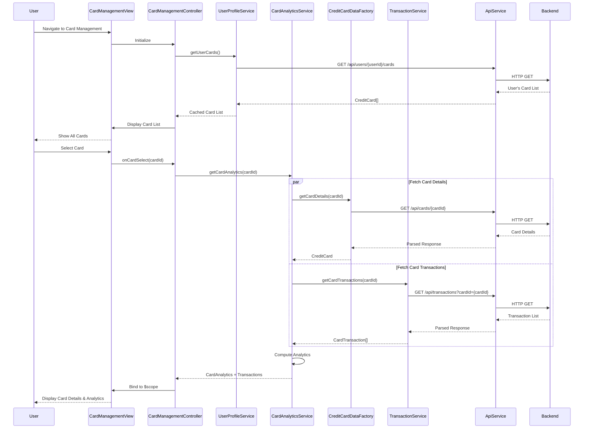

# Low-Level Design: QE-10471 - Credit Card Management and Monitoring

## a. Architecture Mapping

- **Card Management View** → AngularJS Module (`app.cardManagement`)
- **Card Management Controller** → AngularJS Controller (`CardManagementController`)
- **Card Analytics Module** → AngularJS Service (`CardAnalyticsService`)
- **User Profile Service** → AngularJS Service (`UserProfileService`)
- **Credit Card Data Service** → AngularJS Factory (`CreditCardDataFactory`)
- **Transaction Service** → AngularJS Service (`TransactionService`)
- **Card List Component** → AngularJS Directive (`cardListDirective`)
- **Card Detail Component** → AngularJS Directive (`cardDetailDirective`)

**Recommended Folder Structure:**
```
app/
├── modules/
│   └── card-management/
│       ├── card-management.module.js
│       ├── card-management.controller.js
│       ├── card-management.html
│       └── card-management.css
├── services/
│   ├── card-analytics.service.js
│   ├── user-profile.service.js
│   └── transaction.service.js
├── factories/
│   └── credit-card-data.factory.js
├── directives/
│   ├── card-list.directive.js
│   └── card-detail.directive.js
└── shared/
    └── filters/
```

## b. Component Specifications

| Component Name | Artifact Type | Responsibility | Key Dependencies |
|---|---|---|---|
| CardManagementController | Controller | Manages multi-card view, handles card selection, coordinates card-specific analytics | CardAnalyticsService, UserProfileService, $scope, $state |
| CardAnalyticsService | Service | Aggregates card-wise spending, calculates monthly trends, provides card-specific insights | CreditCardDataFactory, TransactionService, $q |
| UserProfileService | Service | Validates card ownership, retrieves user's card list, manages session-level card cache | ApiService, $http, $cacheFactory |
| CreditCardDataFactory | Factory | Fetches individual card details, limits, and balances | ApiService, $http |
| TransactionService | Service | Retrieves card-specific transaction history with filtering by cardId | ApiService, $http |
| cardListDirective | Directive | Renders responsive card list with card summary information | None |
| cardDetailDirective | Directive | Displays detailed card information including spend analysis and transaction list | None |

## c. Data Model

**CreditCard (JS Object):**
```javascript
{
  cardId: String,
  userId: String,
  cardNumber: String,              // Masked format: XXXX-XXXX-XXXX-1234
  cardType: String,                // Visa, MasterCard, Amex, etc.
  creditLimit: Number,
  currentBalance: Number,
  availableBalance: Number,
  monthlySpend: Number,
  lastTransactionDate: Date
}
```

**CardAnalytics (JS Object):**
```javascript
{
  cardId: String,
  monthlySpendTrend: Array,        // [{month: String, amount: Number}]
  totalSpend: Number,
  averageMonthlySpend: Number,
  utilizationRate: Number          // (currentBalance / creditLimit) * 100
}
```

**CardTransaction (JS Object):**
```javascript
{
  transactionId: String,
  cardId: String,
  merchantName: String,
  amount: Number,
  category: String,
  date: Date,
  status: String                   // Pending, Completed, Failed
}
```

## d. Data Flow

User navigates to Card Management page → CardManagementController initializes and calls UserProfileService.getUserCards() to validate ownership and retrieve card list (cached after first call) → Controller displays all cards using cardListDirective → User selects a specific card → Controller invokes CardAnalyticsService.getCardAnalytics(cardId) → CardAnalyticsService makes parallel calls to CreditCardDataFactory.getCardDetails(cardId) and TransactionService.getCardTransactions(cardId) using $q.all() → Both services call backend REST APIs via ApiService → CardAnalyticsService aggregates data to compute monthly spend trends and utilization rate → Aggregated CardAnalytics and transaction list are returned to Controller → Controller binds data to $scope → cardDetailDirective renders card-specific spending chart, balance information, and transaction history in responsive layout.

## e. Primary Sequence Diagram



## f. Implementation Notes

- Use AngularJS $cacheFactory to cache user's card list after initial load to optimize performance and meet 3-second sync requirement
- Implement ES6 Map data structure for efficient card lookup by cardId in CardAnalyticsService
- Apply AngularJS custom filters for card number masking and currency formatting
- Use Bootstrap responsive grid and card components for multi-card display supporting 10+ cards
- Implement ui-router state management for card selection with URL parameter (e.g., /cards/:cardId)

## g. Error Handling

HTTP interceptor with try/catch blocks in service methods, user notification via toast directive, graceful degradation with cached data when API calls fail.

## h. Security Notes

Requires token-based auth via existing SSO; card ownership validated server-side; card numbers masked on client-side; sensitive data not stored in browser storage.