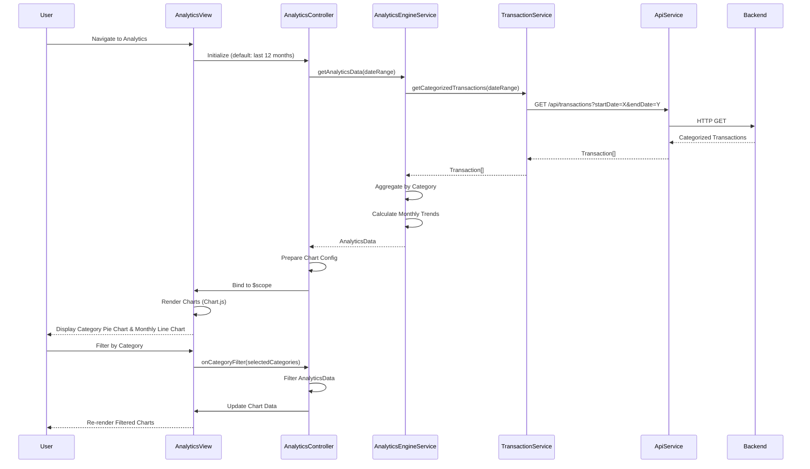

# Low-Level Design: QE-10472 - Analytics and Spending Insights

## a. Architecture Mapping

- **Analytics Dashboard View** → AngularJS Module (`app.analytics`)
- **Analytics Controller** → AngularJS Controller (`AnalyticsController`)
- **Analytics Engine** → AngularJS Service (`AnalyticsEngineService`)
- **Transaction Service** → AngularJS Service (`TransactionService`)
- **Data Visualization Library** → Third-party library integration (Chart.js via angular-chart.js directive)
- **Category Filter Component** → AngularJS Directive (`categoryFilterDirective`)
- **Spend Chart Component** → AngularJS Directive (`spendChartDirective`)

**Recommended Folder Structure:**
```
app/
├── modules/
│   └── analytics/
│       ├── analytics.module.js
│       ├── analytics.controller.js
│       ├── analytics.html
│       └── analytics.css
├── services/
│   ├── analytics-engine.service.js
│   └── transaction.service.js
├── directives/
│   ├── category-filter.directive.js
│   └── spend-chart.directive.js
└── shared/
    ├── constants/
    │   └── spending-categories.constant.js
    └── filters/
```

## b. Component Specifications

| Component Name | Artifact Type | Responsibility | Key Dependencies |
|---|---|---|---|
| AnalyticsController | Controller | Orchestrates analytics view, manages filter state, binds chart data to view | AnalyticsEngineService, $scope, $filter |
| AnalyticsEngineService | Service | Aggregates transactions by category, computes monthly trends, prepares chart data | TransactionService, SpendingCategoriesConstant, $q |
| TransactionService | Service | Fetches categorized transaction data with date range filtering | ApiService, $http |
| categoryFilterDirective | Directive | Renders interactive category filter checkboxes with select all/none functionality | None |
| spendChartDirective | Directive | Renders responsive pie chart for category-wise spending and line chart for monthly trends using Chart.js | angular-chart.js |
| SpendingCategoriesConstant | Constant | Defines nine spending categories with display names and color codes | None |

## c. Data Model

**SpendingCategories (Constant Array):**
```javascript
[
  { id: 'food_dining', name: 'Food & Dining', color: '#FF6384' },
  { id: 'fuel', name: 'Fuel', color: '#36A2EB' },
  { id: 'shopping', name: 'Shopping', color: '#FFCE56' },
  { id: 'travel', name: 'Travel', color: '#4BC0C0' },
  { id: 'entertainment', name: 'Entertainment', color: '#9966FF' },
  { id: 'utilities', name: 'Utilities', color: '#FF9F40' },
  { id: 'healthcare', name: 'Healthcare', color: '#FF6384' },
  { id: 'education', name: 'Education', color: '#C9CBCF' },
  { id: 'miscellaneous', name: 'Miscellaneous', color: '#4BC0C0' }
]
```

**CategorySpending (JS Object):**
```javascript
{
  categoryId: String,
  categoryName: String,
  totalAmount: Number,
  percentage: Number,              // (totalAmount / grandTotal) * 100
  transactionCount: Number
}
```

**MonthlyTrend (JS Object):**
```javascript
{
  month: String,                   // Format: 'YYYY-MM'
  totalSpend: Number,
  categoryBreakdown: Object        // { categoryId: amount }
}
```

**AnalyticsData (JS Object):**
```javascript
{
  categorySpending: Array,         // CategorySpending[]
  monthlyTrends: Array,            // MonthlyTrend[]
  totalSpend: Number,
  dateRange: Object                // { startDate: Date, endDate: Date }
}
```

## d. Data Flow

User navigates to Analytics Dashboard → AnalyticsController initializes with default date range (last 12 months) and calls AnalyticsEngineService.getAnalyticsData(dateRange) → AnalyticsEngineService invokes TransactionService.getCategorizedTransactions(dateRange) → TransactionService calls backend REST API via ApiService to fetch all transactions within date range → API returns pre-categorized transactions → AnalyticsEngineService aggregates transactions by category using Array.reduce(), calculates total spend per category, computes percentage distribution, and generates monthly trend data by grouping transactions by month → AnalyticsData object is returned to AnalyticsController → Controller binds data to $scope and prepares chart configuration objects → spendChartDirective receives chart data and renders pie chart for category-wise spending and line chart for monthly trends using Chart.js → User interacts with categoryFilterDirective to select/deselect categories → Controller filters AnalyticsData and updates chart data → Charts re-render with filtered data within 1.5 seconds.

## e. Primary Sequence Diagram



## f. Implementation Notes

- Integrate angular-chart.js (AngularJS wrapper for Chart.js) for declarative chart rendering via directives
- Use ES6 Array methods (reduce, filter, map) in AnalyticsEngineService for efficient data aggregation
- Implement AngularJS $watch on filter state to trigger chart updates reactively
- Apply Chart.js responsive configuration and Bootstrap grid for mobile-friendly analytics dashboard
- Use AngularJS custom filter for date range formatting and currency display in tooltips

## g. Error Handling

Interceptor-based error handling with try/catch in aggregation logic, user notification via toast, fallback to empty state with informative message when no data available.

## h. Security Notes

Requires token-based auth via existing SSO; transaction data filtered by authenticated user's ID on backend; no sensitive financial data exposed in chart labels.