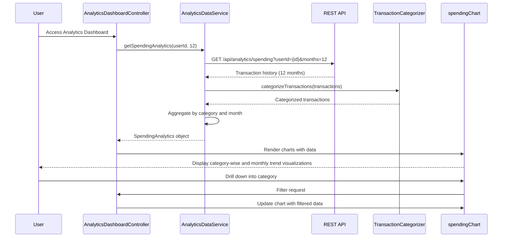

# Low-Level Design: QE-10473 - Analytics and Spending Insights

## a. Architecture Mapping

- **AngularJS Module**: `creditCard.analytics` - Root module for analytics features
- **Controller**: `AnalyticsDashboardController` - Manages analytics dashboard state and user interactions
- **Service**: `AnalyticsDataService` - Fetches and aggregates spending data from REST APIs
- **Service**: `CategoryService` - Manages category definitions and mappings
- **Directive**: `spendingChart` - Renders interactive spending visualizations
- **Factory**: `TransactionCategorizer` - Categorizes transactions into predefined categories

**Folder Structure:**
```
/app
  /modules
    /analytics
      /controllers
      /services
      /directives
      /factories
  /shared
    /models
```

## b. Component Specifications

| Component Name | Artifact Type | Responsibility | Key Dependencies |
|----------------|---------------|----------------|------------------|
| AnalyticsDashboardController | Controller | Orchestrates analytics view, handles user interactions for category/time filtering | AnalyticsDataService, CategoryService, $scope |
| AnalyticsDataService | Service | Fetches transaction history, aggregates spending by category and month via REST API | $http, $q, TransactionCategorizer |
| CategoryService | Service | Provides category definitions (9 categories) and validation | None |
| TransactionCategorizer | Factory | Assigns transactions to categories based on merchant/description | CategoryService |
| spendingChart | Directive | Renders category-wise and monthly trend charts using visualization library | AnalyticsDataService, Chart.js/D3.js |

## c. Data Model

```javascript
// SpendingAnalytics
{
  userId: String,
  period: {
    startDate: Date,
    endDate: Date
  },
  categorySpending: Array<CategorySpend>,
  monthlyTrends: Array<MonthlySpend>
}

// CategorySpend
{
  categoryName: String, // One of 9: Food & Dining, Fuel, Shopping, Travel, Entertainment, Utilities, Healthcare, Education, Miscellaneous
  totalAmount: Number,
  transactionCount: Number,
  percentage: Number
}

// MonthlySpend
{
  month: String, // YYYY-MM
  totalAmount: Number,
  categoryBreakdown: Array<CategorySpend>
}

// Transaction
{
  transactionId: String,
  cardId: String,
  amount: Number,
  merchant: String,
  category: String,
  transactionDate: Date
}
```

## d. Data Flow

User selects analytics view → AnalyticsDashboardController initializes and calls AnalyticsDataService → Service invokes REST API `/api/analytics/spending?userId={id}&months=12` → API returns transaction history → TransactionCategorizer assigns categories to transactions → AnalyticsDataService aggregates data by category and month → Controller updates $scope with categorySpending and monthlyTrends → spendingChart directive renders interactive visualizations → User interacts with charts (drill-down, filter) → Controller updates view based on selections.

## e. Primary Sequence Diagram



## f. Implementation Notes

- Use AngularJS dependency injection to inject services into controllers and directives
- Implement ES6 classes for services and factories with arrow functions for callbacks
- Use $http interceptors for API authentication token injection and error handling
- Leverage Chart.js or D3.js within custom directive for responsive chart rendering
- Cache analytics data in service using $cacheFactory to reduce API calls on view re-entry

## g. Error Handling

HTTP interceptor captures API errors; service returns rejected promises; controller displays user-friendly error notifications via toastr/modal.

## h. Security Notes

Requires token-based auth via existing SSO; API validates user ownership of transaction data before returning analytics.