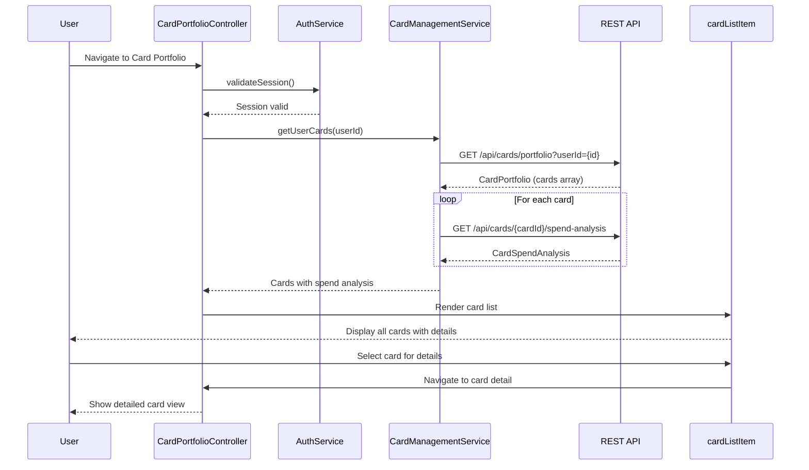

# Low-Level Design: QE-10474 - Multi-Card Management and Monitoring

## a. Architecture Mapping

- **AngularJS Module**: `creditCard.management` - Root module for card management features
- **Controller**: `CardPortfolioController` - Manages multi-card view and user interactions
- **Service**: `CardManagementService` - Fetches card data and card-wise spend analysis from REST APIs
- **Service**: `AuthService` - Validates user authentication and card ownership
- **Directive**: `cardListItem` - Renders individual card details in the portfolio view
- **Filter**: `cardComparison` - Filters and sorts cards based on user-selected criteria

**Folder Structure:**
```
/app
  /modules
    /card-management
      /controllers
      /services
      /directives
      /filters
  /shared
    /models
```

## b. Component Specifications

| Component Name | Artifact Type | Responsibility | Key Dependencies |
|----------------|---------------|----------------|------------------|
| CardPortfolioController | Controller | Manages card portfolio display, filtering, comparison, and drill-down | CardManagementService, AuthService, $scope |
| CardManagementService | Service | Fetches user's credit cards and card-wise spending data via REST API | $http, $q, AuthService |
| AuthService | Service | Validates user session and card ownership | $http, $window (for token storage) |
| cardListItem | Directive | Displays individual card with balance, limit, spend, and action buttons | CardManagementService |
| cardComparison | Filter | Filters and sorts cards by spend, balance, or limit | None |

## c. Data Model

```javascript
// CreditCard
{
  cardId: String,
  userId: String,
  cardNumber: String, // Masked (e.g., **** **** **** 1234)
  cardType: String, // Visa, MasterCard, Amex
  cardIssuer: String,
  creditLimit: Number,
  availableCredit: Number,
  outstandingBalance: Number,
  monthlySpend: Number,
  lastSyncDate: Date
}

// CardPortfolio
{
  userId: String,
  cards: Array<CreditCard>,
  totalCreditLimit: Number,
  totalAvailableCredit: Number,
  totalOutstanding: Number
}

// CardSpendAnalysis
{
  cardId: String,
  currentMonthSpend: Number,
  previousMonthSpend: Number,
  spendTrend: String, // "up", "down", "stable"
  topCategories: Array<{category: String, amount: Number}>
}
```

## d. Data Flow

User logs in and navigates to card portfolio → CardPortfolioController calls AuthService to validate session → AuthService confirms authentication → Controller calls CardManagementService.getUserCards(userId) → Service invokes REST API `/api/cards/portfolio?userId={id}` → API validates ownership and returns CardPortfolio with all cards → Service fetches card-wise spend analysis via `/api/cards/{cardId}/spend-analysis` for each card → Controller updates $scope with cards array → cardListItem directive renders each card with details → User filters/compares cards using cardComparison filter → User selects a card for drill-down → Controller navigates to card detail view with selected cardId.

## e. Primary Sequence Diagram



## f. Implementation Notes

- Use AngularJS $http service with promise chaining for sequential card data and spend analysis retrieval
- Implement ES6 async/await pattern in services for cleaner asynchronous code
- Store authentication token in $window.sessionStorage; inject token in $http request headers via interceptor
- Use ng-repeat with track by cardId in view for efficient card list rendering
- Implement lazy loading for card spend analysis (fetch on-demand when user expands card details)

## g. Error Handling

$http interceptor catches 401/403 errors and redirects to login; service-level try/catch with user notification for data fetch failures.

## h. Security Notes

Requires token-based auth via existing SSO; API validates card ownership per userId before returning card data.