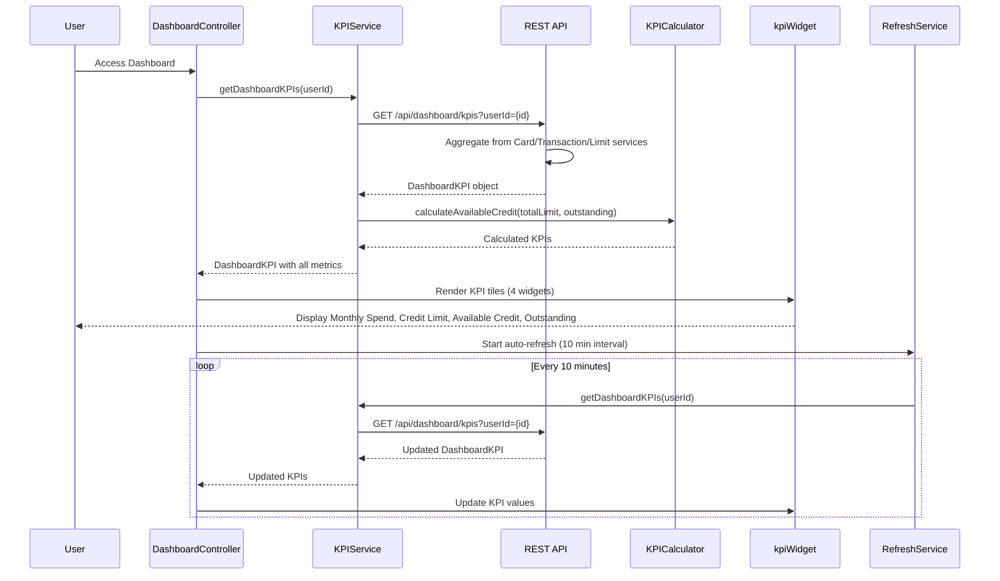

# Low-Level Design: QE-10475 - Dashboard and KPI Management

## a. Architecture Mapping

- **AngularJS Module**: `creditCard.dashboard` - Root module for dashboard features
- **Controller**: `DashboardController` - Manages dashboard state and KPI display
- **Service**: `KPIService` - Fetches aggregated KPI data from REST APIs
- **Service**: `RefreshService` - Handles real-time data refresh logic
- **Directive**: `kpiWidget` - Renders individual KPI tiles (monthly spend, credit limit, available credit, outstanding)
- **Factory**: `KPICalculator` - Calculates derived KPIs from raw card and transaction data

**Folder Structure:**
```
/app
  /modules
    /dashboard
      /controllers
      /services
      /directives
      /factories
  /shared
    /models
```

## b. Component Specifications

| Component Name | Artifact Type | Responsibility | Key Dependencies |
|----------------|---------------|----------------|------------------|
| DashboardController | Controller | Orchestrates dashboard view, triggers KPI data fetch and refresh | KPIService, RefreshService, $scope, $interval |
| KPIService | Service | Fetches aggregated KPI data (monthly spend, limits, outstanding) via REST API | $http, $q, KPICalculator |
| RefreshService | Service | Manages periodic data refresh (5-15 min interval) for near real-time updates | $interval, KPIService |
| kpiWidget | Directive | Displays individual KPI with value, label, and visual indicator | None |
| KPICalculator | Factory | Calculates available credit and aggregates totals from multiple cards | None |

## c. Data Model

```javascript
// DashboardKPI
{
  userId: String,
  monthlySpend: Number,
  totalCreditLimit: Number,
  availableCredit: Number,
  outstandingAmount: Number,
  lastUpdated: Date
}

// CardSummary
{
  cardId: String,
  creditLimit: Number,
  currentBalance: Number,
  monthlySpend: Number
}

// AggregatedData
{
  userId: String,
  cards: Array<CardSummary>,
  totalMonthlySpend: Number,
  totalCreditLimit: Number,
  totalOutstanding: Number,
  totalAvailableCredit: Number
}
```

## d. Data Flow

User accesses dashboard → DashboardController initializes and calls KPIService.getDashboardKPIs(userId) → Service invokes REST API `/api/dashboard/kpis?userId={id}` → API aggregates data from Credit Card Data Service, Transaction Processing Service, and Credit Limit Management System → API returns DashboardKPI object → KPICalculator validates and calculates derived metrics (available credit = total limit - outstanding) → KPIService returns KPIs to controller → Controller updates $scope with KPI values → kpiWidget directives render four KPI tiles → RefreshService triggers periodic refresh every 10 minutes → Updated KPIs are fetched and view is refreshed automatically.

## e. Primary Sequence Diagram



## f. Implementation Notes

- Use AngularJS $interval service for periodic refresh; cancel interval on $scope.$destroy to prevent memory leaks
- Implement ES6 classes for KPIService and KPICalculator with clean separation of API calls and business logic
- Use $http interceptor to inject authentication token and handle 401/500 errors globally
- Leverage Bootstrap grid system for responsive KPI widget layout (col-md-3 for desktop, col-xs-12 for mobile)
- Cache KPI data in service for 5 minutes using $cacheFactory to reduce redundant API calls on view re-entry

## g. Error Handling

$http interceptor captures API errors; service returns rejected promises; controller displays error notification and retries after 30 seconds.

## h. Security Notes

Requires token-based auth via existing SSO; API validates userId ownership before returning aggregated KPI data.