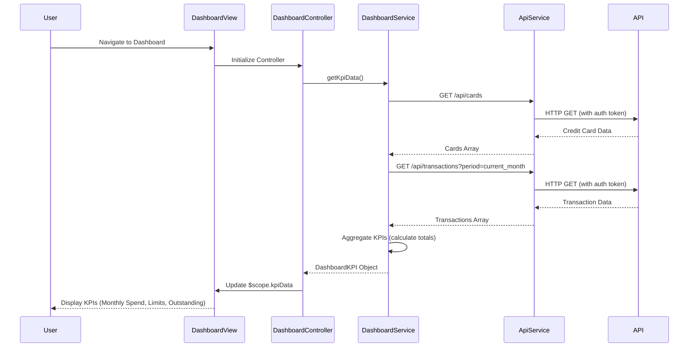

# Low-Level Design: QE-10476 - Credit Card Dashboard and KPI Management

## a. Architecture Mapping

**HLD Component → AngularJS Artifact:**
- Dashboard UI Layer → AngularJS Module (`app.dashboard`), Controller (`DashboardController`), HTML Template (`dashboard.html`)
- API Gateway Integration → AngularJS Service (`DashboardService`) for REST API calls
- Authentication Service → AngularJS Factory (`AuthFactory`) for token management and session handling
- KPI Display Components → AngularJS Directives (`kpiCard`, `creditSummary`) for reusable KPI widgets
- Data Aggregation Logic → AngularJS Service (`KpiCalculationService`) for client-side data processing

**Recommended Folder Structure:**
```
app/
├── modules/
│   └── dashboard/
│       ├── dashboard.module.js
│       ├── dashboard.controller.js
│       ├── dashboard.service.js
│       ├── dashboard.html
│       └── directives/
│           ├── kpi-card.directive.js
│           └── credit-summary.directive.js
├── shared/
│   ├── services/
│   │   ├── auth.factory.js
│   │   └── api.service.js
│   └── interceptors/
│       └── http.interceptor.js
└── assets/
    ├── css/
    └── js/
```

## b. Component Specifications

| Component Name | Artifact Type | Responsibility | Key Dependencies |
|----------------|---------------|----------------|------------------|
| `app.dashboard` | Module | Root module for dashboard feature, registers all dashboard components | `ngRoute`, `app.shared` |
| `DashboardController` | Controller | Manages dashboard state, fetches KPI data, handles user interactions | `DashboardService`, `$scope`, `$q` |
| `DashboardService` | Service | Fetches credit card data and transactions from REST API, aggregates KPIs | `$http`, `ApiService`, `$q` |
| `AuthFactory` | Factory | Manages authentication tokens, session validation, and secure API calls | `$window`, `$http` |
| `kpiCard` | Directive | Renders individual KPI widgets (Monthly Spend, Credit Limit, Available Credit, Outstanding) | None |
| `creditSummary` | Directive | Displays aggregated credit summary across all cards with visual indicators | None |
| `ApiService` | Service | Base service for HTTP requests with error handling and response transformation | `$http`, `HttpInterceptor` |
| `HttpInterceptor` | Interceptor | Adds authentication headers, handles global errors, manages loading states | `AuthFactory`, `$q` |

## c. Data Model

**CreditCard Model:**
```javascript
{
  cardId: String,
  cardNumber: String,
  cardType: String,
  creditLimit: Number,
  availableCredit: Number,
  outstandingAmount: Number,
  lastUpdated: Date
}
```

**Transaction Model:**
```javascript
{
  transactionId: String,
  cardId: String,
  amount: Number,
  category: String,
  date: Date,
  description: String
}
```

**DashboardKPI Model:**
```javascript
{
  monthlySpend: Number,
  totalCreditLimit: Number,
  totalAvailableCredit: Number,
  totalOutstanding: Number,
  cardCount: Number,
  lastRefreshed: Date
}
```

## d. Data Flow

User navigates to the dashboard view, triggering `DashboardController` initialization which calls `DashboardService.getKpiData()`. The service makes parallel REST API calls via `ApiService` to fetch credit card details (`/api/cards`) and recent transactions (`/api/transactions`), both secured with authentication tokens from `AuthFactory`. Upon receiving responses, `DashboardService` aggregates data client-side to compute KPIs (monthly spend by filtering current month transactions, total credit limit by summing all card limits, available credit and outstanding amounts). The aggregated `DashboardKPI` model is returned to the controller, which updates `$scope.kpiData`, triggering Angular's digest cycle to re-render the view with `kpiCard` and `creditSummary` directives displaying the updated KPIs.

## e. Primary Sequence Diagram



## f. Implementation Notes

- Use AngularJS 1.x module pattern with dependency injection for all services, controllers, and directives to ensure testability and maintainability.
- Implement ES6 classes for services and controllers where possible, transpiled via Babel for browser compatibility.
- Use `$q.all()` to parallelize API calls for credit cards and transactions, reducing total load time to meet 2-second NFR.
- Apply Bootstrap grid system (col-xs, col-sm, col-md, col-lg) in dashboard.html for responsive layout across devices.
- Implement HTTP interceptor to attach JWT tokens from `AuthFactory` to all outgoing requests and handle 401 responses globally.

## g. Error Handling

HTTP interceptor captures API errors, displays user-friendly notifications via Bootstrap alerts, and logs errors to console; controllers use try/catch for synchronous operations.

## h. Security Notes

Requires token-based authentication via existing SSO; all API calls include Authorization header with JWT token managed by AuthFactory.