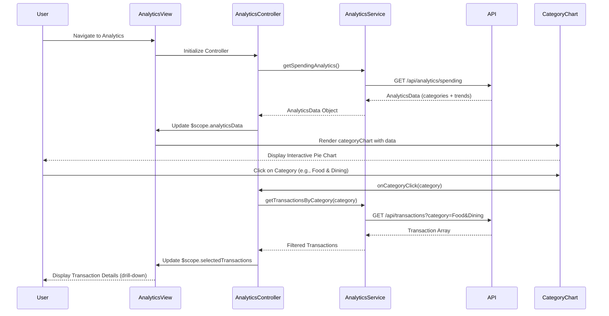

# Low-Level Design: QE-10477 - Spending Analytics and Transaction Insights

## a. Architecture Mapping

**HLD Component → AngularJS Artifact:**
- Analytics Dashboard UI → AngularJS Module (`app.analytics`), Controller (`AnalyticsController`), HTML Template (`analytics.html`)
- Analytics Engine Integration → AngularJS Service (`AnalyticsService`) for fetching aggregated data from REST API
- Charting Library → AngularJS Directive (`categoryChart`, `trendChart`) wrapping Chart.js or D3.js for interactive visualizations
- Transaction Data Service → AngularJS Service (`TransactionService`) for fetching and filtering transaction data
- Category Filter Component → AngularJS Directive (`categoryFilter`) for user-driven category selection

**Recommended Folder Structure:**
```
app/
├── modules/
│   └── analytics/
│       ├── analytics.module.js
│       ├── analytics.controller.js
│       ├── analytics.service.js
│       ├── transaction.service.js
│       ├── analytics.html
│       └── directives/
│           ├── category-chart.directive.js
│           ├── trend-chart.directive.js
│           └── category-filter.directive.js
├── shared/
│   └── services/
│       └── api.service.js
└── assets/
    └── js/
        └── chart.min.js
```

## b. Component Specifications

| Component Name | Artifact Type | Responsibility | Key Dependencies |
|----------------|---------------|----------------|------------------|
| `app.analytics` | Module | Root module for analytics feature, registers all analytics components | `ngRoute`, `app.shared`, `chart.js` |
| `AnalyticsController` | Controller | Manages analytics state, fetches spending data, handles chart interactions and drill-down | `AnalyticsService`, `TransactionService`, `$scope` |
| `AnalyticsService` | Service | Fetches aggregated spending data (category-wise, monthly trends) from analytics API | `$http`, `ApiService`, `$q` |
| `TransactionService` | Service | Fetches raw transaction data, applies client-side filtering by category and date range | `$http`, `ApiService` |
| `categoryChart` | Directive | Renders interactive pie/bar chart for category-wise spending using Chart.js | `Chart.js` |
| `trendChart` | Directive | Renders line chart for monthly spend trends with drill-down capability | `Chart.js` |
| `categoryFilter` | Directive | Provides UI for selecting/filtering spending categories (9 predefined categories) | None |

## c. Data Model

**CategorySpending Model:**
```javascript
{
  category: String,
  amount: Number,
  percentage: Number,
  transactionCount: Number
}
```

**MonthlyTrend Model:**
```javascript
{
  month: String,
  year: Number,
  totalSpend: Number,
  categoryBreakdown: Array<CategorySpending>
}
```

**Transaction Model:**
```javascript
{
  transactionId: String,
  cardId: String,
  amount: Number,
  category: String,
  date: Date,
  description: String,
  merchant: String
}
```

**AnalyticsData Model:**
```javascript
{
  categorySpending: Array<CategorySpending>,
  monthlyTrends: Array<MonthlyTrend>,
  totalTransactions: Number,
  dateRange: { start: Date, end: Date }
}
```

## d. Data Flow

User navigates to the analytics view, triggering `AnalyticsController` which calls `AnalyticsService.getSpendingAnalytics()` to fetch pre-aggregated category-wise and monthly trend data from the analytics API endpoint (`/api/analytics/spending`). The service returns an `AnalyticsData` object to the controller, which updates `$scope.analyticsData`. The view renders two primary charts: `categoryChart` directive receives `$scope.analyticsData.categorySpending` and renders an interactive pie chart showing the 9 predefined categories, while `trendChart` directive receives `$scope.analyticsData.monthlyTrends` and renders a line chart. When the user clicks a category in the pie chart (drill-down), the controller calls `TransactionService.getTransactionsByCategory(category)` to fetch detailed transactions, updates `$scope.selectedCategoryTransactions`, and the view displays a transaction list below the chart.

## e. Primary Sequence Diagram



## f. Implementation Notes

- Use Chart.js library wrapped in AngularJS directives for rendering interactive charts; directives watch scope data and re-render charts on data changes.
- Implement ES6 arrow functions and Promises in services for cleaner async handling; use `$q` for AngularJS digest cycle integration.
- Apply lazy-loading for transaction details on drill-down to optimize initial page load and meet 1.5-second rendering NFR for up to 1000 transactions.
- Use Bootstrap responsive utilities and CSS3 media queries to ensure charts scale appropriately on mobile, tablet, and desktop.
- Implement client-side caching in `AnalyticsService` using `$cacheFactory` to store aggregated data and reduce redundant API calls.

## g. Error Handling

HTTP interceptor handles API failures with user-friendly error messages displayed via Bootstrap modals; chart directives include error states for rendering failures.

## h. Security Notes

Standard input validation and secure API calls assumed; authentication tokens included in all analytics API requests via HTTP interceptor.